# triPilot 기능별 워크플로 v1

멘토링(2026-10-03)에서 받은 숙제 「기능별 워크플로 다 작성해서 공유」 · 「각 에이전트에 대한 플로우」 · 「사람이 보고 따를 규정 문서로 각 플로우와 유스케이스 — 통합 및 정리」에 답하는 문서다.
유스케이스 v7(2026-10-03)의 기능마다 흐름 그림 한 장과, 입력 · 출력 · 예외 · 상한 · 시험을 적은 표를 둔다.

- 사실 기준: `final_project_cs 9e99c46c (2026-10-07)`. 흐름은 코드를 읽어 만들었고, 유스케이스 v7 과 달라진 곳은 기능마다 「다른 점」에 적었다.
- 그림은 사람이 1분 안에 따라 읽게 줄였다 — 위에서 아래로 큰 줄기 하나, 상자 11개 · 선 13개 이하. 줄인 것(접수 확인 안의 인증 · 중복 · 횟수 제한 등)은 표에 있다.
- 그림 읽는 법: 상자 테두리가 누가 판단하는지를 말한다 — 얇은 실선 [코드], 굵은 실선 [에이전트], 긴 점선 [공용 도구], 파란 점선 [언어 모델], 회색 [고객 · 개인 AI]. 마름모는 코드의 판단, 갈색 선은 반복.
- 이름: F 는 기능(Feature), A 는 에이전트 · 공용 도구 한 번의 실행 안쪽이다. 번호는 유스케이스 순서를 따른다(F02 · F09 는 「아키텍처 한눈에 v26」 그림을 다시 실었다).

## 기능 목록

| ID | 기능 | 유스케이스 | 판단에 쓰는 것 | 그림 |
|---|---|---|---|---|
| F01 | 여행을 시작한다 | UC-01 | 코드만 | 새로 그림 |
| F02 | 쓰던 계획으로 여행을 등록한다 (계획 확인) | UC-02 | 언어 모델 보조 | v26 그림 |
| F03 | 일정을 짜 달라고 한다 | UC-03, 등록 단계는 UC-02 | 언어 모델 보조 · 공용 도구 | 새로 그림 |
| F04 | 여행계획서 링크를 본다 | UC-04 | 코드만 | 새로 그림 |
| F05 | 여행 중에 묻는다 | UC-05 | 언어 모델 보조 · 공용 도구 | 새로 그림 |
| F06 | 일정을 바꿔 달라고 한다 | UC-06, UC-05의 후보만 요청하기 | 언어 모델 보조 | 새로 그림 |
| F07 | 생긴 문제를 알린다 | UC-07 | 언어 모델 보조 | 새로 그림 |
| F08 | 다른 안을 고르거나 그대로 두거나 되돌린다 | UC-08, UC-11의 답 | 언어 모델 보조 · 공용 도구 | 새로 그림 |
| F09 | 일정이 깨졌는지 검증하고 다시 맞춘다 (일정 고치기) | UC-09 · UC-10 · UC-11 | 에이전트 · 언어 모델 보조 | v26 그림 |
| F10 | 새벽 영업 확인 | UC-09 일부, UC-10, UC-11 | 공용 도구 | 새로 그림 |
| F11 | 일정 알림을 보낸다 | UC-12, UC-10의 배달 실패 처리 | 언어 모델 보조 | 새로 그림 |
| F12 | 서비스 장애를 알아챈다 | UC-13 | 코드만 | 새로 그림 |
| F13 | 내 설정을 관리한다 | UC-14, 동의 관리 부분은 UC-01 | 코드만 | 새로 그림 |
| F14 | 개인 AI 비서가 MCP 도구를 부른다 | 별도 UC ID 없음. 도구가 UC-02·03·05·06·07·08 등을 호출한다. | 코드만 | 새로 그림 |
| A01 | 요식업 에이전트 한 번의 실행 | UC-07, UC-09, UC-10, UC-05·UC-08의 공통 일정 처리 | 에이전트 · 언어 모델 보조 · 공용 도구 | 새로 그림 |
| A02 | 액티비티 에이전트 한 번의 실행 | UC-09, UC-10, UC-11, UC-07 일부, UC-05·UC-08의 공통 일정 처리 | 에이전트 · 언어 모델 보조 · 공용 도구 | 새로 그림 |
| A03 | 이동 판정기 | UC-10의 앞뒤 이동 재판정, UC-09·UC-10의 이동 사건 대체 경로 | 공용 도구 | 새로 그림 |

## F01 여행을 시작한다

- 시작: 고객이 `/start` 화면을 연다. 언어는 설정 메뉴에서 바꾼다.
- 관여자: 고객, 프런트엔드 코드, 동의 기록 API, 게스트 세션 코드. 이 설정 흐름에는 에이전트·오케스트레이터·언어 모델 호출이 없다.

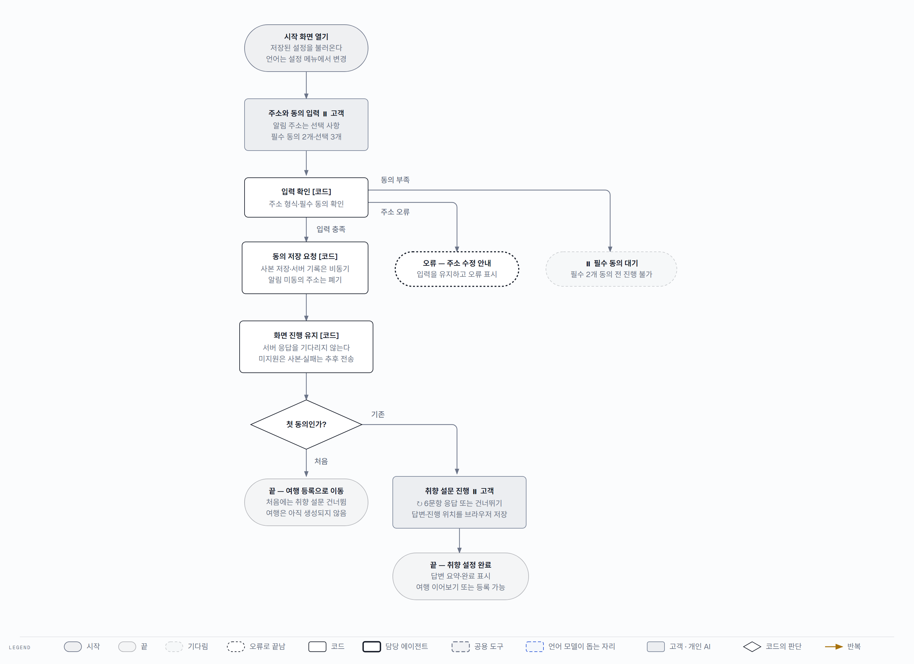

### 입력 · 출력 · 예외 · 상한 · 시험

| 항목 | 내용 |
|---|---|
| 입력 | 언어 `ko/en`, 선택 디스코드 주소, 동의 5개 항목, 선택 취향 설문 6문항. 문항은 테마·여행자 구성·우선순위·실내/실외·일정 변경 방식·여유다. |
| 출력 | 브라우저 동의 사본, 서버 동의 기록, 선택 언어 설정, 선택 취향 답변 사본. 처음 동의하면 `/trips/new`로 이동한다. 여행·일정 버전·계획서 링크는 이 기능에서 생성하지 않는다. |
| 예외 → 결과 | 잘못된 주소 → 입력 카드에 오류를 표시하고 진행 차단. 필수 동의 부족 → 다음 동작 없음. 서버 동의 API 미지원 404 → 로컬 사본 사용. 약관 버전 변경 → `outdated`; 일반 실패 → `failed`, 사본 유지. **서버 기록을 기다리지 않고 화면 이동한다**: `void saveConsents(...)`. 저장소 사용 불가 → 현재 페이지 상태만 유지. |
| 상한 · 시간 | 필수 항목은 `service_terms`, `privacy`; 선택은 `sensitive`, `location`, `alert_channel`. `consent.terms_version="2026-10-05.1"`, `consent.evidence_retention_days=1825`. 취향 저장 스키마는 문자열 200자, 우선순위 3개, 분야별 세부 선택 8개 이하. 별도 자동 재시도 횟수는 없고 동의 맞춤 작업을 직렬 처리한다. |
| 시험 | `tests/e2e/test_consents.py`, `tests/e2e/test_web_cookie_session.py`, `tests/e2e/test_trip_survey.py`; 프런트엔드 `frontend/apps/web/src/features/consent/consent-sync.test.ts`, `frontend/apps/web/src/features/onboarding/model.test.ts`, `frontend/apps/web/src/features/onboarding/payload.test.ts`. 시험 실행은 하지 않았다. |

### 유스케이스 v7 과 다른 점 (지금 코드 기준)

- 첫 시작에 취향 설문 6문항을 거치던 설명과 달리, **처음 필수 동의 후 바로 여행 등록 화면으로 이동한다**. 설문은 시작 화면의 별도 카드와 마이페이지에서 설정한다.
- 동의는 단일 체크가 아니라 필수 2개·선택 3개이며, 버전·전문 해시를 서버에 기록한다.
- 언어는 설정 메뉴의 브라우저 설정이다. 별도의 필수 언어 선택 단계는 없다.
- 알림 채널 동의 없이 입력한 디스코드 주소는 폐기한다. 동의한 주소의 저장 실패는 시작 진행을 막지 않는다.
- v7 추적표의 기존 사용자 키 발급만으로 시작을 설명하기 어렵다. 현재 웹에는 게스트 쿠키 세션 경로도 있다.

### 확인 못 한 것

- 배포 환경에서 동의 기록·세션 생성이 실제 성공하는지는 실행하지 않았다.
- YAML의 서버 기록 결과는 비동기 작업이다. 화면 이동보다 먼저 완료된다는 보장은 없다.

## F02 쓰던 계획으로 여행을 등록한다 (계획 확인)

시작: 고객이 글 · 사진 · 파일로 계획을 올리거나, 개인 AI 비서가 일정 JSON 을 제출한다

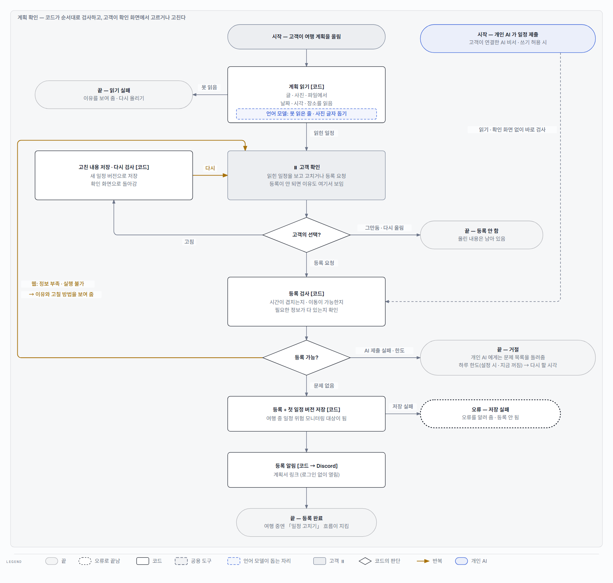

「아키텍처 한눈에 v26」 그림 1 을 그대로 실었다. 단계별 설명은 그 문서 1절에 있다.

## F03 일정을 짜 달라고 한다

- 시작: 고객이 `/trips/new`의 「계획 짜 주기 (테스트)」를 선택하고 「계획 확인하기」를 누른다. 웹은 접수 완료 후 `POST /v1/web/trip-intakes/{intake_id}/plan`을 호출한다. 별도로 앱 API `POST /v1/trips/plan`, 쓰기를 켠 MCP의 일정 생성 도구가 있다.
- 관여자: 고객 또는 개인 AI, 웹·API 코드, 일정 생성 코드, 언어 모델, 규정 검색 공용 도구, 장소 카탈로그·요식 원장·관광공사, 이동 계산을 맡는 팀 연결부. 웹 일정 생성은 오케스트레이터 사건 처리 대신 생성기를 직접 호출한다.

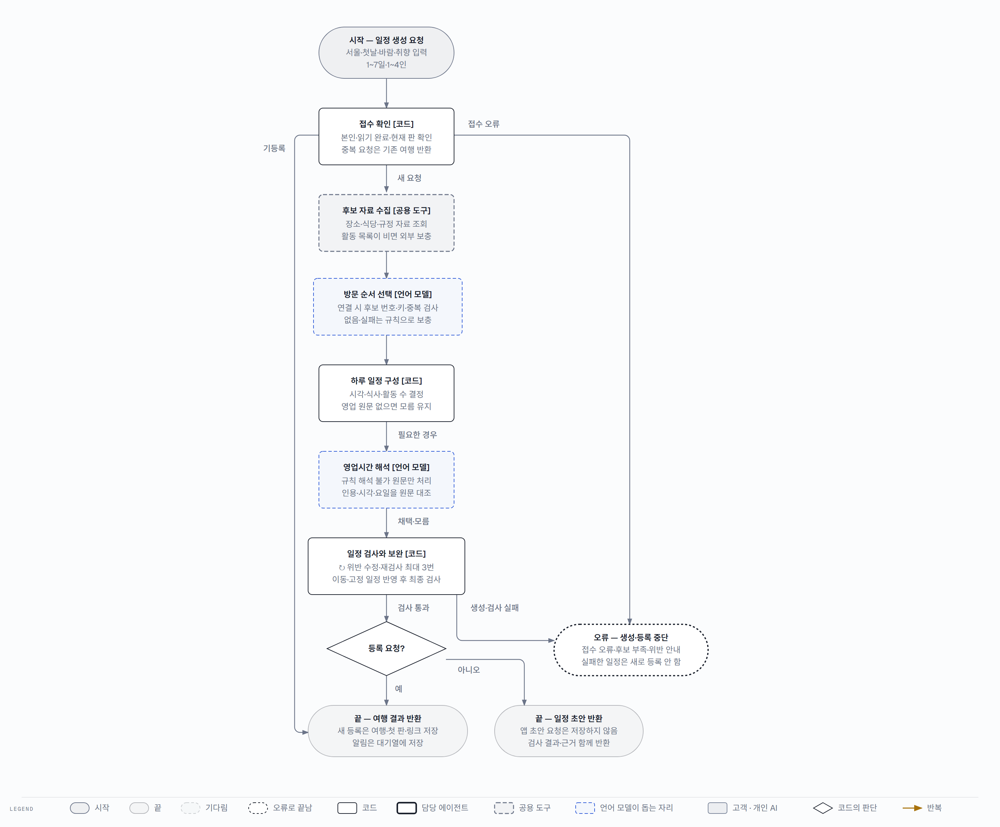

### 입력 · 출력 · 예외 · 상한 · 시험

| 항목 | 내용 |
|---|---|
| 입력 | 서울, 첫날, 1~7일, 1~4인, 바람 글, 선택 설문. 웹 화면과 MCP는 `keep_read_items=false`; 웹 계획 API 자체는 기본 `true`여서 기존에 읽은 일정의 빈 곳만 채우기도 한다. 앱 API는 `request_id`, `customer_id`, 선택 제약과 `register`를 받는다. |
| 출력 | 초안 요청이면 검사를 통과한 일정 초안 1개와 생성 방식·근거·검사·정보 충족률. 등록 요청이면 여행 1개, 첫 일정 버전 1개, 계획서 링크 1개, 알림 대기열 항목 1개. **실제 알림 배달 완료를 뜻하지 않는다.** |
| 예외 → 결과 | 입력 부족 → 화면에서 수정 대기. 읽기 실패·읽기 시간 초과 → 실패 문구 반환. 남의/없는 접수 → 404. 읽기 미완료·낡은 판 → 409. 보존할 일정이 요청 날짜 밖 → 422. 서울 외·범위 밖·잘못된 설문·후보 부족·항목 부족·고칠 수 없는 위반·하루 마감 초과 → 생성 거절. 관광공사 제한 때문에 생성이 거절되면 `source_busy`로 변환한다. 모델 없음·호출 실패·쓸 수 없는 선택 → 규칙 순위로 계속하고 생성 방식에 기록. 영업 원문·모델 해석 실패 → 해당 정보는 모름. 등록 검사 실패·게스트 제한 → 여행을 새로 만들지 않는다. |
| 상한 · 시간 | `MAX_DAYS=7`, `MAX_PARTY=4`, `MAX_REPAIR_ROUNDS=3`, `SHORTLIST_PER_DAY=8`, `CATALOG_LIMIT_PER_KIND=400`. 밀도 목표 없으면 하루 활동 2개·점심/저녁 2개; 목표 있으면 활동 1~4개 범위에서 측정. 아침 후보 부족은 해당 날 아침만 생략하고 기록한다. `travel.day_window.default_start/default_end`로 하루 범위를 정한다. 웹 읽기 `READ_POLL_MS=1500`, `READ_LIMIT_MS=300000`. 진행 신호 `travel.op_stream.beat_seconds=3`, 느림 표시 `slow_seconds=8`, 계획 스트림 `max_seconds.plan=240`, 사용자당 `max_per_user=3`. 웹 중복 키는 접수 ID와 revision에서 만든다. |
| 시험 | `tests/e2e/test_trip_planner.py`, `tests/e2e/test_op_stream.py`, `tests/unit/travel/test_planner.py`, `tests/unit/travel/test_planner_dining_ledger.py`, `tests/unit/travel/test_planner_engine_moves.py`, `tests/unit/travel/test_place_hours.py`; 프런트엔드 `frontend/apps/web/src/lib/live/intake-plan.test.ts`. 시험 실행은 하지 않았다. |

### 유스케이스 v7 과 다른 점 (지금 코드 기준)

- 웹의 시작 위치는 읽은 뒤 확인 화면의 생성 분기보다, **등록 화면의 별도 「계획 짜 주기 (테스트)」 패널**이다. 빈 직접 입력을 제출하면 자동으로 생성하지 않고 입력을 요구한다.
- 확인 화면에서 생성 요청 문장을 발견해도 바로 생성하지 않는다. 등록 화면의 생성 패널을 안내한다.
- “개인 AI 앱은 기본 초안”은 `/v1/trips/plan`에는 맞지만 **MCP 일정 생성에는 맞지 않는다**. MCP는 웹 접수·계획 API를 사용하여 바로 등록한다.
- “같은 웹 요청이면 같은 여행”은 동일 접수·revision에 대한 계획 호출에 해당한다. MCP 생성 도구를 다시 부르면 새 접수를 만들며, 도구 인자에 재사용할 `request_id`가 없다.
- 규정 검색은 모델의 참고 근거이며 후보를 규정 문장으로 필터링하지 않는다. 모든 취향 조건의 만족을 보장하는 생성기로 표현하면 안 된다.
- 영업시간을 모르는 장소가 반드시 거절되는 것은 아니다. 모름을 유지한 채 검사 가능한 조건으로 진행한다.

### 확인 못 한 것

- 배포 환경의 실제 모델 연결, 장소 자료 충족률, 이동 계산기 연결 상태.
- 스트림 시간 초과·브라우저 이탈 후 서버 작업이 끝났는지는 실행하지 않았다. 화면에서 기다리기를 끝낸 것을 서버 작업 취소로 표현하면 안 된다.

## F04 여행계획서 링크를 본다

- 시작: 고객 또는 동행자가 토큰이 포함된 `/plan/{trip_id}` 링크를 연다. 로그인·사용자 키는 요구하지 않는다.
- 관여자: 고객·동행자, API 코드, 서명 토큰 코드, 여행 저장소, HTML 렌더링 코드. 언어 모델·에이전트 호출은 없다.

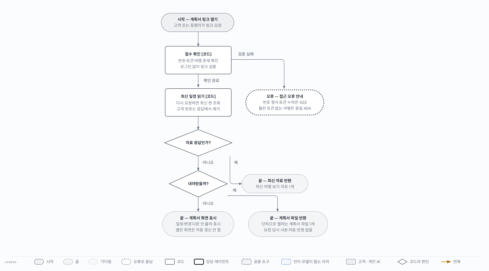

### 입력 · 출력 · 예외 · 상한 · 시험

| 항목 | 내용 |
|---|---|
| 입력 | 여행 UUID, 필수 쿼리 `t`, 선택 `format`, 선택 `download`. |
| 출력 | 기본은 HTML 계획서 1페이지. `format=json`이면 최신 여행 자료 1개. `download=true`이면 HTML 파일 1개. `format=json` 분기가 내려받기보다 먼저 적용된다. HTML에는 일정 시각·제목·변경 표시·다른 안·변경 기록·출처가 표시된다. |
| 예외 → 결과 | 토큰 불일치·없는 여행 → 동일 404. 여행 UUID 형식 오류·토큰 누락 → 요청 검증 422. 정의하지 않은 `format` 문자열 → HTML 분기로 진행. DB·렌더링 실패에 대한 별도 복구·재시도 분기는 이 경로에 없다. |
| 상한 · 시간 | 토큰은 `secret_key`를 이용한 HMAC-SHA256 결과 앞 32자리이며 DB에 저장하지 않는다. 이 토큰에는 만료 시각이 없다. 서버 비밀값 교체 시 기존 링크 검증 결과가 달라진다. 내려받기 제목은 파일명 금지 문자를 제거하고 60자로 제한한다. 자동 새로고침·주기 조회·재시도 설정은 없다. |
| 시험 | `tests/e2e/test_trip_api.py`: 최신 판 표시, 틀린 토큰·없는 여행 404, 다른 서비스 공간의 링크 검증을 다룬다. 시험 실행은 하지 않았다. 내려받기 전용 시험은 확인하지 못했다. |

### 유스케이스 v7 과 다른 점 (지금 코드 기준)

- 최신 판을 조회한다는 설명은 맞다. 다만 **열려 있는 화면이 실시간으로 바뀌는 구현은 아니다**. 링크를 다시 요청하면 최신 판을 읽는다.
- HTML 내려받기와 JSON 자료 응답이 있다.
- JSON에는 재난 정지·지킴이·밀도 경고 등 최신 여행 보기 정보도 포함된다. 기본 HTML 렌더러는 이 정보를 모두 표시하지 않는다.
- 내려받은 파일은 요청 당시의 사본이며 이후 변경을 자동 반영하지 않는다.

### 확인 못 한 것

- 프록시·배포 계층의 캐시 설정. 기본 HTML과 JSON 분기는 이 함수에서 명시적인 `Cache-Control`을 지정하지 않는다.
- 내려받기 전용 시험 및 실제 브라우저 파일 저장 동작.

## F05 여행 중에 묻는다

- 시작: 고객이 `/trips/{여행}`에서 채팅을 보낸다. 웹은 `POST /v1/web/trips/{trip_id}/messages`, 개인 AI는 `POST /v1/trips/{trip_id}/messages` 또는 사용자 인증이 있는 웹 API를 호출한다.
- 관여자: 고객, 개인 AI, 요청 접수·분류·담당 배정 코드, 결정 언어 모델, 규정 검색 공용 도구, 요식 원장, 관광공사 자료, 이동 계산기. 기본 결정 경로는 담당 에이전트를 기록하지만, 에이전트 팀 실행을 기다리지 않고 서버 코드가 답한다.

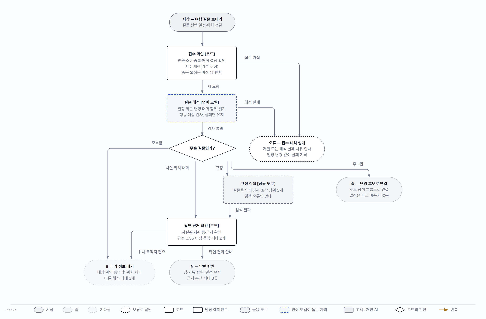

### 입력 · 출력 · 예외 · 상한 · 시험

| 항목 | 내용 |
|---|---|
| 입력 | `request_id`, 질문 문장, 선택한 일정 `item_id`와 현재 위치 `location`은 선택. 시각 `at`이 없으면 서울 현재 시각. |
| 출력 | 답변 1개, 요청 처리 기록, 대화 기록. 상세 질문은 `more`, 다른 해석은 최대 3개 `choices`. 근처 추천 최대 3곳. 위치가 없으면 `needs_location: true`. 후보만 요청하면 F06의 열린 제안으로 연결. |
| 예외 → 결과 | 인증·소유 확인 실패 → 접수 거절. 같은 채팅 요청 → 기존 처리와 이전 답 반환. 모델 호출·JSON·행동/대상/변경 식별자 오류 → `decision_failed`, 일정 유지, 실패 기록; 기본 경로에서는 기존 규칙으로 재처리하지 않는다. 규정 검색 미연결 → 일정 사실이 있으면 그것과 검색 불가 안내, 없으면 오류 안내. 검색 예외 → 오류 안내. 근거 점수 미달 또는 고객용 문장 없음 → 일정 사실이나 “맞는 내용 없음”으로 답한다. 서울 밖·정확도 2,000m 초과 → 위치를 사용하지 않는다. 위치 획득 실패·취소 → 프런트엔드 안내, 위치를 넣은 재전송 없음. 목적지 좌표 없음 → 계산 불가 안내. 근처 후보 없음 → 조사 반경·조사 수와 함께 없음 안내. |
| 상한 · 시간 | 기본 `travel.decision_unit.mode: "on"`; 운영 설정 `chat.decision_mode`가 덮어쓸 수 있다. `travel.decision_unit.num_predict: 400`. 최근 변경 `RECENT_CHANGES=8`, 최근 대화 `RECENT_TURNS=6`, 각 대화 `TURN_CHARS=160`. 결정 호출 자체에 재시도 루프 없음; Ollama 시간 제한 설정 `ollama_timeout_seconds` 기본 60초. 규정 검색 `top_k=3`, `travel.question.min_policy_score=0.55`, 답에 사용하는 고객용 규정 문장 최대 2개. 식당 탐색 700→1,500→3,000m, 활동 1,500→3,000m. 식당 원장 추가는 현재 위치 1,500m 이내. 정확도 500m 초과·위치 10분 경과는 경고를 붙이고 사용. 웹 횟수 제한은 `web_guard.limits_enabled=false`; 켜면 `web_guard.limits.message`의 사용자·접속 주소·서비스 일일 상한 각각 50회. SSE는 `travel.op_stream.max_seconds.message=90`, 동시 작업 `max_per_user=3`; 90초 초과·연결 종료에도 처리 일꾼은 계속 실행된다. |
| 시험 | `tests/e2e/test_decision_unit_web.py`: 사실 답변, 앞 대화, 모호함, 모델 실패, 위치 없음·범위·정확도, 경로 추정, 근처 추천, 좌표 비저장. `tests/integration/rag/test_travel_corpus_retrieval.py`: 여행 규정 범위·테넌트 격리. `tests/unit/travel/test_policy_customer_lines.py`: 고객용 규정 문장. |

### 유스케이스 v7 과 다른 점 (지금 코드 기준)

- 규정 답은 언어 모델이 새로 쓰지 않는다. 검색 점수 기준을 넘은 자료에 대응하는 **등록된 고객용 문장**을 최대 2개 사용한다. 검색용 임베딩 호출과 요청 해석 모델 호출은 별개다.
- 규정 검색의 출처 식별자는 일반 고객 답에 넣지 않고 처리 기록에 남긴다. 웹에서는 개발 모드일 때만 별도 근거를 보인다.
- 질문 해석이 모호해도 후보가 모두 사실 질문이면 첫 후보로 먼저 답하고 나머지를 질문 단추로 제공한다.
- 기본 결정 경로와 `off`·`shadow` 경로가 다르다. `off`는 사실 질문을 규칙으로 먼저 답하고, 나머지는 분류와 언어 모델 추출을 거친다. `shadow`는 결정 모델 결과를 기록한 뒤 이 기존 경로로 실행한다. 구조화 호출을 지원하지 않는 모델도 기존 경로를 사용한다.
- 장소 정보는 요식 원장을 먼저 읽고 부족한 정보를 관광공사에서 보충한다. 이 채팅 조회에서는 Google을 호출하지 않는다.
- 위치 질문 재전송에는 현재 프런트엔드의 위치 항목 동의와 브라우저 위치 획득이 필요하다.

### 확인 못 한 것

- 운영자의 실제 해석 모드 변경값, 배포 모델·규정 벡터·장소 자료의 실제 상태.
- 시험 파일은 읽었으며 실행하지 않았다.

## F06 일정을 바꿔 달라고 한다

- 시작: 고객의 `/trips/{여행}` 채팅 변경 요청 또는 후보 요청. 개인 AI는 메시지 API나 `POST /v1/trips/{trip_id}/items/{item_id}/alternate`를 호출한다. 같은 웹 대안 변경 API도 존재한다. 현재 화면에는 일정 상세의 독립 「다른 안」 실행 단추가 없다.
- 관여자: 고객, 개인 AI, 결정 언어 모델, 접수·담당 배정 코드, 여행 변경 코드, 요식 원장, 관광공사 목록 DB, 활동 점검 공용 도구, 이동 계산기, 일정 저장소, 알림 대기열.

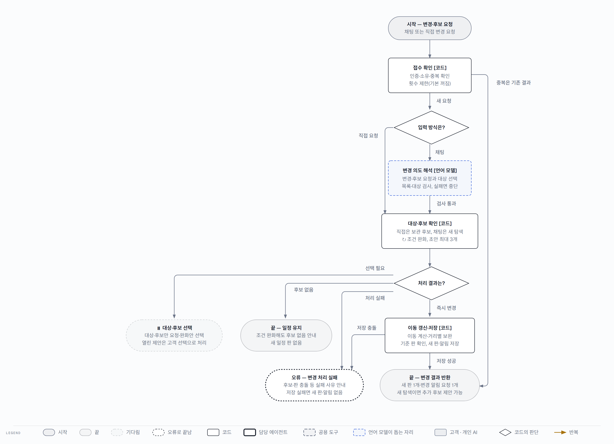

### 입력 · 출력 · 예외 · 상한 · 시험

| 항목 | 내용 |
|---|---|
| 입력 | 채팅: 문장·요청 식별자·선택 일정. 직접 대안 API: 대상 항목, `base_version`, `request_id`, 선택 후보 `choice`는 선택. `choice`가 없으면 첫 보관 후보를 사용한다. |
| 출력 | 성공하면 새 일정 버전 1개와 변경 알림 대기열 항목 1개. 새 후보 탐색으로 변경한 뒤 추가 후보가 있으면 열린 제안 1개와 제안 알림 요청도 추가된다. 후보만 요청·조건 완화는 일정 판 없이 열린 제안 1개. 대상 불명확은 되물음과 해석 후보. |
| 예외 → 결과 | 채팅 모델 오류·목록 밖 출력 → 변경 없음, 실패 기록. 대상 불명확 또는 장소 없는/식사·활동 아닌 대상 → 되묻는다. 직접 API에서 항목·장소 없음 → 404. 기준 판 변경, 보관 후보 없음, 알 수 없는 선택, 다음 장소 일정 충돌, 활동 재검사 불통과 → 직접 API에서는 409. 새 탐색에서 조건 완화까지 후보 없음 → 채팅은 `no_alternate` 답으로 완료. 새 판 저장 충돌 → `stale`, 새 판·알림 저장 없음. 활동 점검기가 없으면 보관 후보를 재검사하지 않고 `rechecked: null`로 적용 가능. |
| 상한 · 시간 | `travel.decision_unit.mode="on"`, `travel.decision_unit.num_predict=400`; 결정 모델과 웹 스트림 시간 제한은 F05와 같다. 식당 탐색 반경 700→1,500→3,000m, 활동 1,500→3,000m. 조건 완화는 30·60·90·120분 늦추기, 다음 장소 주변 1,500m, 원래 장소 주변 5,000m; 완화안 최대 3개. 일반 후보 순위 선택은 최선 1개+다른 안 최대 2개, 새 변경 후 추가 후보는 완화안을 보충해 최대 3개. 직접 변경은 보호 일정 판정과 일정 전체 재판정을 거치지 않는다. 웹 일일 제한은 기본 꺼짐. 알림 배달은 별도 작업이며 `travel.notice_per_customer_enabled=false`가 기본이라 운영 채널로 연결된다; 고객 연결 채널 분기는 구현돼 있으나 기본 꺼짐이다. |
| 시험 | `tests/e2e/test_decision_unit_web.py`: 변경 대상·모호함·모델 실패·후보만 요청. `tests/unit/travel/test_fresh_alternate.py`: 반경 확대·중복 장소 제외·조건 완화. `tests/integration/travel/test_relaxed_alternate.py`: 늦춘 후보 선택과 추가 후보 제안. `tests/e2e/test_trip_api.py`: 보관 후보 교체·기준 판 충돌. `tests/unit/travel/test_moves_refresh_after_swap.py`: 이동 갱신. |

### 유스케이스 v7 과 다른 점 (지금 코드 기준)

- 현재 일정 상세의 「다른 안」은 후보 이름 표시다. 독립 실행 단추는 없으며, 서버의 대안 변경 API는 존재한다.
- 직접 대안 변경 API는 **보관 후보만** 사용한다. 후보가 없을 때 새로 찾는 것은 채팅 변경 경로다.
- 새 탐색으로 변경한 경우에만 추가 후보 제안을 별도로 연다. 보관 후보 교체는 남은 후보와 원래 장소를 항목에 보관하지만 같은 추가 제안 생성 절차를 거치지 않는다.
- 앞뒤 이동 계산이 실패하면 항상 옛 경로를 버리는 것은 아니다. 새 장소가 도보 상한 안이면 이름을 고치고 옛 노선·소요·시각을 유지하며 추정임을 표시한다. 멀면 옛 노선을 제거하고 거리 추정 경로를 만든다.
- 후보만 요청의 일반 후보는 조건 완화 설명 `note`를 제거해 제안한다. 처음부터 조건 완화만 가능한 결과는 설명을 붙여 묻는다.
- 고객별 알림 배달 연결은 구현됐다. 기본 스위치가 꺼져 있어 기본 배달 방향은 여전히 운영 채널이다.

### 확인 못 한 것

- 배포 환경의 후보 자료·점검기·이동 계산기 상태와 고객별 알림 스위치 실제 값.
- 시험 파일은 읽었으며 실행하지 않았다.

## F07 생긴 문제를 알린다

- 시작: 고객이 채팅으로 늦음·휴무를 알리거나, 개인 AI 등이 `POST /v1/trips/{trip_id}/reports` 또는 `POST /v1/web/trips/{trip_id}/reports`에 구조화된 신고를 보낸다. 구조화된 신고는 늦음·휴무·품절을 받는다.
- 관여자: 고객, 개인 AI, 채팅 결정 언어 모델, 신고 검증 코드, 여행 변경 코드, 요식 원장, 후보 계산·일정 재판정 공용 도구, 이동 계산기, 일정 저장소, 알림 대기열. 구조화된 신고 API는 언어 모델을 호출하지 않는다.

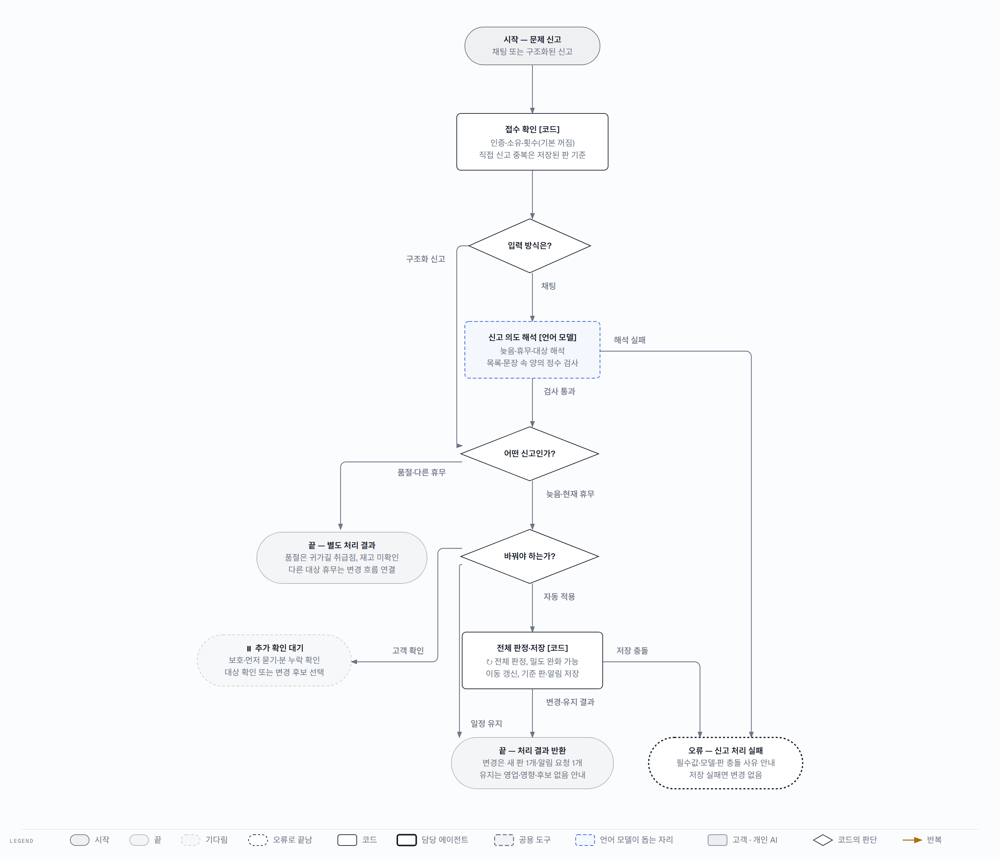

### 입력 · 출력 · 예외 · 상한 · 시험

| 항목 | 내용 |
|---|---|
| 입력 | 구조화 신고: `request_id`, `type`은 `delay`·`closed`·`stock_out`, `message`, 선택 시각 `at`. 늦음은 `minutes`, 품절은 비어 있지 않은 `products` 필수. 채팅은 고객 원문과 선택 항목. |
| 출력 | 늦음·현재 식사 휴무가 자동 적용되면 새 일정 버전 1개+변경 알림 요청 1개. 먼저 물어야 하면 열린 제안 1개+제안 알림 요청 1개. 유지 결과는 도착 시각·뒤 일정 영향·영업 확인 필요·다음 일정 날짜 등의 안내. 품절은 취급 매장 최선 1곳과 다른 후보 최대 2곳, 재고 `unverified`; 일정 판과 변경 알림은 만들지 않는다. |
| 예외 → 결과 | API 분 누락·범위 오류 또는 품절 상품 없음 → 422. 채팅에 분 숫자 없음 → 몇 분인지 되묻는다. 오늘 일정 없음 → 다음 일정 날짜 또는 남은 일정 없음 안내. 오늘 다음 식사/현재 진행 식사 또는 장소 없음 → `no_meal`, 유지. 늦은 도착의 영업 여부 모름 → `needs_check`, 유지. 식사는 가능하나 뒤 일정에 영향 있음 → `knock_on`, 영향만 알리고 유지. 대체 식당 없음 → `unresolved`, 유지; 채팅에서는 완료 목록 밖이므로 실패 상태도 기록한다. 전체 재판정 모두 실패 → `rechecked`, 유지. 품절에서 현재 활동·숙소·취급점 없음 → `unresolved`, 유지. 저장 기준 판 충돌 → `stale`; API는 409, 기본 채팅은 유지 결과로 완료 기록한다. |
| 상한 · 시간 | 구조화 API의 지연 분은 1~1,440. 기본 결정 모델은 양의 정수이면서 고객 문장에 있는 숫자만 인정하며 **1,440 상한 검사는 없다**. 신고 대체 식당 반경 `DINING_RADIUS_M=700m`; 현재 식사 휴무는 후보 도보 시간+착석 여유 `SEATING_BUFFER_MIN=10`분을 더하고 5분 단위로 올린 도착 시각 사용. 등록 후보로 해결 못 하면 근처 요식 원장을 추가하고 한 번 다시 계산. 후보 선택은 최선 1개+다른 안 최대 2개. 전체 판정의 `travel.density.gate.mode` 기본은 `soft`: 구조 위반 없는 안 중 밀도 악화 없는 안을 우선하고, 모두 악화하면 덜 나쁜 안을 경고와 함께 적용 가능. 채팅 모델·웹 횟수·스트림 제한은 F05와 같다. 알림 배달은 별도이며 고객별 연결 분기 `travel.notice_per_customer_enabled`는 기본 꺼짐. |
| 시험 | `tests/e2e/test_trip_api.py`: 세 신고 종류·변경·품절 미확인·변경 신고 중복. `tests/unit/travel/test_delay_knock_on.py`: 뒤 일정 영향·서울 시각. `tests/scenario/test_desk_report_recheck.py`: 전체 재판정 실패·다음 후보 적용·직접 선택 예외. `tests/e2e/test_ask_first.py`: 보호 일정·먼저 묻기. |

### 유스케이스 v7 과 다른 점 (지금 코드 기준)

- 기본 결정 모델의 행동 목록에는 품절이 없다. 따라서 기본 채팅에는 품절을 매장 추천으로 연결하는 확정된 분기가 없다. 품절 처리는 구조화 신고 API에 있으며, 결정 모드 `off`·`shadow`의 기존 추출 경로에도 있다.
- 기본 채팅 휴무 신고가 현재 식사 외의 명확한 식사·활동을 가리키면 **F06의 새 후보 변경 경로**로 처리한다. 이 분기는 신고용 보호 판정과 일정 전체 재판정을 거치지 않는다.
- 늦어도 식사가 가능하면 뒤 일정의 겹침·마감 영향까지 확인한다. 영향이 있어도 뒤 일정을 실제로 밀지 않고 안내한다.
- 영업 여부가 불명확하다는 이유로 기존 식당을 바꾸지 않는다.
- 구조화 신고의 중복 검사는 해당 요청으로 **저장된 일정 버전**을 찾는다. 판을 만들지 않은 유지·품절·질문 결과까지 모두 재사용하는 중복 방지는 아니다.
- 품절은 현재 진행 중인 활동과 숙소를 기준으로 귀가 동선을 계산한다. 일반적인 “현재 위치 주변 매장” 조회가 아니다.
- 전체 재판정은 기본 설정에서 모든 밀도 악화를 금지하지 않는다. 구조 위반이 없으면 덜 나쁜 밀도 악화안을 경고와 함께 적용할 수 있다.

### 확인 못 한 것

- 기본 결정 모델이 실제 품절 문장을 어떤 다른 행동으로 분류하는지.
- 운영 원장의 영업·취급 상품 자료와 외부 점검 결과.
- 시험 파일은 읽었으며 실행하지 않았다.

## F08 다른 안을 고르거나 그대로 두거나 되돌린다

- 시작: 고객이 `/trips/{여행}`의 「선택이 필요해요」에서 후보·「지금 일정 그대로 두기」·「바꿔 줘 — 다른 곳 보기」를 누른다. 선택 API는 `POST …/proposals/{proposal_id}/choose`. 되돌리기는 채팅 또는 `POST …/rollback`. 고객 무응답의 제안 만료는 정기 여행 검사에서도 처리한다.
- 관여자: 고객, 개인 AI, 선택·되돌림 코드, 채팅 되돌림의 결정 언어 모델, 제안 저장소, 활동 점검·유사도·목록 공용 도구, 이동 계산기, 일정 저장소, 알림 대기열. 선택 단추와 직접 되돌림 API는 언어 모델을 호출하지 않는다.

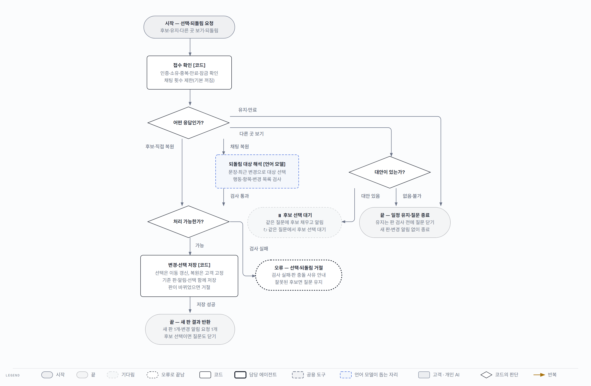

### 입력 · 출력 · 예외 · 상한 · 시험

| 항목 | 내용 |
|---|---|
| 입력 | 후보 선택: 제안 식별자와 `key`; `null`은 그대로 두기. 날씨 변경 동의는 `key="change"`. 직접 되돌림: `request_id`, `base_version`, `to_version`, 선택 메모. 채팅 되돌림: 원문·선택 항목·최근 변경과 대화. |
| 출력 | 후보 확정 → 새 버전 1개, 변경 알림 요청 1개, 제안 `chosen`. 그대로 두기 → 제안 `kept`, 새 버전 없음. 날씨 변경 동의 → 같은 제안에 후보 최대 3개와 제안 알림 요청 1개, 새 버전 없음. 대안 계산 불가·없음 → 제안 `kept`, `no_alternate`. 무응답 만료 → 제안 `expired`, 새 버전 없음. 되돌림 → 옛 판 전체 내용을 담은 새 버전 1개와 변경 알림 요청 1개. |
| 예외 → 결과 | 제안 없음 → 404. 이미 답함 → 409와 기존 상태·선택값. 만료 후 선택 → 제안을 `expired`로 저장한 뒤 409. 기준 판 변경·대상 소멸 → `superseded`로 저장한 뒤 409. 잘못된 후보·동의 키, 다음 장소 일정 충돌, 활동 재검사 실패 → 422, 질문은 열어 둔다. 저장 경합 → 409, 선택·새 판·알림 거래를 되돌린다. 직접 되돌림의 기준 판 불일치·유효하지 않은 과거 판 → 409. 채팅에서 이미 사라진 변경 → 되묻는다. 오래된 변경 뒤 추가 변경이 있으면 이후 변경까지 함께 되돌릴지 묻는다. |
| 상한 · 시간 | 제안 만료는 `item.ends_at`, 없으면 `item.starts_at`; 별도 고정 대기시간 없음. 정기 검사와 선택 직전 모두 만료 확인. 동일 여행·항목·기준 판의 제안은 중복 생성하지 않는다. 날씨 동의 후 활동 탐색 반경 600→1,500m, 각 계산에서 재검사 후보 상한 6개, 제시 후보 최대 3개. 활동 점검기가 없으면 동의 후 대안 계산은 하지 않고 질문을 닫는다. 일반 보관 후보 선택은 점검기가 없으면 활동 재검사를 생략할 수 있다. 채팅 변경 이력 최대 8개; 변경 뒤 15분 이내 되돌림은 오변경 의심을 기록한다. 되돌림은 `1 <= to_version < 현재 버전`이어야 한다. 직접 선택·되돌림에는 채팅 사용량 계수가 없으며, 채팅 되돌림은 F05의 계수·모델·스트림 제한을 받는다. 알림 배달은 별도이며 고객별 분기는 기본 꺼짐. |
| 시험 | `tests/e2e/test_ask_first.py`: 선택·유지·무응답 만료·이미 응답·기준 판 변경. `tests/e2e/test_indoor_unknown_consent.py`: 동의→후보→선택, 계산하지 않는 유지, 동의 전 후보 키 거절. `tests/e2e/test_decision_unit_web.py`: 채팅 되돌림·오래된 변경 확인·이미 되돌린 변경. `tests/e2e/test_trip_api.py`: 옛 판 복원·고객 고정·잘못된 판. `tests/unit/travel/test_rollback_notice.py`: 복원 및 다시 적용 안내. |

### 유스케이스 v7 과 다른 점 (지금 코드 기준)

- 그대로 두기는 만료 확인 뒤 처리하지만, **현재 일정 판·항목 일치 검사보다 먼저** 질문을 닫는다. 기준 판이 낡았어도 미만료 열린 질문을 그대로 두기로 닫을 수 있다.
- 만료·낡은 기준 판은 거절만 하지 않고 질문을 닫는다. 잘못된 후보·재점검 실패는 다른 안을 다시 고를 수 있도록 질문을 유지한다.
- 채팅에서 오래된 변경을 되돌리면 그 뒤의 변경도 함께 되돌아간다. 이를 확인하는 추가 질문이 있다.
- 되돌림은 항목 하나만 복원하는 기능이 아니라 **지정한 옛 판 전체**를 새 판으로 저장한다. 되살린 항목에 고객 고정 표시를 붙이며, 복원 시 현재 영업·위험을 재점검하지 않는다.
- 이미 적용된 변경을 다시 적용하려는 채팅은 `already_applied`로 답한다. 되돌렸던 변경을 다시 적용하는 채팅 분기도 있다.
- 채팅 변경 결과에도 현재 최신 판일 때 「되돌리기」 단추가 있다. 자동 변경 알림의 되돌리기 단추와 별개다.
- 선택 성공 서버 상태는 `chosen`이다. 현재 화면의 전용 성공 문구 조건은 `adjusted`라서 선택 성공은 일반 결과 문구로 표시된다.
- 업체 예약 변경은 이 선택·복원 코드가 직접 수행하지 않는다.

### 확인 못 한 것

- 운영 중 열린 제안·실제 판 이력과 배달 완료 여부.
- 시험 파일은 읽었으며 실행하지 않았다.

## F09 일정이 깨졌는지 검증하고 다시 맞춘다 (일정 고치기)

시작: 3분마다 일정 위험 모니터링이 곧 시작할 일정을 외부 정보 6종으로 점검한다

「아키텍처 한눈에 v26」 그림 2 를 그대로 실었다. 에이전트 안쪽 단계는 이 문서의 A01 · A02 · A03 에 있다.

## F10 새벽 영업 확인

- 시작: 1분마다 실행되는 상시 작업의 새벽 확인 단계. 한국 시각 03:00 이상 08:00 미만에 조회한다.
- 관여자: 코드, 구글 장소 정보, 요식업 원장, 공용 이동 판정기, 고객. 이 경로는 사건이나 에이전트 작업을 만들지 않으며 언어 모델을 호출하지 않는다.

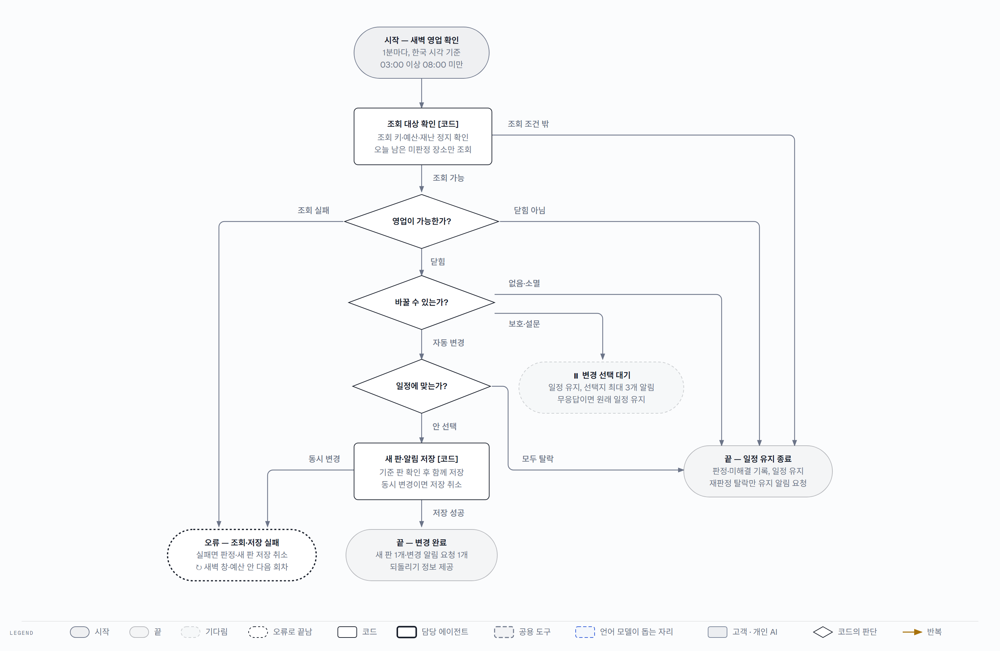

### 입력 · 출력 · 예외 · 상한 · 시험

| 항목 | 내용 |
|---|---|
| 입력 | 최신 일정의 오늘 남은 식사·활동, 장소 이름·좌표, 저장된 외부 장소 번호, 여행 제약. 이미 오늘 판정한 항목과 장소 없는 항목은 제외한다. 재난 정지 중인 여행도 조회 대상에서 제외된다. |
| 출력 | 항목별 열림·닫힘·모름·못 찾음 판정과 실행 집계. 변경하면 새 일정 버전 1개와 변경 알림 요청 1개. 먼저 물으면 보류 제안과 선택 알림 요청을 만들며 표시 선택지는 최대 3개다. 대체안이 없으면 닫힘 판정과 미해결 결과만 남긴다. |
| 예외 → 결과 | 키 없음 → 꺼짐 결과, 조회 없음. 시간 밖 → 조회 없음. 검색·상세 조회 실패 또는 호출 한도 초과 → 실패 집계, 판정 미저장. 장소 불일치 → 못 찾음 판정 저장. 영업시간 없음 → 모름 판정 저장. 전체 재판정 탈락 → 일정 유지 알림 요청. 동시 버전 변경 → 트랜잭션을 되돌리고 실패 집계. 항목 사라짐 → 변경 없음이며 별도 변경 완료 집계에도 넣지 않는다. 예상하지 못한 예외는 항목별로 모두 잡는 구조가 아니므로 호출한 상시 작업까지 올라갈 수 있다. |
| 상한 · 시간 | `travel.dawn_check.start: "03:00"`, `until: "08:00"`, `match_radius_m: 300`. 검색 응답 최대 5곳 중 반경 안에서 가장 가까운 곳을 고른다. 이름의 별도 유사도 검사는 없다. 항목·날짜당 판정 1개. 기본 외부 요청 제한 8초. `rate_google_places_per_day` 기본 16과 `travel.google_budget.free_monthly`에서 산출한 공유 DB 예산을 적용한다. 조회 실패에는 별도 항목별 재시도 횟수 상한이 없고 새벽 창·예산이 제한한다. `travel.dining.google_price_enabled: false`. 밀도는 `travel.density.gate.mode`에 따라 엄격 차단하거나, 기본 완화 모드에서 악화가 가장 작은 안을 경고와 함께 선택한다. |
| 시험 | `tests/scenario/test_dawn_check.py`: 시간 창, 호출 예산, 실패와 못 찾음 구분, 식사·활동 교체, 먼저 묻기, 전체 재판정 탈락. `tests/scenario/test_trip_reminders.py`: 하루 시작 알림의 변경 건수. 시험 파일을 읽었으며 이번 조사에서 실행하지 않았다. |

### 유스케이스 v7 과 다른 점 (지금 코드 기준)

- v7의 “감시 3분과 상시 작업 1분 중 어느 쪽에 맞출지 미결”은 현재 외부 변화 감시만 3분 간격으로 제한하는 코드로 구분됐다. 새벽 확인은 1분 작업에서 실행되며 판정 기록으로 중복을 막는다.
- 식당 대체 후보는 근처 요식업 원장 가게를 여행 전용 장소로 추가한 뒤 다시 계산한다.
- 새벽 확인의 먼저 묻기 분기는 전체 일정 재판정 전에 갈라진다. 자동 변경 분기만 이 자리에서 전체 재판정을 통과한다.
- 새벽 대체안 없음은 v7대로 미해결 기록으로 끝난다. 3분 감시의 대안 없음 알림이나 조건 완화 제안을 이 흐름에 추가하면 안 된다.
- 구글 영업시간 원문은 저장하지 않는다. 외부 장소 번호와 판정·이유·확인 기록을 남긴다.

### 확인 못 한 것

- 현재 커밋 `bc750713`을 읽었다. 실행 환경의 실제 조회 설정, 스케줄러 등록 상태, 외부 응답과 실제 배달은 확인하지 않았다.

## F11 일정 알림을 보낸다

- 시작: 1분 상시 작업의 일정 안내 단계가 알림 요청을 생성하고, 별도 1분 배달 작업이 알림 대기열을 처리한다.
- 관여자: 코드, 고객, 외부 경로 사건 정보, 번역 언어 모델, 디스코드. 고객별 발송을 켜면 고객이 연결한 디스코드 또는 텔레그램도 관여한다.

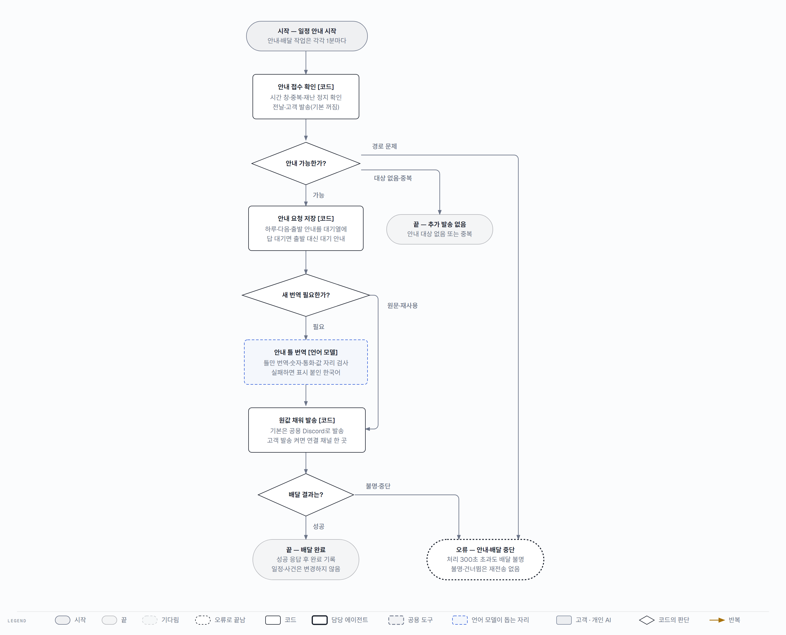

### 입력 · 출력 · 예외 · 상한 · 시험

| 항목 | 내용 |
|---|---|
| 입력 | 최신 일정, 한국 시각, 여행별 하루 시작 시각, 열린 보류 제안, 하루 안내 예정 시각 전 24시간의 변경 버전 수, 여행 언어, 경로 정의와 경로 사건, 발송 설정. 재난 정지 여행은 안내 대상에서 제외된다. |
| 출력 | 하루·날짜당 하루 시작 알림 요청 1개, 현재 비이동 항목당 다음 일정 알림 요청 1개, 이동 항목당 출발 알림 요청 1개. 실제 배달에 성공하면 선택된 채널에 메시지 1통. 일정과 사건은 생성·변경하지 않는다. 실행 결과의 발송 건수는 실제 배달 수가 아니라 대기열 신규 등록 수다. |
| 예외 → 결과 | 마지막 비이동 일정 → 다음 일정 안내 없음. 이동 항목 없음 → 출발 안내 없음. 이동 종료 → 출발 안내 없음. 답 대기 → 출발 지시 대신 대기 안내. 경로 사건 조회 실패 → 오류 집계, 요청 미생성. 계획 경로에 사건 → 보류, 요청 미생성. 경로 정의·사건 소스 없음 → 목적지·시각만 안내. 지원하지 않는 구간 → 경로 확인 시각 없이 안내. 번역 실패·검사 탈락 → 실패 표시를 붙인 한국어 발송. 발송 주소 없음 → 일반 실패로 재시도. 시간 초과·연결 끊김 → 배달 여부 불명, 자동 재전송 없음. 처리 중 300초 초과 → 불명으로 전환. 발송 금지 대상·고객 연결 없음·동의 없음·차단·무효 채널 → 건너뜀, 자동 재전송 없음. |
| 상한 · 시간 | 하루 시작은 사용자 시작 시각 또는 `travel.day_window.default_start` 08:00과 첫 항목 60분 전 중 이른 시각부터 첫 항목 시작 전까지. `travel.reminders.day_start_lead_minutes: 60`. 다음 안내는 현재 항목 시작 이상 종료 미만이며 종료가 없으면 다음 항목 시작까지. 출발 안내는 이동 시작 이상 종료 미만; 종료·다음 항목도 없으면 시작 후 1분까지. `travel.reminders.eve_hour: null`, `travel.notice_per_customer_enabled: false`. 번역 캐시 기본 최대 512개, 설정 파일로 재시작 간 재사용. `ollama_timeout_seconds` 기본 60초. 배달 요청 기본 8초, 디스코드 본문 최대 2,000자. 일반 실패는 최초 포함 3회, `reliability.outbox_retry_seconds: 60`. 429는 제공자가 지정한 간격을 따르고 시도 횟수를 소비하지 않는다. `reliability.outbox_stale_processing_seconds: 300`. |
| 시험 | `tests/scenario/test_trip_reminders.py`, `tests/unit/travel/test_departure_notice_estimate.py`, `tests/unit/travel/test_notice_translation.py`, `tests/unit/travel/test_notice_phrase_cache.py`, `tests/unit/travel/test_discord_notice.py`, `tests/e2e/test_notice_routing.py`. |

### 유스케이스 v7 과 다른 점 (지금 코드 기준)

- v7에는 고객별 실제 배달 연결이 없었지만 현재 고객 연결 채널로 보내는 코드가 있다. 다만 기본 설정은 꺼짐이며, 기본 동작은 여전히 공용 디스코드 채널이다.
- 번역 검사는 숫자 누락·새 숫자뿐 아니라 원화 단위 변경과 값 자리 이름별 개수도 검사한다. 이미 있던 숫자를 추가로 반복하는 것은 허용한다.
- 전날 안내 코드가 남아 있으나 기본 꺼짐이다.
- 다음 일정·출발 대상이 답 대기 중이면 일반 안내 대신 대기 문구를 보낸다.
- 안내를 생성할 때 경로 사건을 조회한다. 대기열에 들어간 뒤 실제 배달 직전에 경로를 다시 조회하는 구조는 아니다.

### 확인 못 한 것

- 실제 스케줄러 지연, 번역 모델·캐시 설정, 채널 연결과 외부 배달 성공은 확인하지 않았다.
- 나열한 시험을 이번 조사에서 실행하지 않았다.

## F12 서비스 장애를 알아챈다

- 시작: 운영 실행기가 상시 작업을 실행하고 종료 결과를 받는다. 별도로 식당 가격 조회를 켠 경우 월 무료 한도 첫 초과도 운영 알림을 시작한다.
- 관여자: 코드, 운영자, 디스코드. 고객·개인 AI·언어 모델은 장애 판정에 참여하지 않는다.

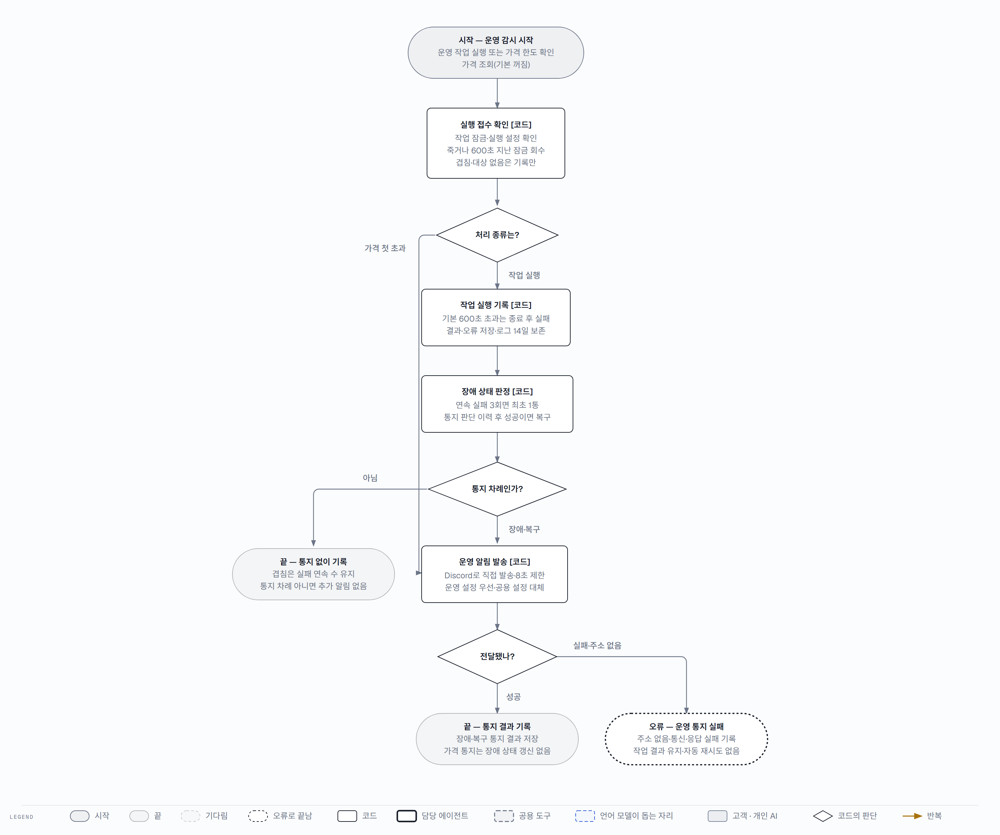

### 입력 · 출력 · 예외 · 상한 · 시험

| 항목 | 내용 |
|---|---|
| 입력 | 작업 이름, 종료값, 표준 출력·오류, 잠금의 프로세스 번호·시각, 기존 연속 실패 수·통지 판단 이력, 운영 발송 설정. 가격 한도 알림은 요금 단위별 월 사용량과 무료 한도를 입력받는다. |
| 출력 | 작업별 실행 흔적·날짜별 로그·장애 상태 파일. 최초 연속 장애 알림 최대 1통, 이후 성공 시 복구 알림 최대 1통. 가격 조회의 월 첫 무료 한도 초과 알림은 별도 1통이다. |
| 예외 → 결과 | 살아 있는 앞 회차의 잠금 → 건너뜀 기록, 성공·실패 수 갱신 없음. 죽었거나 오래된 잠금 → 회수 후 실행. 작업 시간 초과 → 종료값 124로 실패 처리. 새벽 확인 등의 치명·미기록 오류 집계 → 단발 실행 종료값 1. 운영 주소 둘 다 없음 → 발송 안 함 결과. 통신 예외·비성공 응답 → 발송 실패 결과. 운영 알림 실패는 원래 작업 결과를 바꾸지 않는다. 가격 알림 결과는 별도 발송 함수의 반환값·로그로 처리하며 작업 장애 상태 파일을 갱신하지 않는다. |
| 상한 · 시간 | 코드 상수 `ALERT_AFTER = 3`, `STALE_LOCK_SECONDS = 600`, `LOG_RETENTION_DAYS = 14`. 작업 제한은 `DEFAULT_TIMEOUT_SECONDS = 600`, 실행기의 `--timeout`으로 변경 가능. 운영 발송 제한 8초, 자동 발송 재시도 없음. 알림 판단 전에 통지 이력을 저장하므로 발송 실패해도 같은 장애 묶음에서 다시 보내지 않는다. `ops_alert_webhook_url` 우선, 없으면 `discord_webhook_url`. 가격 알림은 `travel.dining.google_price_enabled: false`가 기본이며, 한도는 `travel.google_budget.free_monthly`를 쓴다. |
| 시험 | `tests/unit/core/test_ops_guard.py`: 겹침·잠금 회수·로그 보존·연속 실패·복구·미설정·통지 결과 보존. `tests/scenario/test_dawn_check.py`: 월 예산과 무료 한도 첫 초과 집계. |

### 유스케이스 v7 과 다른 점 (지금 코드 기준)

- 3회 연속 실패·복구·건너뜀 규칙은 v7과 같다. 다만 “알림을 받았던 장애”가 아니라 “알리기로 판단했던 장애”를 기준으로 복구 통지를 판단한다. 실제 장애 통지 실패도 이력에 포함된다.
- 개별 배달 실패가 곧 배달 작업의 실패는 아니다. 배달 작업은 개별 메시지를 실패·불명·건너뜀으로 기록한 뒤 정상 종료할 수 있다. 따라서 이 장애 알림이 모든 개별 메시지 실패를 탐지한다고 그리면 안 된다.
- 식당 가격 조회를 켰을 때의 월 무료 한도 초과 운영 알림이 추가돼 있다.
- 치명 오류를 집계해 작업 실패로 보고한다. 서버 전체를 자동 종료하는 분기는 이 흐름에 없다.

### 확인 못 한 것

- 운영 실행기를 실제 스케줄러가 사용하고 있는지, 현재 장애 상태·로그와 실제 운영 채널 전달은 확인하지 않았다.
- 서버의 모든 장애를 하나로 모으는 별도 자동 오류 리포트는 이 흐름에서 확인하지 못했다. 확인한 리포트는 작업 출력·오류 집계·실행 로그다.
- 시험은 실행하지 않았다.

## F13 내 설정을 관리한다

- 시작: 고객이 `/mypage`, `/mypage/edit`에서 취향·알림 연결·시험 발송·에이전트 키 관리를 선택한다. 기존 사용자 키 교체 API도 남아 있다.
- 관여자: 고객, 프런트엔드 코드, 인증·동의·프로필·키 관리 코드, 디스코드, 텔레그램. 설정 처리에는 언어 모델·에이전트·오케스트레이터 호출이 없다.

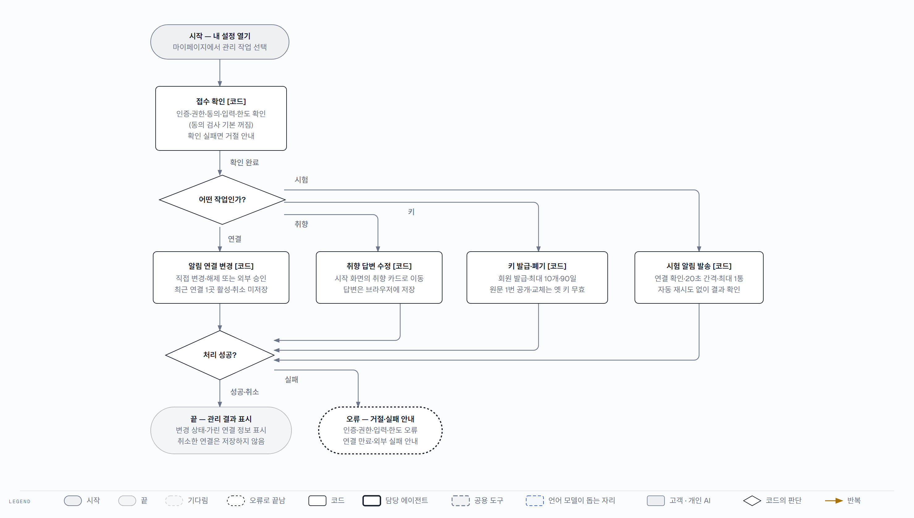

### 입력 · 출력 · 예외 · 상한 · 시험

| 항목 | 내용 |
|---|---|
| 입력 | 쿠키 세션 또는 기존 사용자 키, 선택 프로필 부분 변경, 디스코드 연결 승인, 텔레그램 연결 코드, 시험 발송 요청, 취향 답변. 에이전트 키 생성은 이름·`read/write`·만료일수를 받는다. |
| 출력 | 마스킹한 디스코드 연결 상태, 대화 번호를 숨긴 텔레그램 상태, 활성 `notice_channel` 한 곳. 시험 요청당 고정 문구 알림 최대 1통과 결과. 에이전트 키 생성 시 원문 1개를 한 번만 반환하고 이후 목록에는 메타데이터만 표시한다. 취향은 브라우저 사본이다. |
| 예외 → 결과 | 인증 없음·만료 → 401; 쿠키와 키 동시 제시 → 400; 쿠키 쓰기 검증 실패 → 403. 에이전트 키로 계정 관리 → 403. 알림 연결 설정 없음 → 시작 API 404, 화면 연결 기능 비활성/숨김. 잘못된 주소·이메일·알 수 없는 필드·미연결 채널 선택 → 422, 부분 저장도 하지 않음. 시험 연결 없음 → 409; 20초 이내 시도 → 429. 디스코드 콜백은 `connected/cancelled/expired/failed`로 웹에 302 이동; 복귀 웹 설정 없음은 503. 텔레그램 코드 오류·만료·재사용 → 만료 안내, 다른 고객의 대화 → 연결 거절, 그룹 대화 → 무시, 중복 업데이트 → 재처리 안 함. |
| 상한 · 시간 | `travel.profile.test_interval_seconds=20`. 디스코드 시험 HTTP 8초, 연결 코드 교환 `HTTP_TIMEOUT=10.0`. 연결 시작은 `security.discord_connect_start_per_hour=10`, `security.telegram_connect_start_per_hour=10`; 디스코드 일회용 상태 `security.web_auth_state_seconds=600`, 텔레그램 코드 `security.telegram_link_code_seconds=600`. 에이전트 키 `security.web_agent_key_max_days=90`, `security.web_agent_keys_per_user=10`, 이름 1~60자. `consent.gate_enabled=false`가 기본이다. |
| 시험 | `tests/e2e/test_web_profile.py`, `tests/e2e/test_discord_connect.py`, `tests/e2e/test_telegram_connect.py`, `tests/e2e/test_web_agent_keys.py`, `tests/e2e/test_web_cookie_session.py`, `tests/e2e/test_consents.py`; 프런트엔드 `frontend/apps/web/src/features/profile/model.test.ts`, `frontend/apps/web/src/features/onboarding/model.test.ts`. 시험 실행은 하지 않았다. |

### 유스케이스 v7 과 다른 점 (지금 코드 기준)

- 디스코드 주소 붙여넣기 외에 외부 승인으로 연결하는 버튼과 텔레그램 연결·해제·시험 발송이 있다.
- 알림을 받을 곳은 한 번에 한 곳이다. 마지막 연결이 활성화되고, 활성 연결을 지우면 남은 연결로 전환하거나 없음이 된다.
- 웹의 계정 관리는 쿠키 세션을 중심으로 한다. 회원은 별도의 에이전트 키를 만들고 개별 폐기할 수 있다. 기존 사용자 키 교체 API도 남아 있으며 기존 키 전체를 무효화한다.
- 취향은 고객 프로필 API에 저장하지 않는다. 브라우저에 두고 일정 처리 때 설문으로 전달한다.
- 복구 이메일은 프로필 API에서 형식 검증·저장할 수 있지만 현재 마이페이지에는 이메일 수정 UI가 없다. 인증·복구 메일 발송도 이 기능에는 없다.
- v7의 “고객 주소로 일정 알림을 보내는 연결이 없다”는 설명과 달리 코드가 있다. 다만 `travel.notice_per_customer_enabled=false`가 기본이며, 켜면 후속 일정 알림을 활성 고객 채널로 보낸다. 이는 위 설정·시험 흐름과 별도의 알림 배달 흐름이다.
- 시험 제한은 직전 시도에서 20초 간격을 확인한다. 별도의 분당 3회 카운터는 아니다.

### 확인 못 한 것

- 실제 배포에서 디스코드 앱·텔레그램 봇·복귀 화면 설정이 준비되어 있는지.
- 고객별 일정 알림 스위치의 배포 적용값과 실제 배달 성공 여부.
- 텔레그램 연결 성공 뒤 보내는 인사말과 시험 메시지가 실제 도착하는지는 실행하지 않았다.

## F14 개인 AI 비서가 MCP 도구를 부른다

- 시작: 개인 AI가 원격 `/mcp` 또는 `/mcp/`에 연결하거나 로컬 표준입출력 프록시를 실행하고 도구를 호출한다.
- 관여자: 개인 AI, MCP 어댑터 코드, 사용자 키 인증 코드, 웹 API, 선택한 기능의 오케스트레이터·에이전트·공용 도구·외부 정보. **MCP 어댑터 자체는 언어 모델을 호출하지 않는다.** 일정 생성 안의 실제 모델 호출과 출력 검사는 F03의 n8·n11이다.

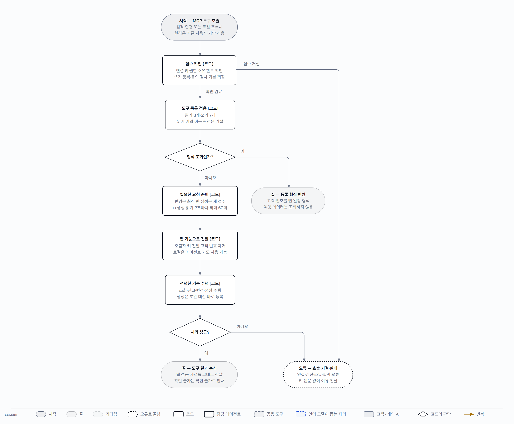

### 입력 · 출력 · 예외 · 상한 · 시험

| 항목 | 내용 |
|---|---|
| 입력 | 원격은 `Authorization: Bearer` 또는 `X-User-Key`; 둘 다 있으면 MCP에서는 Bearer가 우선이다. 로컬은 `TRIPILOT_USER_KEY`. 도구 인자에는 호출자 `customer_id`를 받지 않는다. 일정 제출 몸통에 고객 번호가 있어도 제거한다. |
| 출력 | **읽기 8개**: 여행 목록, 일정, 알림, 제안, 등록 스키마, 일정 위험 점검, 재난 복구 요약, 이동 판정. 일정 조회는 선택 날짜로 필터링하며 지도·전체 변경 이력을 줄이고 요약 줄과 최근 변경 최대 5개를 반환한다. **쓰기 7개**: 말하기, 문제 신고, 항목 교체, 제안 선택, 되돌리기, 일정 검증·등록, 일정 생성·등록. 변경 결과는 해당 웹 기능의 답변·상태·판 번호이며, 요청에 따라 변경하지 않거나 선택을 기다리는 제안을 반환할 수도 있다. |
| 예외 → 결과 | 원격 모듈 꺼짐·설정 읽기 실패 → 404. 원격 키 없음·무효 → 401. 로컬 실행 시 키 없음 → 시작 실패. 미등록 쓰기 도구 → 호출 불가. 에이전트 읽기 키로 POST 도구 호출 → 403; 따라서 읽기 표시가 붙은 **이동 판정도 웹 API가 POST여서 에이전트 `read` 키로는 거절된다**. 남의/없는 여행 → 404. 날짜 형식·인자 검증 실패 → 도구 오류. 웹 오류 → 코드·상태·허용된 추가 정보만 도구 오류로 변환. HTTP 연결 실패 → 예외 종류만 안내. 생성 접수 `fatal`·읽기 한도 초과 → 도구 오류, 계획 호출 중단. |
| 상한 · 시간 | 원격 모듈 `config/project.yaml`의 `modules.mcp.enabled=true`; 쓰기 `travel.mcp.write_enabled=false`, 반영하려면 서버 재시작. 로컬 쓰기는 `--write`로 별도 선택한다. HTTP 요청 제한은 코드 상수 `timeout=180.0`. MCP 생성 읽기는 2초 간격 최대 60회; 첫날·1~7일·1~4인, 기본 2일·2인. 위험 점검 실제 기본은 `travel.mcp.risk_check.horizon_hours=3`, 항목 `max_items=6`, 새 조회 `fresh_max_items=3`, `fresh_share=0.5`; 동시 처리 `travel.mcp.max_concurrent.risk_check=4`, `move_judge=4`, 초과하면 503과 5초 뒤 재시도 안내. 자체 자동 재시도는 생성 접수 읽기 반복 외에 없다. |
| 시험 | `tests/e2e/test_mcp_server.py`, `tests/e2e/test_mcp_read_tools.py`, `tests/e2e/test_web_agent_keys.py`, `tests/e2e/test_trip_planner.py`, `tests/contract/test_mcp_opens_a_classified_case.py`. 시험 실행은 하지 않았다. 에이전트 키의 웹 API 시험을 원격 MCP 연결 성공 시험으로 해석하면 안 된다. |

### 유스케이스 v7 과 다른 점 (지금 코드 기준)

- 요청에 적힌 읽기 7개와 달리 현재는 **읽기 8개·쓰기 7개**다. 재난 후 복구 요약 조회가 추가되었다.
- v7의 “권한 범위가 정해진 앱 키”와 현재 원격 MCP의 연결 검사는 일치하지 않는다. 원격 연결은 `web_session.resolve`를 호출하여 **기존 사용자 키만 받는다**. 새 에이전트 키를 지원하는 것은 전달 대상인 웹 API다.
- 로컬 프록시는 원격 MCP 연결 검사를 거치지 않고 웹 API를 호출하므로 에이전트 키의 웹 인증 경로를 사용할 수 있다.
- 읽기 표시·쓰기 도구 등록 스위치는 웹 API 권한과 별개다. 읽기 이동 판정의 POST와 에이전트 읽기 권한 사이에 불일치가 있다.
- MCP 일정 생성은 초안 반환이 아니라 웹 경로를 통한 바로 등록이다. 호출마다 새 접수를 만들기 때문에 도구 재호출 전체의 멱등성을 보장하지 않는다.
- 위험 점검 설명 문자열에는 기본 12시간이 남아 있지만, 실제 API가 읽는 설정 기본은 **3시간**이다.
- “답변을 그대로 전한다”, “확인 불가를 문제없음으로 말하지 않는다”는 개인 AI에게 주는 서버 지침이다. 개인 AI가 지침을 준수했는지 MCP 코드가 검증하지는 않는다.

### 확인 못 한 것

- 실제 개인 AI 제품과 원격·로컬 연결이 성공하는지.
- 새 에이전트 키로 원격 MCP에 연결하는 통합 시험은 확인하지 못했다. 코드상 기존 사용자 키 전용 연결 검사는 확인했다.
- 선택한 웹 기능 전체의 내부 흐름은 이 블록에서 펼치지 않았다. 일정 생성의 모델 호출·출력 검사는 F03에 명시했으며, MCP 어댑터에는 모델 호출이 없다.

## A01 요식업 에이전트 한 번의 실행

- 시작: 오케스트레이터가 요식업 담당에게 일정 관리 작업을 전달한다. 고객 신고·다른 안 선택·되돌리기·규정 질문 또는 감시 사건이 입력이다.
- 관여자: 고객 또는 개인 AI, 오케스트레이터, 요식업 에이전트, 공용 읽기 도구, 요식업 원장, 외부 성립 점검 정보, 필요한 경우 문장 해석·대상 선택 언어 모델. 에이전트는 초안을 반환하며 일정 저장·발송은 코어가 수행한다.

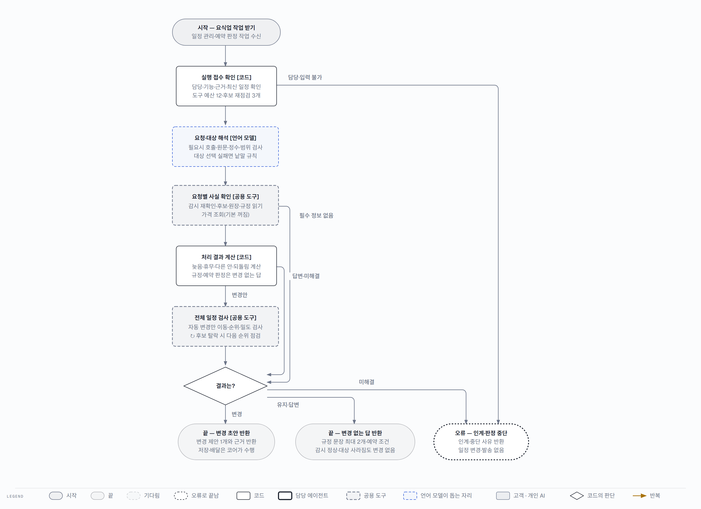

### 입력 · 출력 · 예외 · 상한 · 시험

| 항목 | 내용 |
|---|---|
| 입력 | 이 도식은 여행 일정 관리·규정 질문 작업의 내부 실행이다. 작업의 담당·할 일·허용 도구·근거 묶음, 여행·대상 항목·기준 버전, 고객 문장 또는 감시 원인. 담당 검사 후 일정 관리 여부를 구분하는 진입은 `app/domains/travel_ops/instances/dining/team.py:153`이다. |
| 출력 | 변경 시 실행 제안 1개, 교체 항목·다른 안·고객용 문구·근거·결정 기록. 보통 상태 유지 시 제안 0개와 답변. 미해결 시 실패 사유가 있는 중단 결과. 에이전트 내부에서 새 일정 버전이나 실제 알림을 만들지 않는다. |
| 예외 → 결과 | 다른 담당 → 인계 결과. 미지원 기능·근거 부족 → 중단. 일정·후보·필수 신고값 없음 → 모름 결과. 감시 대상 사라짐 → 변경 없는 답. 성립 점검 실패 → 치명 소스 실패 결과. 후보 재점검의 권한·예산·반복 제한 → 해당 후보를 미확인으로 탈락. 원장·가격의 보조 조회 제한 → 없는 값으로 계속 계산. 늦어도 영업 가능 → 뒤 일정 영향이 있으면 영향 설명, 없으면 그대로 가능 답. 영업 모름 → 기존 일정 유지와 확인 필요 답. 대체안 없음·전체 재판정 실패 → 중단 결과. |
| 상한 · 시간 | 선언된 `max_steps = 12`가 공용 도구 호출 예산으로 전달된다. 같은 도구·정규화 인자 재호출은 반복 제한을 받는다. 감시 식당 후보 재점검은 `DINING_RECHECK_LIMIT = 3`. `travel.dining.google_price_enabled: false`. 바깥 실행 제한은 `reliability.team_timeout_seconds: 90`; 동기 코드가 매번 이 시간에 즉시 중단된다고 보장하면 안 된다. 규정 답변은 고객용 규정 문장 최대 2개와 예약 조건 수치를 사용한다. 대상 선택은 `travel.pointer.mode`와 `ollama_pointer_model` 설정에 따르며, 기본 모델 이름은 비어 있다. 모델 번호의 정수·목록 범위와 이동 항목 제외를 검사하고 실패·미설정 시 낱말 규칙을 쓴다. |
| 시험 | `tests/scenario/test_case_watch_dining.py`, `tests/scenario/test_dining_needs_check.py`, `tests/unit/travel/test_dining_replan_rules.py`, `tests/integration/dining/test_dining_alternative_opening.py`, `tests/unit/travel/activity/test_watch_batch_unit.py`. |
| 별도 예약 판정 경로 | 일정 관리가 아닌 작업은 예약 → 장소 → 예약 시각의 원장 상태를 읽고, 확인 시각이 없으면 중단한다. 조건 확인이면 알려지지 않은 요청 조건은 모름 결과, 아니면 조건 답을 반환한다. 영업 확인이면 해당 시각 영업값이 없을 때 중단하고, 있으면 열림·닫힘 답을 반환한다. 이 경로는 변경 초안을 만들지 않는다. 참조: `app/domains/travel_ops/instances/dining/team.py:163`, `app/domains/travel_ops/instances/dining/team.py:243`. |

### 유스케이스 v7 과 다른 점 (지금 코드 기준)

- v7에는 에이전트 내부 실행을 독립 유스케이스로 명세하지 않았다. 위 흐름은 일정 초안을 만드는 실제 내부 경로다.
- 요식업 원장의 시간대별 판정과 근처 원장 후보가 대체 계산에 연결돼 있다.
- “오늘 일정 없음” 계산 결과는 공통 결과 포장에서 일반 유지 답 목록에 포함되지 않는다. 이 에이전트 경로에서는 중단 결과로 반환하며, 여행 창구의 날짜 안내와 구분해야 한다.
- 고객이 고른 변경·되돌리기는 에이전트의 자동 변경용 전체 재판정을 건너뛴다. 코어 적용 단계의 검사는 별도다.
- 실패 결과의 코드상 명칭이 사람 이관을 뜻하더라도, 실제 고객 건을 운영자가 인수하는 절차를 이 흐름에 추가하면 안 된다.

### 확인 못 한 것

- 실제 조립된 모델·도구·정책 자료, 실행 결과를 받은 뒤 오케스트레이터의 추가 검토·적용은 이 내부 실행 도식의 범위 밖이다.
- 시험은 실행하지 않았다.

## A02 액티비티 에이전트 한 번의 실행

- 시작: 오케스트레이터가 활동 일정 작업을 전달한다. 같은 여행에서 여러 문제가 묶이면 활동 담당이 조정 역할을 맡는다.
- 관여자: 고객 또는 개인 AI, 오케스트레이터, 활동 에이전트, 등록된 식사·이동 계산 부품, 공용 읽기·이동 도구, 외부 성립 정보, 필요한 경우 문장 해석·대상 선택 언어 모델.

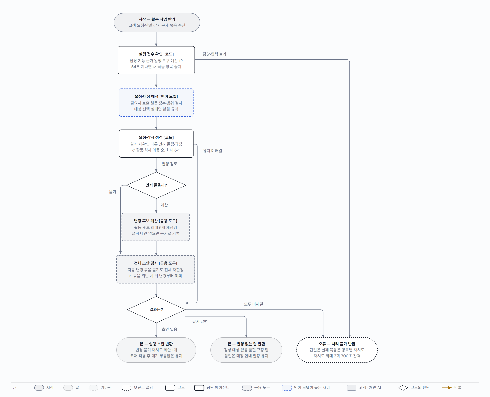

### 입력 · 출력 · 예외 · 상한 · 시험

| 항목 | 내용 |
|---|---|
| 입력 | 이 도식은 일정 관리 실행과 감시 묶음 조정이다. 최신 여행·항목, 감시 대상 또는 고객 요청, 원인, 설문·보호 조건, 후보 장소와 근거. 묶음은 활동 → 식사 → 이동 순서이며 같은 종류 안에서는 시작 시각·순서로 처리한다. |
| 출력 | 단일 변경 또는 먼저 묻기는 실행 제안 1개. 묶음도 적용·묻기·동의 요청·재시도 항목을 포함한 실행 제안 1개로 합친다. 변경 없는 정상 결과는 답만 반환한다. 모두 미해결·실패면 실패 결과와 항목별 표지를 반환한다. 실제 새 버전·알림·고객 대기 요청은 코어 적용 이후의 결과다. |
| 예외 → 결과 | 담당·기능·근거 부적합 → 인계 또는 중단. 대상 사라짐 → 변경 없음. 종류 불일치·필수 정보 없음 → 중단. 점검 소스 실패 → 치명 실패; 묶음에서는 해당 항목만 재시도 대상으로 남김. 도구 한도 초과 후보 → 미확인으로 탈락. 날씨만이고 실내외 모름 → 후보 조회 전에 묻기. 실내외를 알아도 설문에서 자동 변경을 직접 선택하지 않았으면 먼저 묻기. 날씨 대체를 계산했지만 못 찾음 → 다시 묻기 결과. 다른 원인의 대안 없음·전체 재판정 탈락 → 미해결 기록. 묶음 시간 소진·항목 예외 → 해당 항목을 다음 회차 대상으로 두고 다른 항목은 계속 처리. 등록 계산 부품 없음 → 처리하지 못한 종류로 기록하며 다른 종류 계산을 대신 쓰지 않는다. |
| 상한 · 시간 | `max_steps = 12`; 묶음은 항목마다 도구 예산을 새로 시작한다. 활동 후보 재점검은 `ACTIVITY_RECHECK_LIMIT = 6`. `travel.watch.batch_enabled: true`, `batch_max_items: 6`, `batch_time_ratio: 0.6`. `reliability.team_timeout_seconds: 90`의 60%, 즉 54초가 지나면 새 항목을 시작하지 않는다. 이미 시작한 동기 계산을 정확히 54초에 끊지는 않는다. 실패 항목 재개는 감시 쪽 `travel.watch.retry_max: 3`, `retry_cooldown_seconds: 300`에 따른다. 고객 대기 만료는 대상 종료 시각, 종료가 없으면 시작 시각이다. |
| 시험 | `tests/unit/travel/activity/test_activity_trigger_budget.py`, `tests/unit/travel/activity/test_watch_batch_unit.py`, `tests/scenario/test_watch_batch.py`, `tests/e2e/test_indoor_unknown_consent.py`, `tests/unit/travel/activity/test_activity_fit.py`. |
| 규정 질문의 추가 모델 | 항목을 직접 지정하지 않으면 A01과 같은 대상 선택 모델 자리를 사용할 수 있다. 정수·목록 범위를 검사하고 이동 항목은 고르지 않는다. 모델 미설정·실패·준비 중이면 낱말 규칙을 사용한다. 참조: `app/domains/travel_ops/instances/_shared/itinerary_team.py:218`, `app/domains/travel_ops/components/conversation/item_pointer.py:94`. |
| 별도 예약 판정 경로 | 일정 관리 외에는 예약·규정·예약 시각을 읽는다. 취소 판정은 취소 기한을 모르면 중단, 기한을 지났으면 불가 답, 기한 안이면 위약금율 확인 여부에 따라 답한다. 성립 판정은 이미 시작·정원 초과를 먼저 확인한 뒤 장소와 성립 점검을 읽는다. 장소가 없으면 그 부분 미확인 경고와 확인 범위의 답을 반환할 수 있다. 점검 실패는 중단, 문제가 있으면 예약 변경 제안 1개와 승인 대기 결과를 반환한다. 변경 요청도 예약 변경 승인 제안으로 끝난다. 이 예약 경로에는 날씨만이면 먼저 묻는 일정 규칙이 적용되지 않는다. 참조: `app/domains/travel_ops/instances/activity/team.py:190`, `app/domains/travel_ops/instances/activity/team.py:225`, `app/domains/travel_ops/instances/activity/team.py:272`, `app/domains/travel_ops/instances/activity/team.py:422`. |

### 유스케이스 v7 과 다른 점 (지금 코드 기준)

- 같은 여행의 여러 문제를 활동 담당이 조정하는 묶음 실행이 있다. 하나의 공유 초안에 순서대로 계산하고 마지막에 합친 결과를 다시 검사한다.
- 묶음의 묻는 안도 전체 일정 재판정을 통과해야 한다. F10의 먼저 묻기 분기와 순서가 다르다.
- 합친 변경이 위반을 만들면 가장 뒤에 적용한 변경부터 제외한다. 제외된 변경 때문에 다시 남게 된 이동 항목은 재시도 대상으로 복원한다.
- 새 장소로 다시 만든 이동은 그 계산 순간에 경로 사건을 함께 받지 않는다. 새 이동의 사건은 이후 감시 회차가 확인한다.
- 예약 기반 성립 점검과 일정 감시의 날씨 동의 규칙은 서로 다르다. 두 실행 경로를 하나의 자동 변경 규칙으로 합치면 안 된다.

### 확인 못 한 것

- 실행 환경의 등록 계산 부품과 모델·정책 설정, 코어 적용 이후 실제 고객 선택·배달은 확인하지 않았다.
- 시험은 실행하지 않았다.

## A03 이동 판정기

- 시작: 장소 변경 초안이 앞뒤 이동을 다시 만들거나, 이동 감시가 경로 사건을 재확인한 뒤 대체 경로를 요청한다.
- 관여자: 일정 변경 코드, 활동·요식업·이동 에이전트 또는 묶음 조정자, 공용 이동 판정 연결부, 시간표·노선·도로 자료, 자체 길찾기. 이 두 변경 경로는 언어 모델을 호출하지 않는다.

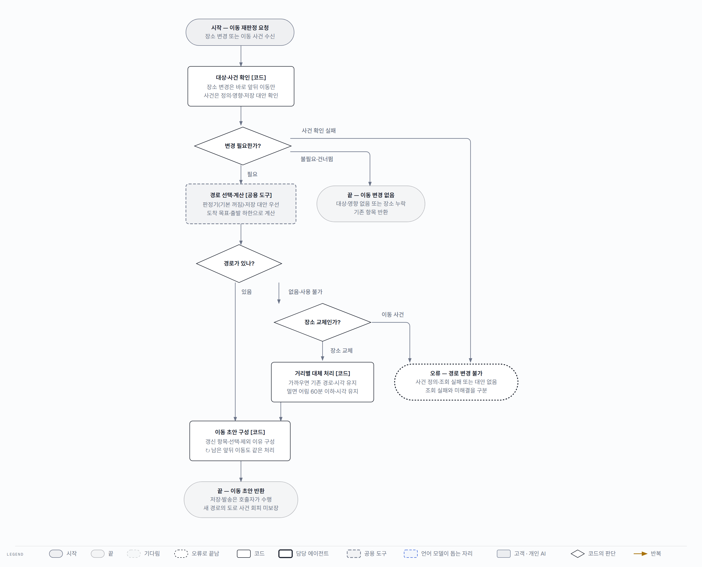

### 입력 · 출력 · 예외 · 상한 · 시험

| 항목 | 내용 |
|---|---|
| 입력 | 장소 변경: 변경 전·후 항목과 교체 대응표. 실제 장소 번호가 바뀐 비이동 항목의 바로 앞뒤 이동만 대상이다. 이동 사건: 대상 이동의 경로 정의·계획 수단·구간 사건·앞뒤 장소·현재 시각. |
| 출력 | 장소 변경은 갱신한 앞뒤 이동 항목 목록. 사건 처리는 변경 없음, 미해결 또는 이동 항목을 교체하는 변경 계산 1개. 판정 성공 시 경로 후보·선택 수단·출발·도착·소요·제외 이유가 포함된다. 저장·알림은 호출자 단계다. |
| 예외 → 결과 | 장소 변경 없음·인접 이동 없음 → 원래 목록 반환. 양쪽 장소·좌표 없음 → 해당 이동 유지. 판정기 미등록·설정 없음 또는 경로 계산 결과 없음 → 가까운 교체는 경로 유지, 먼 교체는 어림 경로. 도보 상한을 못 읽으면 0으로 두어 양수 거리 교체를 어림 경로로 처리한다. 자료 범위 밖 날짜 → 연결부가 경로 없음과 자료 부족 이유로 반환한다. 이동 경로 정의·사건 조회 실패 → 에이전트 중단 결과. 계획 수단에 영향 없음 → 변경 없음. 저장 대안도 없고 새 경로도 못 찾음 → 미해결. 예상하지 못한 판정기 예외를 이 두 변경 함수가 모두 어림값으로 바꾸는 구조는 아니다. |
| 상한 · 시간 | `mobility_data_dir` 기본 빈 값이므로 설정 기본상 판정기 꺼짐. 자료를 설정하면 기동 때 존재·해시를 확인하며 불량 자료는 기동 실패로 올린다. `mobility_local_router: true`가 기본이다. 장소 변경 재판정은 다음 장소 시작을 도착 목표, 앞 장소 종료 또는 시작을 출발 하한으로 사용한다. 사건의 새 경로는 출발 하한을 현재 시각과 앞 일정 종료 중 늦은 값으로 한다. 두 변경 경로 모두 인원·설문을 별도 전달하지 않고 기본 입력으로 판정기를 만든다. 먼 교체 어림은 직선 거리의 도보 환산, 소요 최대 `TRANSFER_MAX_MIN = 60`분이며 기존 이동 시각을 옮기지 않는다. |
| 시험 | `tests/e2e/test_mobility_engine_flow.py`: 실제 시간표를 통한 앞뒤 이동 재판정·사건 새 경로·자료 범위 밖 날짜. `tests/unit/travel/mobility/test_review_fixes_wiring.py`, `tests/unit/travel/mobility/test_plan_v1.py`, `tests/unit/travel/mobility/test_plan_estimate_v1.py`, `tests/unit/travel/test_departure_notice_estimate.py`. |
| 사건 변환 | 지하철 무정차 → 해당 역 제외, 노선 중단 → 해당 노선 제외, 버스 중단 → 해당 버스 노선 제외. 도로 통제처럼 판정기 조건으로 옮기지 못하는 사건은 대상 이름을 결과에 남긴다. 새 경로가 그 도로 사건을 회피한다고 보장하지 않는다. 참조: `app/domains/travel_ops/instances/mobility/wiring.py:157`. |
| 판정기의 후보 선택 | 도보·대중교통·설정상 허용 수단을 계산하고 경로 표기와 도착 목표를 검사한다. 앞 일정 종료 이후 출발 가능 후보를 선택하며 필요한 경우 출발 하한에서 재판정한다. 가장 늦게 떠나도 되는 후보를 계획 수단으로 고르고, 동률은 환승 수·소요·생성 순으로 정한다. 다른 후보도 선택한 이동 출발 시각에 성립해야 포함된다. 참조: `app/domains/travel_ops/instances/mobility/engine/plan.py:1519`. |
| 별도 읽기 입구 | 현재 코드에는 개인 AI용 두 장소 이동 조회도 있다. 이것은 위 변경 계산과 별도 읽기 경로다. 서울 밖은 판정하지 않고, 판정기 사용 불가·예외면 직선 어림 결과, 자료 부족과 경로 없음은 구분한다. 출발 입력은 도착 목표를 90·180·360분으로 넓힌 뒤 성공 경로의 소요에 맞춰 한 번 더 판정한다. 도착 목표 입력은 한 번 판정한다. 참조: `app/domains/travel_ops/components/itinerary/move_judge.py:133`. |

### 유스케이스 v7 과 다른 점 (지금 코드 기준)

- v7의 “이동을 못 계산하면 미확인으로 두거나 가까운 장소면 도보로 바꾼다”보다 실제 분기가 구체적이다. 가까운 교체는 기존 노선·소요·시각을 유지하고 이름을 갱신한다. 먼 교체는 옛 경로를 어림 경로로 교체하되 시각은 유지한다.
- 장소가 가까워도 판정기가 사용 가능하면 먼저 새 장소로 재판정한다.
- 저장된 이동 대안이 모두 막히면 사고 조건을 반영해 새로운 경로를 계산한다.
- 모든 판정 결과가 열차 시간표 기반인 것은 아니다. 도보·택시·버스의 계산 근거와 추정 범위를 구분해야 한다.
- 개인 AI용 이동 읽기 입구가 추가됐다. 이 입구의 오류 처리·탐색 반복을 일정 변경용 호출에도 그대로 적용하면 안 된다.

### 확인 못 한 것

- 실행 환경의 이동 자료 존재·버전·신선도, 자체 길찾기 가용성과 실제 외부 사건 반영은 확인하지 않았다.
- 이동 판정기 전체의 모든 수단별 세부 알고리즘 검증까지 수행한 것은 아니다. 위 명세는 요청한 두 변경 호출 경로와 읽은 판정·반환 경계를 기준으로 한다.
- 시험은 실행하지 않았다.
