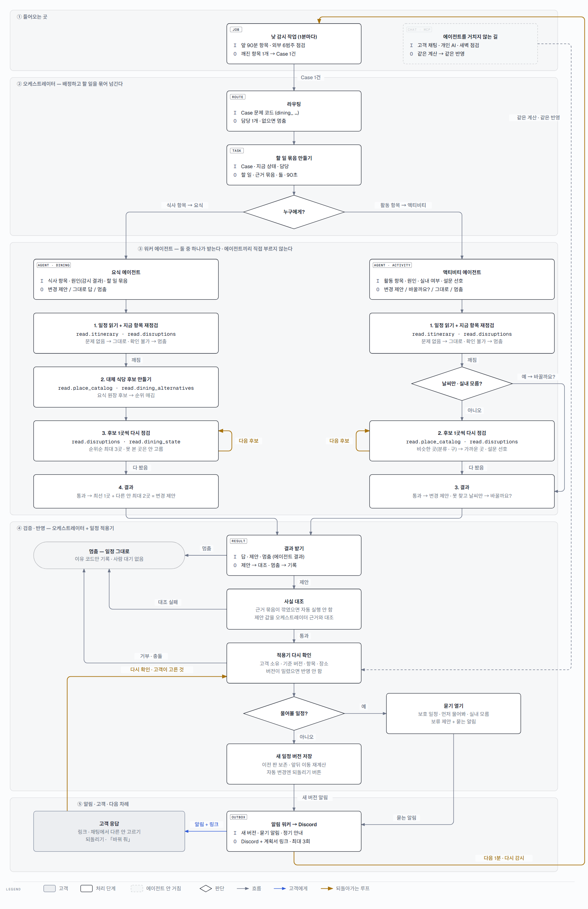
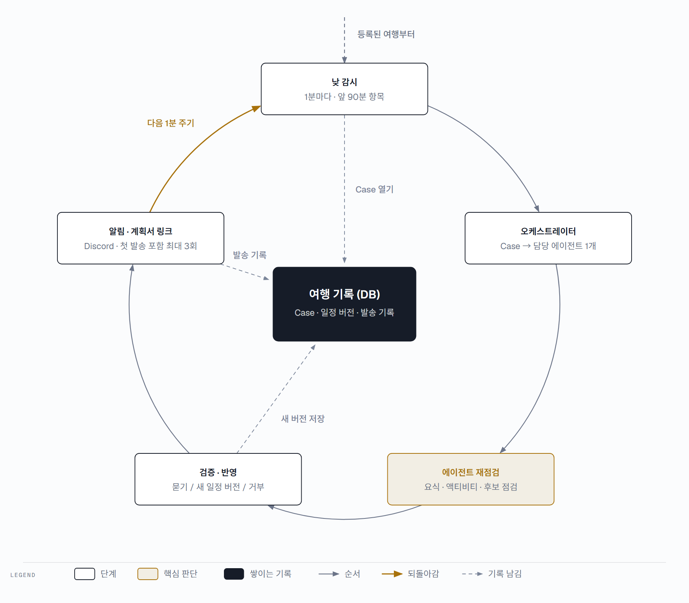
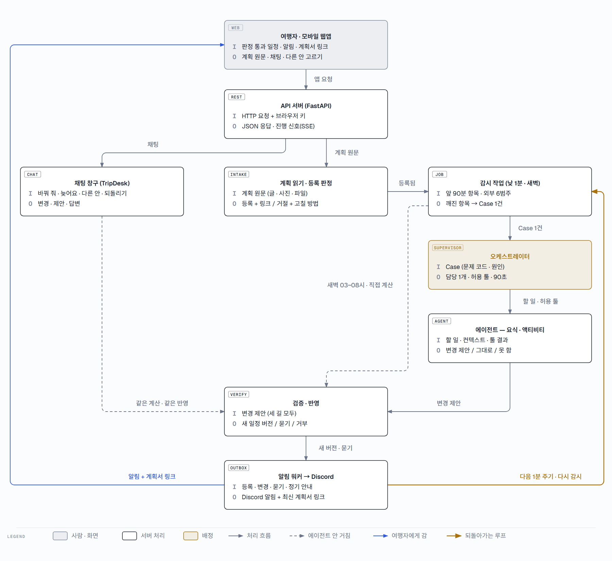
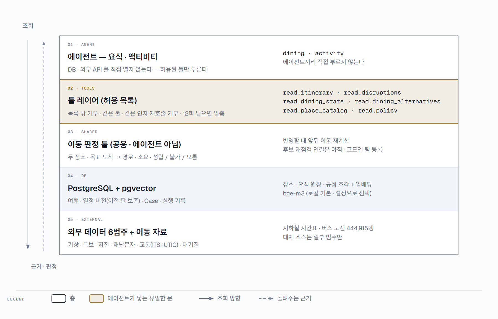

triPilot 은 **외부 에이전트가 짠 여행 일정을 받아 확인하고, 여행이 끝날 때까지 지키는** 서비스입니다. 에이전트는 요식 · 액티비티 둘이고, 이동은 에이전트가 아니라 모두가 부르는 공용 판정 툴입니다. 루프는 둘입니다 — 바깥 루프는 여행 기간 동안 1분마다 감시 → 배정 → 재점검 → 검증 · 반영 → 알림을 돌고, 안쪽 루프는 에이전트가 통과하는 곳이 나올 때까지 다음 후보를 다시 점검합니다. 고객 채팅과 새벽 영업 확인은 에이전트를 거치지 않고 같은 계산과 같은 반영을 씁니다. 첫 그림이 에이전트 사이의 흐름 전체 — 누가 무엇을 받아 어떤 툴을 부르고 무엇을 넘기는지 — 입니다.

## 1. 멀티에이전트 플로우 — Case 한 건이 지나가는 길

낮 감시가 깨진 항목을 찾으면 Case(처리할 건 하나)를 엽니다. 오케스트레이터는 문제 코드 앞부분(식사 dining_ · 활동 activity_)으로 담당 에이전트 하나를 고르고, 할 일 묶음 — 할 일 종류 · 지금 상태와 근거 묶음 · 허용 툴 목록 · 마감 90초 — 을 넘깁니다. 에이전트는 허용된 툴로만 읽고, 지금 항목을 다시 점검한 뒤 대체 후보를 한 곳씩 다시 점검해(굵은 선) 변경 제안을 냅니다. 제안은 바로 반영되지 않습니다 — 오케스트레이터의 사실 대조와 적용기의 재확인을 거친 뒤, 물어볼 일정이면 묻고 아니면 새 일정 버전으로 저장됩니다.

> 예 — 저녁 식당 근처에 재난문자가 걸리면: 감시가 식사 Case 를 열고 → 요식 에이전트가 그 식당을 다시 점검(깨짐) → 요식 원장 후보를 순위대로 최대 3곳 다시 점검 → 최선 1곳 + 다른 안 2곳을 제안 → 대조 · 재확인 통과 → 「먼저 물어봐」를 고른 고객이면 묻고, 아니면 새 버전 저장 + 되돌리기 버튼과 함께 Discord 알림. 툴은 허용 목록 밖이면 거부, 같은 툴 · 같은 인자는 한 번만, 한 실행에 12회까지입니다. 굵은 선 넷이 루프입니다 — 후보 재점검 둘, 고객 응답 뒤 다시 확인, 다음 1분 감시. 이동은 에이전트가 아니라 반영할 때 앞뒤 이동을 다시 계산하는 공용 툴입니다(코드에는 아직 경로 사건 Case 를 받는 팀으로도 등록돼 있어 정리가 필요합니다).

## 2. 바깥 루프 — 여행 기간 동안 1분마다

등록된 여행은 낮 감시가 1분마다 앞으로 90분 안의 항목을 외부 6범주(기상 · 특보 · 지진 · 재난문자 · 교통 · 대기질)로 점검합니다. 깨진 항목이 있을 때만 Case(처리할 건 하나)를 열고 한 바퀴를 돕니다. 깨진 것이 없으면 감시에서 멈추고 다음 1분을 기다립니다.

> 점선은 가운데 여행 기록(DB)에 남기는 것 — 감시는 Case, 반영은 새 일정 버전, 알림은 발송 기록. 여행이 끝나면 앞으로 90분 안에 볼 항목이 없어 감시할 것이 없습니다(여행 종료를 상태로 바꾸는 코드는 확인하지 못했습니다).

## 3. 전체 구조 — 들어오는 길 셋, 반영은 하나

여행자의 요청은 모두 API 서버로 들어옵니다. 들어오는 길은 셋입니다 — 계획 등록(감시 대상이 됨), 낮 감시(오케스트레이터 → 에이전트), 고객 채팅 · 새벽 점검(에이전트를 거치지 않는 점선). 셋 다 같은 검증 · 반영을 거쳐 알림과 계획서 링크로 여행자에게 돌아갑니다.

> 상자 안 I = 받는 것, O = 내보내는 것. 오케스트레이터는 규칙으로 담당 에이전트 하나를 고르고(에이전트끼리 직접 부르지 않음), 에이전트 한 번의 시간 제한은 90초입니다. 진행 신호(SSE)와 일정 변경 신호는 웹 화면으로 따로 갑니다.

## 4. 에이전트 · 툴 · 데이터 층

에이전트는 DB 와 외부 API 를 직접 열지 않습니다. 툴 레이어(허용 목록)가 에이전트가 닿는 유일한 문이고, 판정은 코드가 합니다. 조회가 안 되거나 값이 비면 「모름」, 정상 조회의 빈 결과는 「없음」으로 구분해 돌려줍니다.

> 그림의 툴 여섯 개는 주요 예시입니다 — 전체 허용 목록은 에이전트 등록 정보(manifest)에 있습니다. 이동 판정 툴은 코드에 아직 팀으로 등록돼 있어 공용 툴로 정리가 필요합니다.

## 구성별 받는 것 · 내보내는 것

| 구성 | 받는 것 (I) | 내보내는 것 (O) | 하는 일 |
|---|---|---|---|
| **트리거 — 낮 감시** | 앞으로 90분 안 항목, 외부 6범주 | 문제 항목 + 원인 → Case 1건 | 1분마다 점검 — 깨진 것만 Case 로 |
| **트리거 — 새벽 영업 확인** | 그날 식사 · 활동, Google 영업 정보 | 닫힌 곳의 근처 대체 → 묻기 / 반영 | 03~08시 · 에이전트를 거치지 않는 직접 계산 |
| **채팅 처리 (TripDesk)** | 고객 문장(바꿔 줘 · 늦어요 · 다른 안 · 되돌리기 · 질문) | 변경 · 제안 · 답변 (질문은 일정 그대로) | 에이전트와 같은 계산 코드를 직접 부른다 |
| **오케스트레이터** | Case (문제 코드 · 원인) | 담당 에이전트 1개, 할 일 · 허용 툴 · 컨텍스트 | 규칙 라우팅 · 에이전트 시간 제한 90초 |
| **요식 에이전트** | 식사 항목 · 원인 · 식이 조건 | 그대로 / 대체 식당 1 + 다른 안 최대 2 / 못 함 | read.itinerary · read.disruptions · read.place_catalog · read.dining_alternatives · read.dining_state — 순위순 최대 3곳 재점검 |
| **액티비티 에이전트** | 활동 항목 · 원인 · 실내 여부 · 설문 | 그대로 / 대체 활동 + 다른 안 / 바꿀까요? / 못 함 | read.itinerary · read.disruptions · read.place_catalog — 날씨만 + 실내 모름이면 먼저 「바꿀까요?」 |
| **이동 판정 툴 (공용 · 에이전트 아님)** | 두 장소 · 목표 도착 시각 · 앞 일정 종료 시각 | 경로 · 소요 · 판정(성립 / 불가 / 모름) | 반영 때 앞뒤 이동 재계산 · 일정 생성 (후보 재점검 연결은 아직) |
| **검증 + 반영** | 변경 제안 | 새 일정 버전 / 사용자에게 묻기 / 거부 | 고객 소유 · Case 버전 · 여행 기준 버전 · 항목 · 장소 확인 |
| **알림 (아웃박스 워커)** | 등록 · 변경 · 묻기 알림, 정기 안내 | Discord 웹훅 알림 + 계획서 링크 | 중복 방지 키 · 첫 발송 포함 최대 3회 |
| **계획 읽기 · 일정 생성** | 계획 원문 / 「일정 짜 줘」 선호 | 일정 항목 + 근거 줄 / 판정을 통과한 초안 | 규칙 먼저 · AI 는 줄 위치 · 받아쓰기 · 순서 제안만 |

대표 순환은 감시 → Case → 오케스트레이터 → 에이전트(후보 재점검 루프) → 검증 · 묻기 · 반영 → 알림 → 다음 1분 감시입니다. 이 순환이 triPilot 의 핵심 — 계획을 받아 여행이 끝날 때까지 지킨다 — 을 보여 줍니다. 고객 채팅 · 새벽 영업 확인 · 일정 생성 · 정기 안내(하루 시작 · 다음 일정 · 출발)는 별도 길이며 같은 계산과 버전 저장을 함께 씁니다.

> 지금 상태 — 구현: 일정 등록 거절(이유 + 고칠 방법) · 고객 채팅 · 다른 안 · 되돌리기 · 일정 생성 · 정기 안내 · 일정 변경 SSE. 진행 중: 접수 · 생성 · 채팅 진행 SSE(서버 구현, 웹 연결 중). 아직 없음: 실패 항목을 채팅으로 대안 추천 · 후보 재점검의 이동 판정 연결. 알림은 팀 Discord 채널 하나(개인 Discord 는 등록 · 시험 발송까지). 로그인 · AWS 자동 배포는 팀 계획(코드 없음). AI 모델은 로컬 · API 비교 시험 중.
