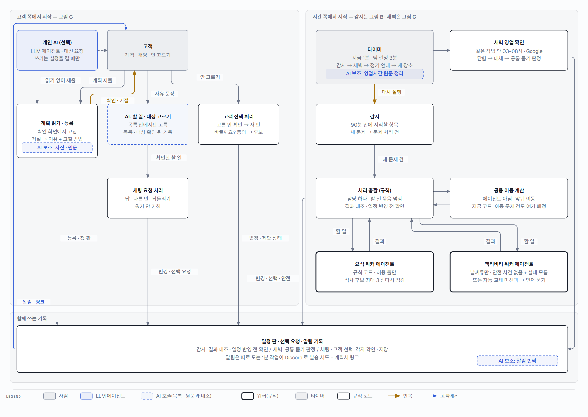
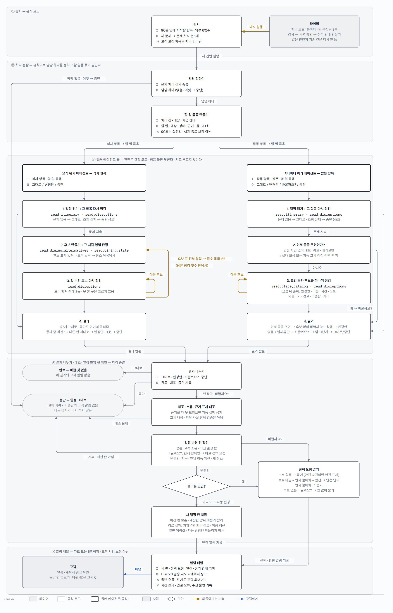
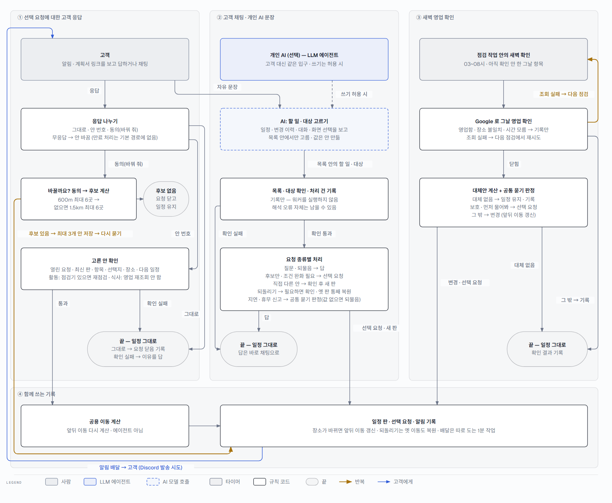

# triPilot 멀티에이전트 플로우 — 규칙 기반 요식 · 활동 워커와 선택적 개인 AI 연결

triPilot 은 고객이 낸 여행 계획을 확인해 등록하고, 여행이 끝날 때까지 지키는 서비스입니다. 이 플로우에는 네 종류의 참여자가 있고 그림의 색과 모양으로 가릅니다 — LLM 에이전트(고객이 연결한 개인 AI · 선택, 파란 실선), 워커 에이전트 둘(요식 · 액티비티 — 역할 · 허용 툴 · 할 일 계약을 받지만 판단은 규칙 코드, 굵은 테두리), AI 모델 호출(에이전트가 아니라 정해진 자리에서 읽기 · 고르기 · 정리 · 번역만, 파란 점선), 규칙 코드(처리 총괄 · 일정 반영 전 확인 · 감시 · 알림). 이동은 에이전트가 아니라 공용 이동 계산입니다. 범위 — 팀이 정한 범위는 요식 · 액티비티 워커 둘과 공용 이동 계산입니다. 지금 코드 설정에는 이동 · 예약 인계 · 숙박 · 항공 담당도 남아 있고, 감시는 이동 문제 건도 엽니다. 그림 A 는 정한 범위를 보여 주고, 실제 연결과 다른 곳은 따로 표시합니다.

정직하게 말하면 — 안쪽 워커는 다음 행동을 스스로 고르는 LLM 루프가 아니라 허용 툴을 부르는 규칙 코드입니다. 일정을 실제로 바꾸는 시스템이라 판단을 코드에 두었습니다. AI 모델은 고르기 · 옮기기만 하고 값을 만들지 않으며, 결과는 허용 목록 · 원문과 대조합니다(해석 오류 자체는 남을 수 있습니다). AI 보조가 들어가는 자리는 계획 읽기(사진 받아쓰기 · 원문 조각), 채팅 할 일 고르기, 영업시간 원문 정리(새로 들어온 장소), 알림 번역입니다.

## 그림 A — 전체 지도: 시작점이 둘

줄 세운 순서표가 아니라 시작점이 여럿인 지도입니다. 왼쪽은 고객 쪽(계획 제출 · 채팅 · 선택 요청에 답하기), 오른쪽은 시간 쪽(타이머가 감시와 새벽 확인을 돌림)입니다. 모든 길은 아래의 같은 기록(일정 판 · 선택 요청 · 알림)에 쓰지만 쓰는 길은 서로 다릅니다 — 감시는 결과 대조와 일정 반영 전 확인을, 새벽은 공통 묻기 판정을, 채팅과 고객 선택은 각자의 확인 · 저장을 거칩니다.

> 굵은 황토색 선이 반복입니다 — 계획 확인 · 거절 뒤 다시 등록, 타이머의 감시 반복. 워커 안의 후보 반복은 그림 B, 「동의 → 다시 묻기」 · 새벽 재시도는 그림 C 에 있습니다. 개인 AI 는 고객이 연결한 경우에만 같은 입구로 들어오고(일정 제출 때는 원문 읽기를 건너뜀), 쓰기는 설정을 켤 때만 됩니다. 타이머 작업은 감시 → 새벽 확인 → 정기 안내(하루 시작 · 다음 장소 · 출발, 대기 중이면 대기 안내, 경로 확인 실패 · 사건이면 출발 안내 보류) 순서로 돕니다.

## 그림 B — 감시가 새로 연 문제 한 건

타이머가 감시를 다시 돌리고, 감시가 90분 안에 시작할 항목에서 새 문제를 찾으면 문제 처리 건을 엽니다. 처리 총괄(규칙)이 식사는 요식 워커, 활동은 액티비티 워커에 할 일 묶음(할 일 · 근거 · 허용 툴 · 마감 설정 90초)을 넘기고, 워커는 후보를 하나씩 다시 점검(굵은 선)한 뒤 결과를 돌려줍니다 — 요식은 앞 순위부터 모두 합쳐 최대 3곳, 후보 표가 전부 탈락하면 장소 목록에서 한 번 더 찾고(남은 점검 횟수 안에서), 액티비티는 조건을 통과한 후보를 모두 점검한 뒤 순위를 매깁니다. 결과는 나뉘고 대조된 뒤 일정 반영 전 확인을 거치고, 물어볼 조건이면 선택 요청을, 아니면 새 일정 판을 저장해 알림을 쌓습니다.

> 예 — 저녁 식당 근처에 재난문자가 걸리면: 감시가 식사 문제 건을 열고 → 요식 워커가 그 식당을 다시 점검(문제 지속) → 후보 표에서 그 시각에 여는 곳을 순위대로 만들고 앞 순위 최대 3곳을 다시 점검 → 남은 후보 중 최선 1 + 다른 안 최대 2 → 대조 · 반영 전 확인 → 「먼저 물어봐」를 고른 고객이면 선택 요청, 아니면 새 판 저장 + 되돌리기 버튼과 함께 알림. 중단이면 일정은 그대로이고 이 중단에 대한 고객 알림은 없습니다.

## 그림 C — 고객 응답 · 채팅 · 새벽 확인 (나란히)

세 길은 따로 시작합니다(차례로 이어지는 것이 아닙니다). 선택 요청에 대한 응답은 그대로 · 안 번호 · 동의(바꿔 줘)로 나뉩니다. 후보가 없으면 요청을 닫고 일정을 그대로 둡니다. 후보 없는 「바꿀까요?」에 동의하면 후보를 계산해 같은 요청에 최대 3개 안을 저장하고 알림으로 다시 묻습니다(굵은 선). 채팅은 AI 모델이 할 일과 대상을 목록 안에서 고르고, 목록 · 대상을 확인 · 기록한 뒤 요청 종류별로 워커 없이 직접 처리합니다. 새벽 확인은 같은 점검 작업 안에서 03~08시에 Google 로 영업을 보고, 닫혔으면 대체안과 공통 묻기 판정을 거치며, 조회 실패는 다음 점검에서 재시도합니다(굵은 선).

> 고객이 고른 안은 고른 순간 열린 요청 · 최신 판 · 항목 · 선택지 · 장소 · 다음 일정을 확인합니다. 활동은 점검기가 연결돼 있으면 외부 사건을 다시 점검하고, 식사는 영업 · 외부 사건을 다시 조회하지 않습니다. 답하지 않으면 자동으로 바꾸지 않지만, 끝난 일정의 제안을 만료로 닫는 처리는 지금 기본 경로에 연결돼 있지 않습니다.

## 참여자별 받는 것 · 내보내는 것

| 참여자 | 종류 | 받는 것 (I) | 내보내는 것 (O) | 메모 |
|---|---|---|---|---|
| **고객** | 사람 | 알림 · 계획서 링크, 선택 요청 | 계획 원문, 채팅 문장, 안 고르기 · 바꿔 줘 | 시작점 |
| **개인 AI (선택)** | LLM 에이전트 | 고객의 지시 · 우리 조회 결과 | 같은 입구로 조회 · 신고 · 고르기 (쓰기는 설정 시) | 고객이 연결했을 때만 |
| **계획 읽기 · 등록** | 규칙 코드 + AI 보조 | 글 · 사진 · 파일 | 등록 + 첫 판 / 거절 + 고칠 방법 | AI 는 사진 받아쓰기 · 원문 조각 가리키기 |
| **타이머 · 감시** | 규칙 코드 | 90분 안에 시작할 항목 · 외부 6범주 | 새 문제마다 문제 처리 건 1개 | 지금 1분 · 팀 결정 3분 |
| **처리 총괄** | 규칙 코드 | 문제 처리 건 | 담당 하나 + 할 일 묶음 / 결과 대조 · 일정 반영 전 확인 · 묻기 판정 | LLM 이 아니라 규칙 |
| **요식 워커** | 워커 에이전트(규칙) | 식사 항목 · 할 일 묶음 | 그대로 / 변경안(최선 1 + 다른 안 최대 2) / 중단 | read.itinerary · read.disruptions · read.dining_alternatives · read.dining_state |
| **액티비티 워커** | 워커 에이전트(규칙) | 활동 항목 · 설문 · 할 일 묶음 | 그대로 / 변경안 / 바꿀까요? / 중단 | read.itinerary · read.disruptions · read.place_catalog |
| **공용 이동 계산** | 규칙 코드 | 두 장소 · 시각 | 앞뒤 이동 · 소요 | 에이전트 아님 · 지금 코드엔 이동 담당으로도 등록 |
| **채팅 할 일 고르기** | AI 모델 호출 | 문장 + 일정 · 변경 이력 · 화면 선택 | 목록 안의 할 일 · 대상 | 값은 안 만듦 · 목록 · 대상 확인 |
| **영업시간 원문 정리 · 알림 번역** | AI 모델 호출 | 관광공사 운영시간 원문 · 한국어 문구 | 구조화한 영업시간 · 고객 언어 문구 | 판정은 코드가 함 |
| **새벽 영업 확인** | 규칙 코드 | 그날 식사 · 활동 · Google 영업 | 대체안 → 공통 묻기 판정 → 선택 요청 / 변경 | 03~08시 · 조회 실패는 다음 점검에서 재시도 |
| **알림 배달** | 규칙 코드 | 변경 · 선택 요청 · 안전 · 정기 안내 기록 | Discord 발송 시도 + 계획서 링크 | 따로 도는 1분 작업(도착 시간 보장 아님) · 일반 오류 첫 시도 포함 최대 3번 · 시간 초과 · 연결 오류는 수신 불명으로 기록하고 재시도 안 함 |

## 이번 검토로 드러난 것 — 결정과 구현이 다른 곳

- 감시 주기 — 팀 결정은 3분인데 코드는 1분이고, 응답 재사용이 실행 1회 안에서만 살아 매분 다시 조회할 수 있습니다(대기질 하루 500회 한도를 넘길 위험 — 계산값, 측정 아님).
- 무응답 만료 — 끝난 일정의 선택 요청을 닫는 처리가 기본 감시 경로에 연결돼 있지 않습니다.
- 중단 알림 — 워커가 변경을 중단하면 고객 알림이 없고, 같은 원인의 실패 건은 다음 감시가 다시 실행하지 않습니다.
- 고정 항목 — 고객이 고정한 항목은 감시에서 건너뜁니다(결정 D-020 은 고정 항목도 감지 · 안전 알림).
- 묶음 처리 — 결정은 여행별 묶음 처리 · 소스별 공유 수집, 코드는 항목별 처리 건입니다. 적용 단계에 전체 일정 재검증도 없습니다.
- 팀 등록 — 이동 · 예약 인계 · 숙박 · 항공 팀이 아직 활성 등록돼 있습니다(팀 결정은 워커 둘 + 공용 이동).
