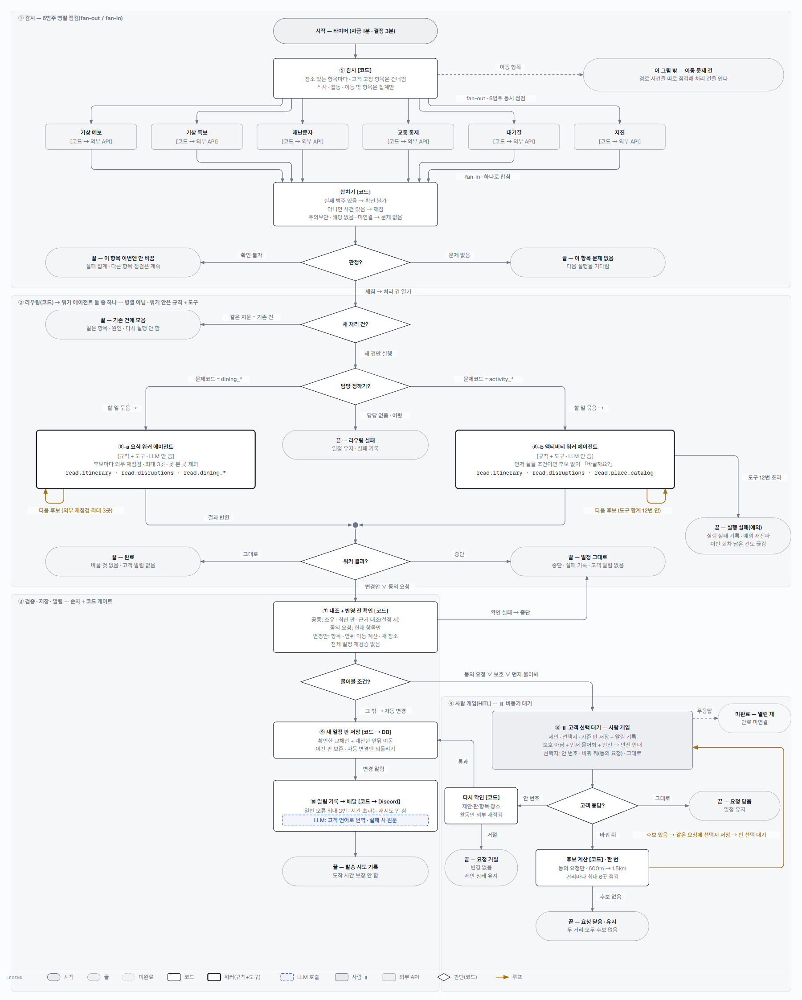
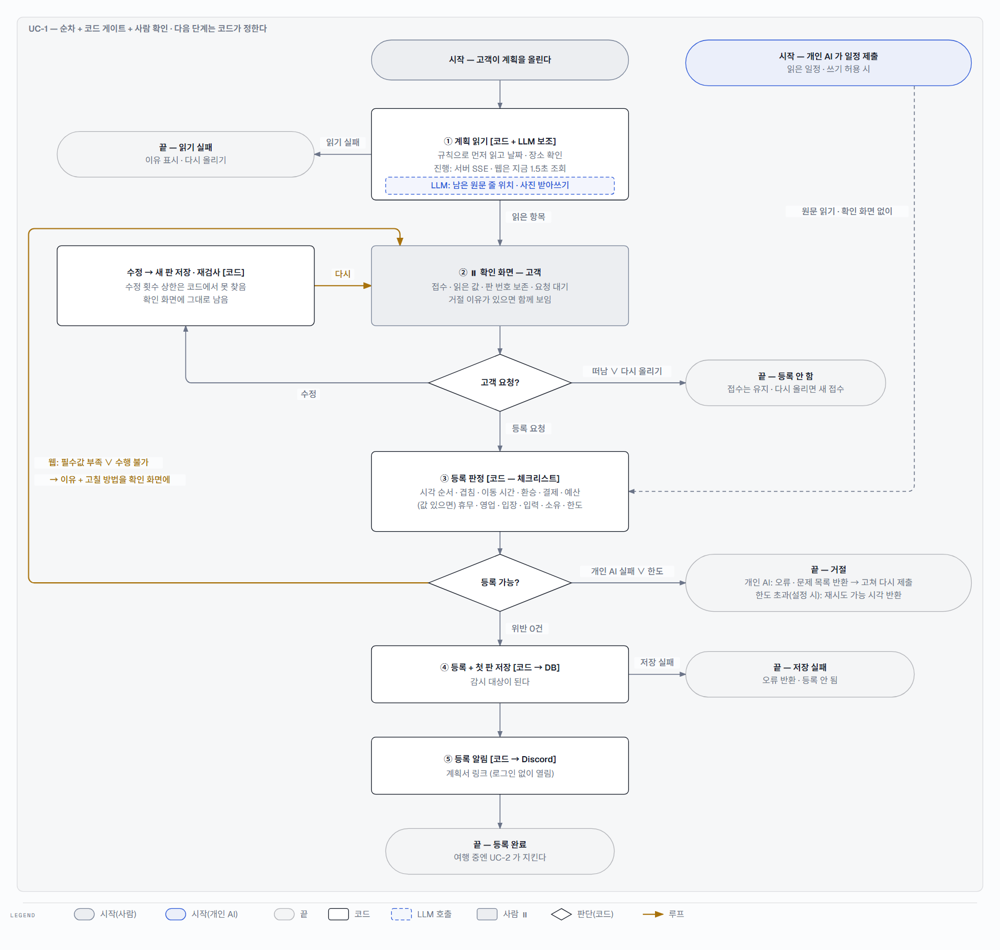

# triPilot 에이전트 흐름 — 누가 다음 단계를 정하나

멘토링 문서의 말대로 이 구조는 워크플로입니다 — 코드가 정한 경로 안에서 단계가 돌고, 요식 · 액티비티 「워커 에이전트」는 자기 역할 · 허용 도구 · 할 일 계약을 받는 규칙 코드이며 LLM 이 다음 행동을 고르는 루프가 아닙니다. 문서는 이런 단계도 「○○ 에이전트」로 부르는 것은 괜찮되 누가 다음 단계를 정하는지(코드인가 LLM 인가)를 그림에서 가르라고 합니다 — 그래서 모든 노드에 [코드] · [LLM] · [규칙 + 도구] · ⏸ 를 붙였고, 마름모(판단)는 전부 코드입니다.

## 멘토링 문서 규칙 → 이 그림에서

| 규칙 | 이 그림에서 |
|---|---|
| 시작과 끝 | 정상 완료 · 등록 안 함 · 처리 중단의 끝을 표시한다. 이동은 범위 밖 출구, 무응답은 끝이 아니라 「미완료 — 열린 채」(점선)로 둔다 |
| 노드 종류 — LLM / 결정적 코드 / 사람 / 분기 | [코드] · [코드 → 외부 API] · [LLM] · [규칙 + 도구] · ⏸ 사람 · 마름모(코드 판단) |
| 분기 조건은 조건식 이름표로 | 문제코드 = dining_* · 같은 지문 = 기존 건 · 동의 요청 ∨ 보호 ∨ 먼저 물어봐 · 도구 12번 초과 등 |
| 병렬 구간 fan-out / fan-in | 장소 있는 항목의 외부 6범주를 동시에 점검 → 합치기(실패 범주 있음 → 확인 불가, 아니면 사건 있음 → 깨짐, 주의보만 · 해당 없음 · 미연결 → 문제 없음). 워커 둘은 병렬이 아니라 둘 중 하나 |
| 루프의 종료 조건 · 최대 횟수 · 상한 도달 경로 | 요식: 외부 재점검 최대 3곳 → 통과 후보 있으면 변경안 · 없으면 중단 / 액티비티: 도구 합계 12번 → 넘으면 예외로 실행 실패 / 동의 후 후보 계산: 한 번 · 거리마다 최대 6곳 → 후보 있으면 같은 요청에 선택지 저장 후 안 선택 대기 · 없으면 요청 닫음 / UC-1 수정: 횟수 상한을 코드에서 찾지 못함 |
| 사람 개입(⏸)과 선택지 | UC-1 확인 화면(수정 · 등록 요청 · 떠남/다시 올리기) · UC-2 고객 선택(안 번호 · 바꿔 줘[동의 요청만] · 그대로, 무응답은 열린 채) |
| 누가 다음 단계를 정하나 — 코드인가 LLM 인가 | 모든 마름모는 코드. LLM 은 정해진 자리에서 읽기 보조 · 번역만 한다 |
| 구간마다 패턴 이름 | 병렬 점검(fan-out / fan-in, P3) · 라우팅(코드, P2) · 순차 + 코드 게이트(P1) · 사람 개입(HITL). 중앙 LLM 위임(P4) · LLM 평가 반복(P8)은 없다 |
| 랭그래프면 노드 · 엣지가 코드와 1:1 | 해당 없음 — 코드가 랭그래프를 쓰지 않는다(아래 「랭그래프 확인」). 대신 명세 카드마다 「코드 위치」 줄을 붙였다 |

## UC-2 여행 중 깨진 일정을 고쳐 받는다

주 액터는 고객, 시작은 시간(타이머)입니다. 감시가 장소 있는 항목마다 외부 6범주를 동시에 점검해 하나의 판정으로 합치고(fan-out / fan-in), 깨졌고 새 건이면 코드 라우터가 문제 코드로 워커 하나를 고릅니다(이동 항목은 경로 사건을 따로 점검해 이동 문제 건으로 — 이 그림 밖). 워커는 후보를 정해진 한도 안에서 다시 점검하고(루프), 결과는 코드가 대조 · 확인합니다. 물어볼 조건이면 고객에게 묻고 ⏸ 기다리며, 아니면 새 일정 판을 저장하고 알림을 기록합니다(배달은 따로 도는 작업).

> 이 그림으로 답할 수 있는 질문 — 누가 다음 단계를 정하나(코드 · LLM 아님) · 무엇이 병렬인가(외부 6범주 점검, 워커 둘은 아님) · 루프는 언제 끝나나(요식 3곳 · 액티비티 도구 12번 · 동의 후 후보 계산은 한 번 — 있으면 선택지를 붙여 다시 묻고 없으면 요청 닫음) · 한도에 닿으면(요식: 남은 통과 후보로 변경안 또는 중단 / 액티비티: 예외로 실행 실패) · 사람은 어디서 개입하나(⑧ 고객 선택 — 무응답이면 열린 채로 남음).

## UC-1 여행 계획을 확인받는다

주 액터는 고객(또는 고객이 연결한 개인 AI). 코드가 먼저 읽고 남은 원문만 LLM 이 돕습니다. 고객은 ⏸ 확인 화면에서 항목을 수정(새 판 저장 · 재검사 → 확인 화면에 남음)하거나 등록을 요청합니다. 등록 요청이면 코드가 체크리스트로 판정하고, 안 되면 이유와 고칠 방법을 확인 화면에 보여 줍니다(루프). 개인 AI 의 제출은 읽기 · 확인 화면 없이 등록 판정으로 가고, 실패는 오류 · 문제 목록으로 개인 AI 가 받습니다. 한도 거절에는 재시도 가능 시각이 붙고, 저장 단계의 실패는 따로 오류로 끝납니다.

> 이 그림으로 답할 수 있는 질문 — 누가 판정하나(코드 체크리스트 · LLM 아님) · LLM 은 어디서 쓰나(남은 원문 줄 위치 · 사진 받아쓰기) · 사람은 어디서 개입하나(② 확인 화면) · 루프는 언제 끝나나(위반 0건이 되거나 고객이 떠날 때 — 수정 횟수 상한은 코드에서 찾지 못했고, 재접수 · 등록 요청은 하루 한도를 설정할 수 있지만 기본은 꺼져 있다).

## 에이전트 명세 카드

문서 10쪽 14항목에 「코드 위치」 줄을 더했다. 워커 둘과, 이 두 그림 안의 LLM 단계 둘(계획 읽기 보조 · 알림 번역)의 카드다. 채팅 할 일 고르기 LLM 은 v12 그림 C 의 길이라 여기 없다.

### 요식 워커 에이전트 (AG-DINING)

| 항목 | 내용 |
|---|---|
| 책임 (한 문장) | 깨진 식사 항목 하나를 다시 점검하고, 그 시각에 여는 근처 대체 식당을 골라 변경안을 낸다 |
| 하지 않는 일 | 일정에 직접 쓰기 · 고객에게 직접 알리기 · 다른 워커 부르기 · LLM 호출 · 업체 예약 변경 |
| 호출 주체 / 트리거 | 처리 총괄(코드) — 감시가 새로 연 식사 문제 건(문제코드 dining_*) · ⑥-a 단계 |
| 입력 | TeamTask — 처리 건 · 실행 식별자 · 할 일 종류(dining.itinerary) · 처리 건 버전 · 입력 문장 · 근거 묶음(현재 상태 · 트리거: 항목 · 시각 · 원인 범주) · 허용 도구 · 마감 시각 |
| 출력 (스키마) | TeamResult · ActionProposal(Pydantic 계약) — 다음 행동(답 / 중단) · 답 문장 · 결정 · 근거 · 변경 제안 itinerary.apply {trip_id, base_version, reason, causes, notice, summary, replacements[{item_id, item}]} (승인 불요 · 위험 낮음) |
| 모델 / 설정 | 없음 — 규칙 코드(LLM 안 씀) |
| 도구 / 권한 | 읽기만 11개: read.itinerary · read.disruptions · read.place_catalog · read.dining_alternatives · read.dining_state · read.place · read.policy · read.booking · read.booking_terms · read.itinerary_version · read.customer_report |
| 보는 컨텍스트 | 할 일 묶음 + 도구 결과. 다른 워커의 출력은 보지 않는다 |
| 상태 / 메모리 | 실행 사이 메모리 없음. 실행 중에는 부른 도구 목록 · 횟수 · 근거를 들고 있다. 결과 기록은 처리 총괄이 한다 |
| 종료 조건 | 정상: 결과 1건(그대로 / 변경안 / 중단). 예외가 나면 처리 총괄이 실행 실패로 닫는다 |
| 실패 처리 | 원래 항목 재점검 실패(없음 · fatal) → 중단 · 후보 표 조회 실패 → 장소 목록으로 · 외부 재점검 3곳을 쓰면 나머지 후보는 「안 봄」으로 제외 → 통과 후보가 있으면 변경안, 없으면 중단 · 마감(90초 설정)을 넘기면 처리 총괄이 중단 — 동기 도구 호출의 실제 종료 시간은 보장 안 함 |
| 가드레일 | 허용 목록 밖 거부 · 같은 도구 + 같은 인자 다시 부르면 거부 · 한 실행 도구 12번 · 모르면 모른다(지어내지 않음) · 제안까지만(실행 안 함) |
| 관측 / 평가 | 실행 기록 · 근거 · 실패 코드를 남긴다. 평가 지표 · 기준 [미확보 — 정할 것] |
| 지연 · 비용 예산 | 마감 90초(설정값 · 실제 종료 보장 아님) · 외부 재점검 최대 3곳 · 외부 API 는 무료 한도. 정량 비용 예산 [미확보] |
| 코드 위치 | dining/team.py:61–131 · itinerary_changes.py:547–565, 725–781 · replan.py:383–409 · itinerary_team.py:254–280 · contracts.py:165–242 |

### 액티비티 워커 에이전트 (AG-ACTIVITY)

| 항목 | 내용 |
|---|---|
| 책임 (한 문장) | 깨진 활동 항목 하나를 다시 점검하고, 먼저 물을 조건이면 「바꿀까요?」를, 아니면 조건을 통과한 대체 활동을 골라 변경안을 낸다 |
| 하지 않는 일 | 일정에 직접 쓰기 · 고객에게 직접 알리기 · 다른 워커 부르기 · LLM 호출 · 업체 예약 변경 |
| 호출 주체 / 트리거 | 처리 총괄(코드) — 감시가 새로 연 활동 문제 건(문제코드 activity_*) · ⑥-b 단계 |
| 입력 | TeamTask(할 일 종류 activity.itinerary) — 설문(자동 교체 선택 여부 · 선호)은 별도 인자가 아니라 읽어 온 여행 정보에서 쓴다 |
| 출력 (스키마) | TeamResult · ActionProposal — 변경 제안 itinerary.apply(요식과 같은 인자) / 동의 요청 itinerary.apply {trip_id, base_version, consent{item_id, indoor_unknown}, causes} (대체안 없음) / 그대로 / 중단 |
| 모델 / 설정 | 없음 — 규칙 코드(LLM 안 씀) |
| 도구 / 권한 | 읽기만 9개: read.itinerary · read.disruptions · read.place_catalog · read.place · read.policy · read.booking · read.booking_terms · read.itinerary_version · read.customer_report |
| 보는 컨텍스트 | 할 일 묶음 + 도구 결과 + 여행 설문. 다른 워커의 출력은 보지 않는다 |
| 상태 / 메모리 | 실행 사이 메모리 없음. 실행 중에는 부른 도구 목록 · 횟수를 들고 있다 |
| 종료 조건 | 정상: 결과 1건. ★도구 12번을 넘기면 예외가 처리 총괄로 올라가 실행 실패로 닫힌다 — 앞 후보가 통과했어도 변경안을 못 낸다 |
| 실패 처리 | 원래 항목 재점검 실패 → 중단 · 못 찾고 날씨류만 → 「바꿀까요?」 · 그 밖 못 찾음 → 중단 · 도구 예산 초과 → 예외(위) · 마감 넘기면 처리 총괄이 중단 |
| 가드레일 | 먼저 물을 조건: 안전 사건 없이 예보 · 특보 · 대기질만 + (실내 모름 또는 자동 교체 직접 선택 안 함) · 도구 규칙은 요식과 같다 |
| 관측 / 평가 | 실행 기록 · 근거 · 실패 코드. 평가 지표 · 기준 [미확보 — 정할 것] |
| 지연 · 비용 예산 | 마감 90초(설정값) · 도구 합계 12번(일정 읽기 · 원래 항목 점검 · 목록 읽기 포함). 정량 비용 예산 [미확보] |
| 코드 위치 | activity/team.py:55–150 · pending.py:90–118 · read_tools.py:535–562 · itinerary_changes.py:399–408 · controller.py:181–198, 299–308 |

### 계획 읽기 보조 [LLM]

| 항목 | 내용 |
|---|---|
| 책임 (한 문장) | 규칙이 못 읽은 원문 줄에서 장소 · 시각 조각을 가리키고, 사진 · 스캔의 글자를 옮겨 적는다 |
| 하지 않는 일 | 일정 판정 · 값 만들기(원문에 없는 인용) · 등록 결정 |
| 호출 주체 / 트리거 | 계획 읽기 파이프라인(코드) — UC-1 ① 단계, 규칙이 남긴 줄이 있거나 사진 · 스캔일 때 |
| 입력 | 남은 줄 번호와 원문 / 이미지와 받아쓰기 지시 |
| 출력 (스키마) | 조각 지정: {spans:[{line, quote, role}]} — 서버가 줄 · 역할 허용 목록과 원문 부분 문자열 일치를 검사 / 받아쓰기: 원문 줄을 옮긴 문자열 |
| 모델 / 설정 | 로컬 Ollama(설정값 ollama_model · 기본 gemma4:12b) · 온도 0 · think 끔 · 비전 호출 시간 제한 240초 — 모델은 비교 시험 중 |
| 도구 / 권한 | 없음 — 입력만 읽는다 |
| 보는 컨텍스트 | 그 접수의 원문 · 이미지 |
| 상태 / 메모리 | 상태 없음 |
| 종료 조건 | 조각 목록 또는 받아쓰기 1건 반환 |
| 실패 처리 | 모델 실패 → 그 보조만 건너뛰고 오류 기록 · 파일 형식 · 받아쓰기 실패 → 읽기 fatal(이유 표시 · 다시 올리기) |
| 가드레일 | 목록 안의 줄 · 역할만 · 원문에 실제로 있는 문자열만 받는다 |
| 관측 / 평가 | 읽기 결과 · 실패 이유 기록. 평가 지표 [미확보 — 정할 것] |
| 지연 · 비용 예산 | 비전 호출 240초 · 비용 예산 [미확보] |
| 코드 위치 | intake/llm_spans.py:19–99 · intake/pipeline.py:154–160, 615–623 · intake/sources.py:9–30 · ollama_chat.py:122–143 |

### 알림 번역 [LLM]

| 항목 | 내용 |
|---|---|
| 책임 (한 문장) | 한국어 알림 문구를 고객 언어로 옮긴다(한국어 고객이면 안 부름) |
| 하지 않는 일 | 시각 · 금액 · 고유명사 · 예약번호 · 버전 번호 만들기, 보낼지 말지 정하기 |
| 호출 주체 / 트리거 | 알림 배달 작업(코드) — ⑩ 단계. 문구틀 · 언어가 캐시에 있으면 호출 안 함 |
| 입력 | 문구틀(값을 나중에 채우는 자리표시 {name} 포함) 또는 캐시에 없는 문구 + 여행 언어 태그(예: zh-TW) |
| 출력 (스키마) | 번역 문자열 → 자리표시 검사 뒤 값을 채워 발송 |
| 모델 / 설정 | 로컬 Ollama(주소 설정 시) · 기본 gemma4:12b · 온도 0 · think 끔 · 기본 HTTP 시간 제한 60초 · 출력 토큰 상한은 코드에 명시 안 됨 — 모델은 비교 시험 중 |
| 도구 / 권한 | 없음 — 입력만 읽는다 |
| 보는 컨텍스트 | 그 알림 문구 하나 |
| 상태 / 메모리 | LLM 호출은 상태 없음. 번역 단계는 문구틀 · 언어 캐시를 재사용한다 |
| 종료 조건 | 번역 1건 반환 또는 실패 시 한국어 원문 |
| 실패 처리 | 모델 오류 · 빈 응답 · 숫자 검사 실패 · 자리표시 개수 불일치 → 실패 집계 + 「[번역 실패 — 한국어 원문]」으로 발송(안 보내는 것보다 낫다) |
| 가드레일 | 숫자는 원문 숫자 문자열이 번역에 모두 남았는지(집합 포함) 검사 — 같은 숫자의 중복 누락 · 새 숫자 추가는 못 막는다 · 자리표시는 이름별 개수 검사 |
| 관측 / 평가 | 실패 카운터 · 로그 · 캐시 적중/빗나감/거절 기록이 있다. 품질 평가 지표 [미확보] |
| 지연 · 비용 예산 | HTTP 60초 · 비용 · p95 목표 [미확보] |
| 코드 위치 | notify/translate.py:33–45 · notify/phrase.py:57–130 · notify/discord.py:145–160 · scripts/run_outbox_worker.py:33–46 |

## 랭그래프 확인

| 질문 | 답 |
|---|---|
| 계획에 있었나 | 있었다. 구현계획서 v9(쇼핑몰 CS 시절)에 11번 — 「Top-Level LangGraph 가 Coordination 계층에 있고 팀마다 Subgraph 를 가질 수 있다」(v9:292, 417, 451), MVP 기술 스택(v9:1054), 8월 실행계획서 v1 의 완료 기준 · 산출물(「LangGraph checkpoint 와 업무 상태 분리」, 「LangGraph 그래프」 — :48, :161). |
| 지금 계획에는 | 없다. 여행으로 바꾼 v10 · 지금 기준선 v11 에 LangGraph 0번(파일 전체 문자열 개수 검색). |
| 코드에 들어온 적이 있나 | 확인한 범위에서는 없다. 현재 workspace 저장소의 접근 가능한 전체 ref 이력에서 「from langgraph」「import langgraph」 -S 검색 결과 0건, 파이썬 파일 -G 검색도 0건. 지금 파일 기준으로도 cs · sample(안의 composer 포함) 파이썬 파일에 import 0. 최초 확인 가능한 커밋 00622110 의 requirements.txt 에도 langgraph==1.2.8 이 있었다(설치 목록에만 있음). |
| 그럼 흐름은 무엇이 정하나 | 직접 짠 처리 총괄(app/application/controller.py:235–354)과 처리 건 상태 전이(transition_case). DoD-04 는 이름만 「LangGraph checkpoint」이고 자체 CaseService.checkpoint 와 실행 판 번호(graph_revision)로 2026-08-14 통과 판정을 받았다(실제 되돌리기 · 동시 실행 검증은 한계로 기록). |
| 왜 안 들어갔나 | 확인하지 못했다. 루트 · 제품 wiki/decisions 전체에서 LangGraph 를 쓰지 않기로 한 결정이나 이유를 찾지 못했다(D-003 에는 구현 사실 정정만). 2026-09-10 에 「import 0곳」을 발견하고 문서 문장을 정정했을 뿐, 뺀 것인지 빠진 것인지는 정하지 않았다(루트 CLAUDE.md 사실표). 자체 Controller 가 상태 전이 · 동시성 · 멱등 · 알림 적재를 하는 것은 확인했지만, 그것이 미도입의 이유였는지는 기록이 없다. |

## 이번 검토로 드러난 제품 결함

- 액티비티 워커가 도구 12번을 넘기면 예외가 처리 총괄로 올라가 실행 실패로 닫힌다 — 앞 후보가 통과했어도 변경안을 못 내고, 감시 실행 반복에 예외 포착이 없어 이번 회차의 남은 처리 건까지 끊길 수 있다(activity/team.py · read_tools.py:535–562 · trip_watch_cases.py:110–114).
- 고객이 답하지 않은 선택 요청을 끝난 일정에 맞춰 닫는 처리가 기본 감시에 연결돼 있지 않다(pending.py:264–270 · run_sweepers.py:98–103).
- 열린 제안에서 고른 안의 확인이 실패하면 요청은 닫히지 않고 열린 채 남는다(없는 제안 · 이미 닫힌 제안은 그 상태 그대로)(pending.py:288–319 · trip_api.py:902–920).
- 알림 번역의 숫자 검사는 집합 포함만 봐서 같은 숫자의 중복 누락 · 새 숫자 추가를 못 막는다(translate.py:41–44).
- UC-1 진행 표시는 서버가 SSE 를 주지만 웹 확인 화면은 아직 1.5초 조회를 쓴다(intake-review.tsx:77–110).
