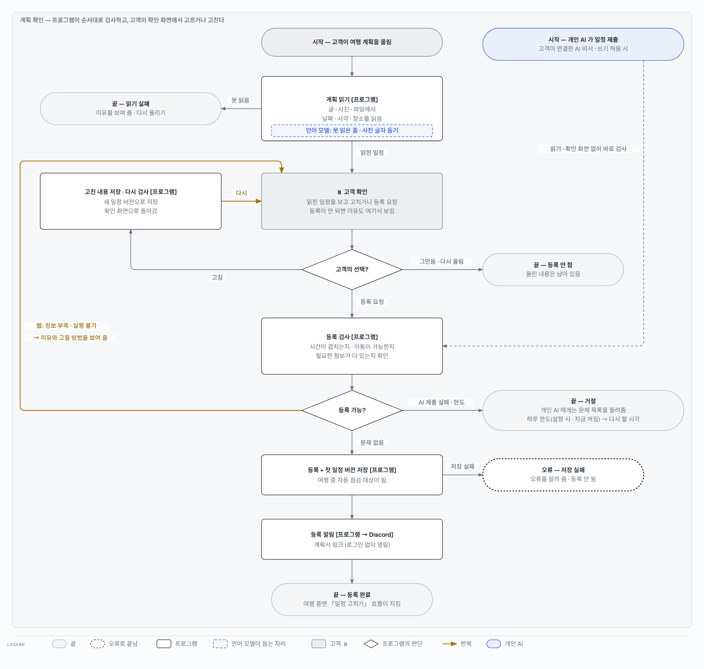
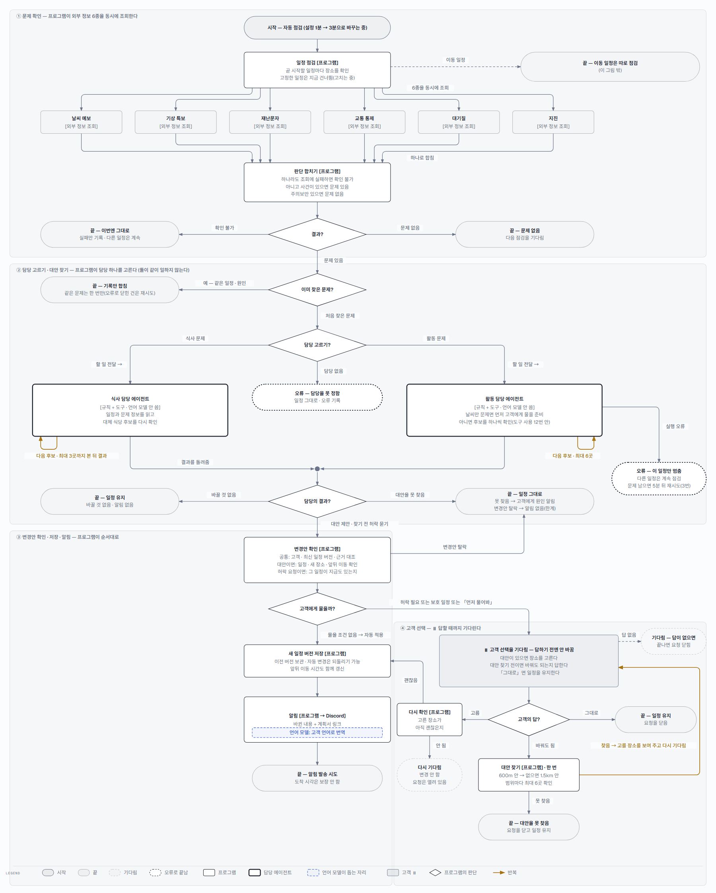

# triPilot 에이전트 흐름 — 계획을 확인받고, 여행 중 문제가 생긴 일정을 고쳐 받기

- triPilot 은 고객의 여행 계획을 검사해 등록하고, 여행 중 식당 · 활동에 문제가 생기면 대안을 찾아 일정을 고칩니다.
- 다음에 무엇을 할지는 언제나 프로그램이 정한 규칙이 정합니다. 언어 모델(LLM)은 계획을 읽을 때와 알림을 번역할 때만 돕습니다.
- 대안을 찾는 일은 식사 담당 · 활동 담당 에이전트 둘이 나눠 맡고, 한 번에 하나만 일합니다.
- 바꾸기 전에 고객에게 물어야 하면 답을 기다리고, 그렇지 않으면 바로 바꾸고 알립니다.
- 아래 두 그림에서 자동으로 되는 일과 고객이 고르는 자리(⏸)를 보시면 됩니다.

## 그림 읽는 법

| 모양 | 뜻 |
|---|---|
| 흰 상자 [프로그램] | 정해진 규칙대로 일하는 코드. 다음 단계도 여기서 정합니다 |
| 굵은 상자 · 담당 에이전트 | 식사 담당 · 활동 담당. 자기 몫의 할 일과 허락된 도구만 받아 대안을 찾습니다(언어 모델은 쓰지 않음) |
| 파란 점선 칸 · 언어 모델 | AI 가 돕는 자리. 정해진 범위 안에서 읽기 · 번역만 하고, 결과는 프로그램이 다시 확인합니다 |
| 회색 상자 ⏸ · 고객 | 고객이 고르거나 고치는 자리. 답할 때까지 기다립니다 |
| 마름모 | 프로그램의 판단. 화살표 옆 글이 그 조건입니다 |
| 노란 화살표 | 되돌아가는 반복. 옆에 몇 번까지인지 적었습니다 |
| 타원 | 끝(가는 선) · 기다림(점선) · 오류로 끝남(굵은 점선) |

## 1. 여행 계획을 확인받는다

고객이 글 · 사진 · 파일로 계획을 올리면 프로그램이 날짜 · 시각 · 장소를 읽습니다. 규칙으로 못 읽은 줄과 사진 글자만 언어 모델이 돕습니다.
고객은 확인 화면에서 읽힌 일정을 고치거나 등록을 요청합니다. 고치면 다시 검사해 확인 화면으로 돌아옵니다.
등록을 요청하면 프로그램이 시간이 겹치는지 · 이동이 가능한지 · 필요한 정보가 다 있는지 검사하고, 통과하면 저장한 뒤 계획서 링크를 알립니다.

**예: 「14:00 경복궁, 14:30 남산타워」처럼 이동이 30분 안에 안 되면 등록되지 않고, 확인 화면에 이유와 고칠 방법이 나옵니다.**

**끝나는 길 · 예외**

- 읽지 못하면 이유를 보여 주고 다시 올리게 합니다.
- 고객이 연결한 개인 AI 가 일정을 내면 읽기 · 확인 화면 없이 바로 검사하고, 실패하면 문제 목록을 그 AI 에게 돌려줍니다.
- 고친 횟수에 상한이 있는지는 확인되지 않았습니다. 다시 올리기 · 등록 요청은 하루 한도를 둘 수 있게 돼 있지만 지금은 꺼져 있습니다.

## 2. 여행 중 문제가 생긴 일정을 고쳐 받는다

프로그램이 자동으로 곧 시작할 일정을 점검합니다. 날씨 · 특보 · 재난문자 · 교통 · 대기질 · 지진 6종을 동시에 조회해 한 판단으로 합칩니다.
문제가 처음 발견되면 프로그램이 문제 종류에 따라 담당 에이전트 하나를 고릅니다. 담당은 후보를 정해진 횟수 안에서 다시 확인해 대안을 냅니다.
프로그램이 대안을 확인한 뒤, 고객 허락이 필요하거나 고객이 「먼저 물어봐」를 골랐으면 답을 기다리고, 아니면 일정을 바로 바꿔 알립니다.

**예: 저녁 식당 근처에 재난문자가 오면 식사 담당이 그 시각에 여는 근처 식당을 최대 3곳 다시 확인해 대안을 냅니다. 고객이 「먼저 물어봐」를 골랐다면 대안을 보여 주고 고르기를 기다리고, 아니면 바로 바꾸고 되돌리기 버튼과 함께 알립니다.**

**끝나는 길 · 예외**

- 외부 정보 조회에 실패하면 이번엔 바꾸지 않습니다. 같은 문제를 이미 찾았으면 다시 처리하지 않습니다.
- 잠긴 예약 · 예약번호가 있는 일정(보호 일정)은 바꾸기 전에 먼저 묻습니다. 고객이 「바꾸지 말 것」으로 고정한 일정은 지금 점검에서 아예 빠집니다 — 고정해도 위험 점검과 알림은 받게 고치는 중입니다(2026-10-03 결정).
- 변경안을 확인할 때 바뀌는 부분만 보고, 전체 일정을 처음부터 다시 검사하지는 않습니다.
- 대안을 못 찾으면 일정을 그대로 두고, 그대로 둔 이유를 고객에게 알립니다. 변경안 확인에서 떨어진 경우는 아직 알리지 않습니다(현재 한계).
- 담당 에이전트가 오류로 멈추면 그 일정의 이번 처리만 멈추고 다른 일정은 계속 점검합니다. 외부 조회 실패나 오류로 멈춘 처리는 5분이 지난 뒤 같은 문제가 다시 보이면 최대 3번 다시 시도합니다(고객에게는 알리지 않음).
- 고객이 답하지 않으면 그 일정이 끝날 때 요청을 닫고 일정은 바꾸지 않습니다.

## 3. 역할 요약 — 누가 무엇을 맡나

| 역할 | 맡은 일 | 언제 일하나 | 받는 것 → 내는 것 | 하지 않는 일 |
|---|---|---|---|---|
| 식사 담당 에이전트 | 문제가 생긴 식사 일정 하나의 대체 식당을 찾는다 | 자동 점검이 식사 문제를 처음 찾았을 때 프로그램이 부른다 | 할 일 · 일정 · 문제 정보 → 대체 식당 1곳 + 다른 안 최대 2곳, 또는 「바꿀 것 없음」 · 「대안 없음」 | 일정을 직접 바꾸지 않는다 · 고객에게 직접 알리지 않는다 · 언어 모델을 쓰지 않는다 |
| 활동 담당 에이전트 | 문제가 생긴 활동 일정 하나의 대체 활동을 찾거나, 먼저 고객에게 물을지 정한다 | 자동 점검이 활동 문제를 처음 찾았을 때 프로그램이 부른다 | 할 일 · 일정 · 문제 정보 · 고객 설문 → 대체 활동 제안(후보 최대 6곳 확인), 또는 「바꿔도 될까요?」 질문, 또는 「바꿀 것 없음」 · 「대안 없음」 중 하나 | 일정을 직접 바꾸지 않는다 · 고객에게 직접 알리지 않는다 · 언어 모델을 쓰지 않는다 |
| 계획 읽기 도우미 (언어 모델) | 규칙으로 못 읽은 계획 줄을 짚고, 사진 · 스캔의 글자를 옮겨 적는다 | 고객이 올린 계획에 규칙이 못 읽은 부분이 있을 때 | 원문 줄 · 이미지 → 원문에 실제로 있는 조각 · 옮겨 적은 글 | 원문에 없는 값을 만들지 않는다 · 등록 여부를 정하지 않는다 |
| 알림 번역 도우미 (언어 모델) | 한국어 알림을 고객 언어로 옮긴다 | 외국어 고객에게 알림을 보낼 때 | 한국어 문구 → 번역 문구(실패하면 한국어 원문 그대로) | 시각 · 금액 · 장소 이름 · 예약번호를 바꾸지 않는다 · 보낼지 말지 정하지 않는다 |

## 4. 고객에게 미치는 현재 한계

- 변경안 확인에서 떨어지면 일정은 그대로인데, 고객은 그 사실을 알림으로 받지 못합니다.
- 고객이 「바꾸지 말 것」으로 고정한 일정은 지금 점검에서 아예 빠집니다. 고정해도 위험 점검과 알림은 받게 고치는 중입니다(2026-10-03 결정). 일정별 · 여행 전체 알림 끄기는 나중에 볼 할 일로 남겼습니다.
- 자동 점검이 지금 1분마다로 설정돼 있습니다(외부 정보 하루 한도를 넘길 위험). 팀이 정한 3분으로 맞추는 중입니다(2026-10-03 결정).

고친 것: 대안을 못 찾았을 때 고객에게 원인 알림 · 답 없는 요청을 일정이 끝나면 닫음 · 도구 사용 한도 때문에 점검 전체가 멈추던 문제(2026-10-03, 제품 담당 세션이 이 컴퓨터에서 고쳤고 공유 저장소에는 아직 안 올림). 위 세 줄은 아직 남은 한계입니다. 상세는 부록 C.

---

## 부록 A. 상세 명세 카드

### 요식 워커 에이전트 (AG-DINING)

| 항목 | 내용 |
|---|---|
| 책임 (한 문장) | 깨진 식사 항목 하나를 다시 점검하고, 그 시각에 여는 근처 대체 식당을 골라 변경안을 낸다 |
| 하지 않는 일 | 일정에 직접 쓰기 · 고객에게 직접 알리기 · 다른 워커 부르기 · LLM 호출 · 업체 예약 변경 |
| 호출 주체 / 트리거 | 처리 총괄(코드) — 감시가 새로 연 식사 문제 건(문제코드 dining_*) · ⑥-a 단계 |
| 입력 | TeamTask — 처리 건 · 실행 식별자 · 할 일 종류(dining.itinerary) · 처리 건 버전 · 입력 문장 · 근거 묶음(현재 상태 · 트리거: 항목 · 시각 · 원인 범주) · 허용 도구 · 마감 시각 |
| 출력 (스키마) | TeamResult · ActionProposal(Pydantic 계약) — 다음 행동(답 / 중단) · 답 문장 · 결정 · 근거 · 변경 제안 itinerary.apply {trip_id, base_version, reason, causes, notice, summary, replacements[{item_id, item}]} (승인 불요 · 위험 낮음) |
| 모델 / 설정 | 없음 — 규칙 코드(LLM 안 씀) |
| 도구 / 권한 | 읽기만 11개: read.itinerary · read.disruptions · read.place_catalog · read.dining_alternatives · read.dining_state · read.place · read.policy · read.booking · read.booking_terms · read.itinerary_version · read.customer_report |
| 보는 컨텍스트 | 할 일 묶음 + 도구 결과. 다른 워커의 출력은 보지 않는다 |
| 상태 / 메모리 | 실행 사이 메모리 없음. 실행 중에는 부른 도구 목록 · 횟수 · 근거를 들고 있다. 결과 기록은 처리 총괄이 한다 |
| 종료 조건 | 정상: 결과 1건(그대로 / 변경안 / 중단). 예외가 나면 처리 총괄이 실행 실패로 닫는다 |
| 실패 처리 | 원래 항목 재점검 실패(없음 · fatal) → 중단 · 후보 표 조회 실패 → 장소 목록으로 · 외부 재점검 3곳을 쓰면 나머지 후보는 「안 봄」으로 제외 → 통과 후보가 있으면 변경안, 없으면 중단 · 마감(90초 설정)을 넘기면 처리 총괄이 중단 — 동기 도구 호출의 실제 종료 시간은 보장 안 함 |
| 가드레일 | 허용 목록 밖 거부 · 같은 도구 + 같은 인자 다시 부르면 거부 · 한 실행 도구 12번 · 모르면 모른다(지어내지 않음) · 제안까지만(실행 안 함) |
| 관측 / 평가 | 실행 기록 · 근거 · 실패 코드를 남긴다. 평가 지표 · 기준 [미확보 — 정할 것] |
| 지연 · 비용 예산 | 마감 90초(설정값 · 실제 종료 보장 아님) · 외부 재점검 최대 3곳 · 외부 API 는 무료 한도. 정량 비용 예산 [미확보] |
| 코드 위치 | dining/team.py:61–131 · itinerary_changes.py:547–565, 725–781 · replan.py:383–409 · itinerary_team.py:254–280 · contracts.py:165–242 |

### 액티비티 워커 에이전트 (AG-ACTIVITY)

| 항목 | 내용 |
|---|---|
| 책임 (한 문장) | 깨진 활동 항목 하나를 다시 점검하고, 먼저 물을 조건이면 「바꿀까요?」를, 아니면 조건을 통과한 대체 활동을 골라 변경안을 낸다 |
| 하지 않는 일 | 일정에 직접 쓰기 · 고객에게 직접 알리기 · 다른 워커 부르기 · LLM 호출 · 업체 예약 변경 |
| 호출 주체 / 트리거 | 처리 총괄(코드) — 감시가 새로 연 활동 문제 건(문제코드 activity_*) · ⑥-b 단계 |
| 입력 | TeamTask(할 일 종류 activity.itinerary) — 설문(자동 교체 선택 여부 · 선호)은 별도 인자가 아니라 읽어 온 여행 정보에서 쓴다 |
| 출력 (스키마) | TeamResult · ActionProposal — 변경 제안 itinerary.apply(요식과 같은 인자) / 동의 요청 itinerary.apply {trip_id, base_version, consent{item_id, indoor_unknown}, causes} (대체안 없음) / 그대로 / 중단 |
| 모델 / 설정 | 없음 — 규칙 코드(LLM 안 씀) |
| 도구 / 권한 | 읽기만 9개: read.itinerary · read.disruptions · read.place_catalog · read.place · read.policy · read.booking · read.booking_terms · read.itinerary_version · read.customer_report |
| 보는 컨텍스트 | 할 일 묶음 + 도구 결과 + 여행 설문. 다른 워커의 출력은 보지 않는다 |
| 상태 / 메모리 | 실행 사이 메모리 없음. 실행 중에는 부른 도구 목록 · 횟수를 들고 있다 |
| 종료 조건 | 정상: 결과 1건. 후보는 위 6곳까지 · 도구 한도에 걸린 후보는 「못 봤다」(not_checked)로 빼고 고르지 않는다 — 앞 후보가 통과했으면 그 안으로 변경안을 낸다 (2026-10-03 수정, 82aff095) |
| 실패 처리 | 원래 항목 재점검 실패 → 중단 · 못 찾고 날씨류만 → 「바꿀까요?」 · 그 밖 못 찾음 → 중단 · 도구 한도 → 그 후보만 못 봄(위) · 그 밖 예외 → 그 건만 오류로 닫고 5분 뒤 같은 사건이 남아 있으면 재시도(최대 3번) · 마감 넘기면 처리 총괄이 중단 |
| 가드레일 | 먼저 물을 조건: 안전 사건 없이 예보 · 특보 · 대기질만 + (실내 모름 또는 자동 교체 직접 선택 안 함) · 도구 규칙은 요식과 같다 |
| 관측 / 평가 | 실행 기록 · 근거 · 실패 코드. 평가 지표 · 기준 [미확보 — 정할 것] |
| 지연 · 비용 예산 | 마감 90초(설정값) · 도구 합계 12번(일정 읽기 · 원래 항목 점검 · 목록 읽기 포함). 정량 비용 예산 [미확보] |
| 코드 위치 | activity/team.py:55–150 · pending.py:90–118 · read_tools.py:535–562 · itinerary_changes.py:399–408 · controller.py:181–198, 299–308 |

### 계획 읽기 보조 [LLM]

| 항목 | 내용 |
|---|---|
| 책임 (한 문장) | 규칙이 못 읽은 원문 줄에서 장소 · 시각 조각을 가리키고, 사진 · 스캔의 글자를 옮겨 적는다 |
| 하지 않는 일 | 일정 판정 · 값 만들기(원문에 없는 인용) · 등록 결정 |
| 호출 주체 / 트리거 | 계획 읽기 파이프라인(코드) — UC-1 ① 단계, 규칙이 남긴 줄이 있거나 사진 · 스캔일 때 |
| 입력 | 남은 줄 번호와 원문 / 이미지와 받아쓰기 지시 |
| 출력 (스키마) | 조각 지정: {spans:[{line, quote, role}]} — 서버가 줄 · 역할 허용 목록과 원문 부분 문자열 일치를 검사 / 받아쓰기: 원문 줄을 옮긴 문자열 |
| 모델 / 설정 | 로컬 Ollama(설정값 ollama_model · 기본 gemma4:12b) · 온도 0 · think 끔 · 비전 호출 시간 제한 240초 — 모델은 비교 시험 중 |
| 도구 / 권한 | 없음 — 입력만 읽는다 |
| 보는 컨텍스트 | 그 접수의 원문 · 이미지 |
| 상태 / 메모리 | 상태 없음 |
| 종료 조건 | 조각 목록 또는 받아쓰기 1건 반환 |
| 실패 처리 | 모델 실패 → 그 보조만 건너뛰고 오류 기록 · 파일 형식 · 받아쓰기 실패 → 읽기 fatal(이유 표시 · 다시 올리기) |
| 가드레일 | 목록 안의 줄 · 역할만 · 원문에 실제로 있는 문자열만 받는다 |
| 관측 / 평가 | 읽기 결과 · 실패 이유 기록. 평가 지표 [미확보 — 정할 것] |
| 지연 · 비용 예산 | 비전 호출 240초 · 비용 예산 [미확보] |
| 코드 위치 | intake/llm_spans.py:19–99 · intake/pipeline.py:154–160, 615–623 · intake/sources.py:9–30 · ollama_chat.py:122–143 |

### 알림 번역 [LLM]

| 항목 | 내용 |
|---|---|
| 책임 (한 문장) | 한국어 알림 문구를 고객 언어로 옮긴다(한국어 고객이면 안 부름) |
| 하지 않는 일 | 시각 · 금액 · 고유명사 · 예약번호 · 버전 번호 만들기, 보낼지 말지 정하기 |
| 호출 주체 / 트리거 | 알림 배달 작업(코드) — ⑩ 단계. 문구틀 · 언어가 캐시에 있으면 호출 안 함 |
| 입력 | 문구틀(값을 나중에 채우는 자리표시 {name} 포함) 또는 캐시에 없는 문구 + 여행 언어 태그(예: zh-TW) |
| 출력 (스키마) | 번역 문자열 → 자리표시 검사 뒤 값을 채워 발송 |
| 모델 / 설정 | 로컬 Ollama(주소 설정 시) · 기본 gemma4:12b · 온도 0 · think 끔 · 기본 HTTP 시간 제한 60초 · 출력 토큰 상한은 코드에 명시 안 됨 — 모델은 비교 시험 중 |
| 도구 / 권한 | 없음 — 입력만 읽는다 |
| 보는 컨텍스트 | 그 알림 문구 하나 |
| 상태 / 메모리 | LLM 호출은 상태 없음. 번역 단계는 문구틀 · 언어 캐시를 재사용한다 |
| 종료 조건 | 번역 1건 반환 또는 실패 시 한국어 원문 |
| 실패 처리 | 모델 오류 · 빈 응답 · 숫자 검사 실패 · 자리표시 개수 불일치 → 실패 집계 + 「[번역 실패 — 한국어 원문]」으로 발송(안 보내는 것보다 낫다) |
| 가드레일 | 숫자는 원문과 번역의 숫자 문자열을 개수까지 맞춰 본다 — 원문 숫자가 빠지거나 새 숫자값이 생기면 실패(같은 숫자가 더 나오는 것은 허용) (2026-10-03 수정, 82aff095) · 자리표시는 이름별 개수 검사 |
| 관측 / 평가 | 실패 카운터 · 로그 · 캐시 적중/빗나감/거절 기록이 있다. 품질 평가 지표 [미확보] |
| 지연 · 비용 예산 | HTTP 60초 · 비용 · p95 목표 [미확보] |
| 코드 위치 | notify/translate.py:33–45 · notify/phrase.py:57–130 · notify/discord.py:145–160 · scripts/run_outbox_worker.py:33–46 |

## 부록 B. 멘토링 문서 규칙 → 이 그림에서

| 규칙 | 이 그림에서 |
|---|---|
| 시작과 끝 | 정상 완료 · 등록 안 함 · 처리 중단의 끝을 표시한다. 이동은 범위 밖 출구, 무응답은 「기다림」(점선) — 그 일정이 끝나면 요청을 닫는다 |
| 노드 종류 — LLM / 결정적 코드 / 사람 / 분기 | [코드] · [코드 → 외부 API] · [LLM] · [규칙 + 도구] · ⏸ 사람 · 마름모(코드 판단) |
| 분기 조건은 조건식 이름표로 | 문제코드 = dining_* · 같은 지문 = 기존 건 · 동의 요청 ∨ 보호 ∨ 먼저 물어봐 · 실행 오류 등 |
| 병렬 구간 fan-out / fan-in | 장소 있는 항목의 외부 6범주를 동시에 점검 → 합치기(실패 범주 있음 → 확인 불가, 아니면 사건 있음 → 깨짐, 주의보만 · 해당 없음 · 미연결 → 문제 없음). 워커 둘은 병렬이 아니라 둘 중 하나 |
| 루프의 종료 조건 · 최대 횟수 · 상한 도달 경로 | 요식: 외부 재점검 최대 3곳 → 통과 후보 있으면 변경안 · 없으면 중단 / 액티비티: 위 6곳 · 도구 합계 12번 → 한도에 걸린 후보는 「못 봤다」로 빼고 결과 / 동의 후 후보 계산: 한 번 · 거리마다 최대 6곳 → 후보 있으면 같은 요청에 선택지 저장 후 안 선택 대기 · 없으면 요청 닫음 / UC-1 수정: 횟수 상한을 코드에서 찾지 못함 |
| 사람 개입(⏸)과 선택지 | UC-1 확인 화면(수정 · 등록 요청 · 떠남/다시 올리기) · UC-2 고객 선택(안 번호 · 바꿔 줘[동의 요청만] · 그대로, 무응답은 일정이 끝나면 닫힘) |
| 누가 다음 단계를 정하나 — 코드인가 LLM 인가 | 모든 마름모는 코드. LLM 은 정해진 자리에서 읽기 보조 · 번역만 한다 |
| 구간마다 패턴 이름 | 병렬 점검(fan-out / fan-in, P3) · 라우팅(코드, P2) · 순차 + 코드 게이트(P1) · 사람 개입(HITL). 중앙 LLM 위임(P4) · LLM 평가 반복(P8)은 없다 |
| 랭그래프면 노드 · 엣지가 코드와 1:1 | 해당 없음 — 코드가 랭그래프를 쓰지 않는다(아래 「랭그래프 확인」). 대신 명세 카드마다 「코드 위치」 줄을 붙였다 |

## 부록 C. 결함 — 고친 것 · 남은 것 · 정할 것

- [고침 · 82aff095] 활동 담당이 도구 한도에 걸리면 예외로 실행이 실패하던 것 → 후보를 위 6곳까지만 보고, 한도에 걸린 후보는 「못 봤다」로 뺀다(activity/team.py · itinerary_team.py safe_recheck).
- [고침 · 06c3cb16] 감시 회차 안에서 한 건이 예외로 터지면 남은 건까지 끊기던 것 → 그 건만 오류로 닫고 나머지는 계속, 외부 조회 실패 · 오류로 닫힌 건은 5분이 지난 뒤 같은 사건이 다시 감지되는 회차에 재시도 3번(처음 포함 4번)(trip_watch_cases.py · guardrails.yaml retry_max · retry_cooldown_seconds).
- [고침 · 06c3cb16] 답 없는 선택 요청이 끝난 일정에서도 열린 채 남던 것 → 기본 감시가 만료 처리를 부르고, 고르기 요청 때도 끝난 · 낡은 요청은 닫는다(pending.py expire · choose).
- [고침 · 06c3cb16] 대안을 못 찾아도 고객에게 안 알리던 것 → 「일정은 그대로 + 원인」 알림을 보낸다(안전 사건이면 안전 안내, 같은 사건에 한 번).
- [고침 · 82aff095] 번역 숫자 검사가 빠진 숫자 개수 · 새 숫자를 못 잡던 것 → 개수까지 맞춰 본다(같은 숫자가 더 나오는 것은 허용)(notify/translate.py).
- [의도대로 · 그대로 둠] 고른 안의 확인이 실패해도 요청은 열린 채 남는다 — 다른 안을 고를 수 있게 하려는 것. 끝난 · 낡은 요청만 닫는다.
- [남음] 변경안 확인에서 떨어진 건은 고객에게 알리지 않는다(처리 총괄 _reject_unverified — 닫힘 사유가 다시 열기 · 고객 알림 대상이 아니다).
- [넘김 · 화면 담당] UC-1 진행 표시는 서버가 실시간 전송(SSE)을 주지만 웹 확인 화면은 아직 1.5초마다 조회한다(intake-review.tsx:77–110).
- [정함 2026-10-03 · 고치는 중] 점검 주기는 팀이 정한 3분으로 맞춘다 · 고객이 고정한 일정도 위험 점검과 알림은 받는다(고정 = 자동으로 안 바꿈). 일정별 · 여행 전체 알림 끄기는 나중 할 일(wiki architecture/notifications.md).
- [팀이 정할 것] ① 한 일정에 문제가 여럿일 때 묶어 처리 · 전체 일정 재검사 여부 ② 등록된 팀 목록 정리 ③ 랭그래프를 쓸지.
- ★고친 다섯 건은 제품 저장소의 로컬 커밋이다(2026-10-03) — 아직 원격에 올리지 않았다.

## 부록 D. 랭그래프 확인

| 질문 | 답 |
|---|---|
| 계획에 있었나 | 있었다. 구현계획서 v9(쇼핑몰 CS 시절)에 11번 — 「Top-Level LangGraph 가 Coordination 계층에 있고 팀마다 Subgraph 를 가질 수 있다」(v9:292, 417, 451), MVP 기술 스택(v9:1054), 8월 실행계획서 v1 의 완료 기준 · 산출물(「LangGraph checkpoint 와 업무 상태 분리」, 「LangGraph 그래프」 — :48, :161). |
| 지금 계획에는 | 없다. 여행으로 바꾼 v10 · 지금 기준선 v11 에 LangGraph 0번(파일 전체 문자열 개수 검색). |
| 코드에 들어온 적이 있나 | 확인한 범위에서는 없다. 현재 workspace 저장소의 접근 가능한 전체 ref 이력에서 「from langgraph」「import langgraph」 -S 검색 결과 0건, 파이썬 파일 -G 검색도 0건. 지금 파일 기준으로도 cs · sample(안의 composer 포함) 파이썬 파일에 import 0. 최초 확인 가능한 커밋 00622110 의 requirements.txt 에도 langgraph==1.2.8 이 있었다(설치 목록에만 있음). |
| 그럼 흐름은 무엇이 정하나 | 직접 짠 처리 총괄(app/application/controller.py:235–354)과 처리 건 상태 전이(transition_case). DoD-04 는 이름만 「LangGraph checkpoint」이고 자체 CaseService.checkpoint 와 실행 판 번호(graph_revision)로 2026-08-14 통과 판정을 받았다(실제 되돌리기 · 동시 실행 검증은 한계로 기록). |
| 왜 안 들어갔나 | 확인하지 못했다. 루트 · 제품 wiki/decisions 전체에서 LangGraph 를 쓰지 않기로 한 결정이나 이유를 찾지 못했다(D-003 에는 구현 사실 정정만). 2026-09-10 에 「import 0곳」을 발견하고 문서 문장을 정정했을 뿐, 뺀 것인지 빠진 것인지는 정하지 않았다(루트 CLAUDE.md 사실표). 자체 Controller 가 상태 전이 · 동시성 · 멱등 · 알림 적재를 하는 것은 확인했지만, 그것이 미도입의 이유였는지는 기록이 없다. |
