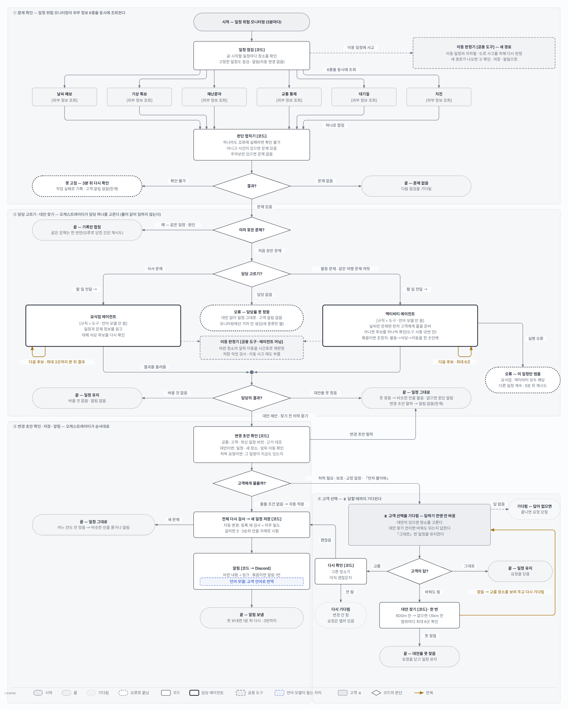
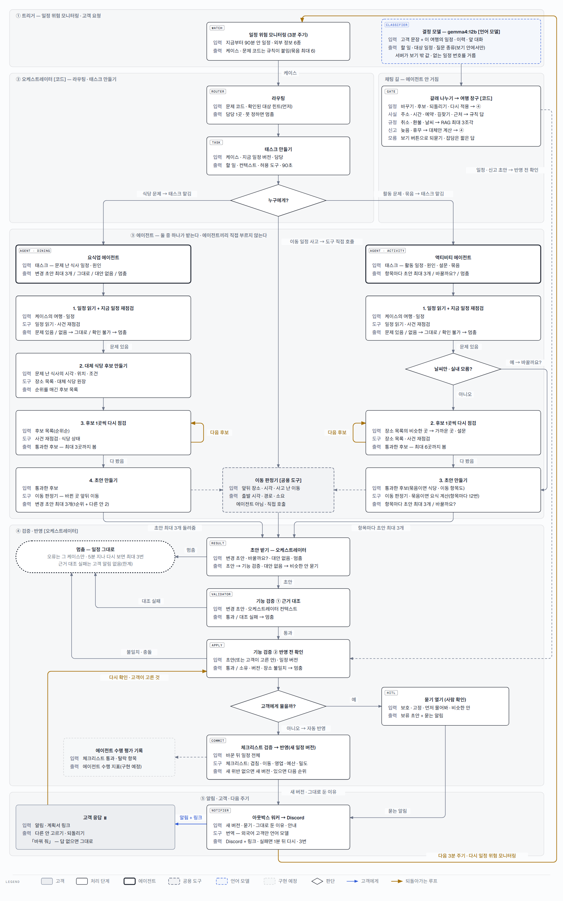
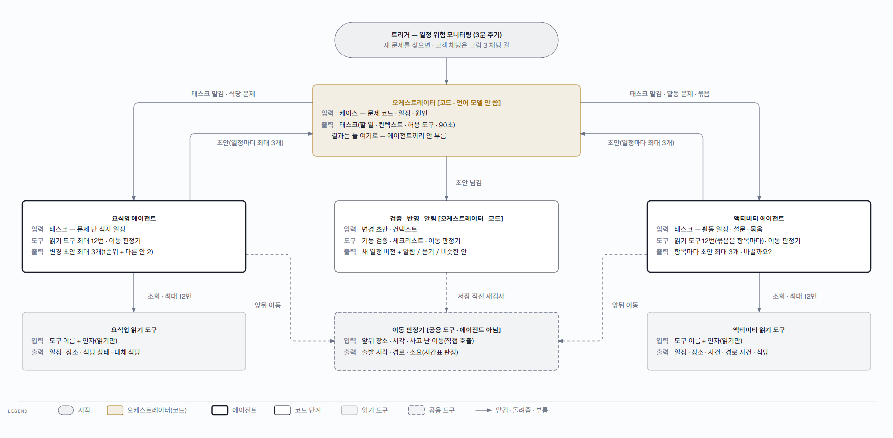

# guguroute 에이전트 흐름 — 계획을 확인받고, 여행 중 문제가 생긴 일정을 고쳐 받기

- guguroute 은 고객의 여행 계획을 검사해 등록하고, 여행 중 식당 · 활동에 문제가 생기면 대안을 찾아 일정을 고칩니다.
- 다음에 무엇을 할지는 언제나 오케스트레이터(코드)가 정한 규칙이 정합니다. 언어 모델(LLM)은 정해진 보기 안에서만 고릅니다 — 계획 읽기(못 읽은 줄 짚기) · 고객 채팅(할 일 고르기) · 일정 짜기(순서 고르기) · 알림 번역.
- 대안을 찾는 일은 요식업 · 액티비티 에이전트 둘이 나눠 맡고, 한 번에 하나만 일합니다.
- 바꾸기 전에 고객에게 물어야 하면 답을 기다리고, 그렇지 않으면 바로 바꾸고 알립니다.
- 그림 1 · 2 는 처리 순서를, 그림 3 은 오케스트레이터와 에이전트가 일을 주고받는 흐름을, 그림 4 는 그 구성을 한눈에 보여 줍니다.

## 그림 읽는 법

| 모양 | 뜻 |
|---|---|
| 일정 위험 모니터링 | 외부 정보 6종(날씨 예보 · 기상 특보 · 재난문자 · 교통 통제 · 대기질 · 지진)으로 곧 시작할 일정에 위험이 생겼는지 3분마다 보는 일. 본문에서는 줄여 「모니터링」 |
| 흰 상자 [코드] | 정해진 규칙대로 일하는 코드(오케스트레이터와 그 단계). 다음 단계도 여기서 정합니다 |
| 굵은 상자 · 담당 에이전트 | 요식업 에이전트 · 액티비티 에이전트. 자기 몫의 태스크(할 일)와 허락된 도구만 받아 대안을 찾습니다(언어 모델은 쓰지 않음) |
| 파란 점선 칸 · 언어 모델 | AI 가 돕는 자리. 정해진 보기 안에서 고르기만 하고, 결과는 코드가 다시 확인합니다 |
| 회색 상자 ⏸ · 고객 | 고객이 고르거나 고치는 자리. 답할 때까지 기다립니다 |
| 긴 점선 상자 · 공용 도구 | 이동 판정기. 에이전트가 아니라 에이전트와 오케스트레이터가 불러 쓰는 함수입니다 — 바뀐 장소의 앞뒤 이동을 시간표로 다시 판정합니다 |
| 마름모 | 코드의 판단. 화살표 옆 글이 그 조건입니다 |
| 노란 화살표 | 되돌아가는 반복. 옆에 몇 번까지인지 적었습니다 |
| 타원 | 끝(가는 선) · 기다림(점선) · 오류로 끝남(굵은 점선) |

## 1. 여행 계획을 확인받는다

고객이 글 · 사진 · 파일로 계획을 올리면 코드가 날짜 · 시각 · 장소를 읽습니다. 규칙으로 못 읽은 줄과 사진 글자만 언어 모델이 돕습니다.
고객은 확인 화면에서 읽힌 일정을 고치거나 등록을 요청합니다. 고치면 다시 검사해 확인 화면으로 돌아옵니다.
등록을 요청하면 코드가 시간이 겹치는지 · 이동이 가능한지 · 필요한 정보가 다 있는지 검사하고, 통과하면 저장한 뒤 계획서 링크를 알립니다.

**예: 「14:00 경복궁, 14:30 남산타워」처럼 이동이 30분 안에 안 되면 등록되지 않고, 확인 화면에 이유와 고칠 방법이 나옵니다.**

**끝나는 길 · 예외**

- 읽지 못하면 이유를 보여 주고 다시 올리게 합니다.
- 고객이 연결한 개인 AI 가 일정을 내면 읽기 · 확인 화면 없이 바로 검사하고, 실패하면 문제 목록을 그 AI 에게 돌려줍니다.
- 고친 횟수에 상한이 있는지는 확인되지 않았습니다. 다시 올리기 · 등록 요청은 하루 한도를 둘 수 있게 돼 있지만 지금은 꺼져 있습니다.

## 2. 여행 중 문제가 생긴 일정을 고쳐 받는다

일정 위험 모니터링이 3분마다(30초 오차 허용) 지금부터 90분 안에 시작할 일정을 점검합니다. 날씨 · 특보 · 재난문자 · 교통 · 대기질 · 지진 6종을 동시에 조회해 한 판단으로 합칩니다.
문제가 처음 발견되면 오케스트레이터가 문제 종류(확인된 대상 힌트가 있으면 그것 먼저)에 따라 담당 에이전트 하나를 고릅니다. 같은 모니터링 회차에 한 여행의 새 문제가 둘 이상이면 최대 6개씩 묶어(남은 1개는 따로 단일 케이스로) 액티비티 에이전트에게 맡기고, 액티비티 에이전트가 조정자가 되어 활동 → 식당 → 이동 순으로 한 초안 위에서 고칩니다(이때 요식업 에이전트는 따로 부르지 않고 식당 계산만 빌려 씁니다).
오케스트레이터가 대안을 확인한 뒤, 고객 허락이 필요하거나 고객이 「먼저 물어봐」를 골랐으면 답을 기다리고, 아니면 일정을 바로 바꿔 알립니다.

**예: 저녁 식당 근처에 재난문자가 오면 요식업 에이전트가 그 시각에 여는 근처 식당을 최대 3곳 다시 확인해 대안을 냅니다. 고객이 「먼저 물어봐」를 골랐다면 대안을 보여 주고 고르기를 기다리고, 아니면 바로 바꾸고 되돌리기 버튼과 함께 알립니다.**

**끝나는 길 · 예외**

- 외부 정보가 대체 소스까지 조회에 실패하면(확인 불가) 그 일정은 이번 모니터링 회차에서 고치지 못합니다. 모니터링 작업을 「실패」로 기록하고 3분 뒤 회차에서 다시 확인합니다. 고객과 운영자에게 따로 알리지는 않습니다(현재 한계 — 아래 4절). 같은 문제를 이미 찾았으면 다시 처리하지 않습니다.
- 잠긴 예약 · 예약번호가 있는 일정(보호 일정)은 바꾸기 전에 먼저 묻습니다. 고객이 「바꾸지 말 것」으로 고정한 일정도 점검합니다 — 일정은 바꾸지 않고, 대안이 있으면 보여 주며 위험을 알립니다.
- 자동으로 바꾸기 전에 등록 때와 같은 검사(체크리스트)로 일정 전체를 다시 봅니다 — 바꾼 탓에 새로 생긴 문제만 막습니다. 1순위 안이 걸리면(시간 겹침 · 이동 불가 · 영업시간 밖 등) 담당이 뽑아 둔 2 · 3순위 안을 차례로 시험해 되는 첫 안을 적용하고, 알림에 몇 순위 안인지 적습니다. 다 안 맞을 때만 그대로 두고 알립니다.
- 하루 밀도(얼마나 빽빽한지)도 봅니다. 바꾼 탓에 그날이 목표보다 빽빽해지면 그 안은 뒤로 밀리고, 더 나은 안이 없을 때만 그 안을 쓰고 알림에 적습니다.
- 묶음일 때 일정마다 결과가 갈립니다 — 고친 것은 새 일정 하나와 알림 하나로 내고, 못 고친 일정은 같은 알림에 한 줄로 적고, 물어야 하는 일정(보호 · 고정 · 「먼저 물어봐」)은 따로 묻습니다. 하나를 못 풀어도 나머지는 진행합니다.
- 대안을 못 찾거나 찾은 안이 모두 체크리스트 검증에 걸리면 일정은 그대로 두고, 조건을 조금 푼 비슷한 안(시각 늦추기 · 다음 일정 근처 · 반경 넓히기)을 찾아 「고르시면 바꿀게요」로 묻습니다. 묻는 안은 고르면 그대로 적용될 안만(같은 원인 재점검 · 체크리스트 검증 · 밀도 통과, 날씨 원인이면 실내만) 싣고, 한 곳도 없을 때만 그대로 둔 이유만 알립니다. 예: 「경복궁 한복 탐방 — 도로가 통제돼요 … 일정은 그대로 두었어요. 조건을 조금 풀면 1) 16:00으로 늦추면 창덕궁 … 고르시면 바꿀게요」. 변경 초안 확인(근거 대조)에서 떨어진 경우는 아직 알리지 않습니다(현재 한계).
- 요식업 · 액티비티 어느 에이전트든 오류로 멈추면 그 일정의 이번 케이스만 멈추고 다른 일정은 계속 점검합니다. 외부 조회 실패나 오류로 멈춘 케이스는 5분이 지난 뒤 같은 문제가 다시 보이면 최대 3번 다시 시도합니다(고객에게는 알리지 않음).
- 알림은 보내지 못하면 1분 뒤 다시 보내 3번까지 시도합니다. 디스코드가 기다리라고 하면 그 간격을 따르고, 응답 시간 초과 · 연결 오류는 갔는지 모르므로 다시 보내지 않고 결과를 「모름」으로 남깁니다.
- 고객이 답하지 않으면 그 일정이 끝날 때 요청을 닫고 일정은 바꾸지 않습니다.

## 3. 멀티 에이전트 흐름 — 오케스트레이터가 맡기고 돌려받는 길

그림 3 은 케이스 하나가 오케스트레이터 → 에이전트 → 검증 · 반영 → 알림을 지나는 길을 보여 줍니다. 에이전트마다 안에서 무엇을 어떤 도구로 하는지, 결과가 어디로 돌아오는지가 보입니다.
오케스트레이터는 코드입니다. 문제 종류를 보고 요식업 에이전트나 액티비티 에이전트 하나에 일을 맡기고, 결과는 늘 오케스트레이터로 돌아옵니다. 두 에이전트는 서로 부르지 않습니다.
같은 여행에 문제가 여럿이면 액티비티 에이전트 하나가 조정자로 맡고, 식당 계산은 요식업 에이전트를 부르지 않고 그 계산만 빌려 씁니다.
이동 판정기는 에이전트가 아니라 두 에이전트와 검증 단계가 함께 쓰는 공용 도구입니다.

그림 4 는 같은 내용을 줄여 보여 줍니다. 누가 누구에게 맡기고 누가 어떤 도구를 쓰는지만 남겼습니다.

**앞단 나누기 · 검증 · 초안**

- 앞단에서 일을 가르는 자리는 둘입니다. 일정 위험 모니터링은 규칙이 문제 코드를 붙여 오케스트레이터가 에이전트에게 맡깁니다. 고객 채팅은 결정 모델(언어 모델)이 고른 할 일을 서버가 일정 계산 · 규칙 답 · RAG · 대체안 · 되묻기로 나눕니다. 채팅에서 에이전트로 가는 갈래와 학습 분류 모델로 가는 갈래는 아직 없습니다.
- 검증은 두 가지입니다. 기능 검증(근거 대조 · 반영 전 확인)은 시스템이 맞게 도는지 보고 반영을 막는 관문입니다. 체크리스트(겹침 · 이동 · 영업시간 · 예산 · 밀도)는 에이전트가 낸 초안이 규칙을 지키는지 봅니다 — 지금은 반영 관문으로도 쓰고, 멘토링 결정대로 에이전트 수행 평가 지표로 쌓는 기능은 아직 없습니다(구현 예정).
- 「초안 최대 3개」는 일정 하나마다의 숫자입니다(1순위 + 다른 안 2). 묶음 케이스는 항목마다 초안을 만들고 저장 · 알림은 한 번입니다.

**읽는 법 · 패턴**

- 라우팅 — 코드가 문제 종류로 담당 하나를 고른다(멘토링 자료의 「라우팅」 패턴)
- 결과가 늘 오케스트레이터로 돌아온다 — 「오케스트레이터-워커」와 닮았지만 오케스트레이터가 언어 모델이 아니라 코드다
- 사람 확인 — 물어야 하는 변경(보호 · 고정 일정 · 「먼저 물어봐」)은 고객이 고를 때까지 바꾸지 않는다
- 에이전트마다 내부 순서(도구를 몇 번 · 언제 멈추나)는 부록 A 의 명세 카드에 적었다

### 길마다 누가 일을 가르나 — 분류 · 규칙 · RAG · 학습 모델

| 길 | 누가 일을 가르나 | 언어 모델이 하는 일 | 규칙 · RAG · 학습 분류 모델 | 검증 |
|---|---|---|---|---|
| 일정 위험 모니터링(3분 주기 · 30초 오차 허용) | 규칙이 문제 코드를 붙이고, 오케스트레이터가 담당 에이전트 하나에 맡긴다 | 안 쓴다 | 규칙 · 읽기 도구 · 이동 판정기 | 기능 검증(근거 대조 · 반영 전 확인) + 체크리스트 |
| 고객 채팅 | 결정 모델(gemma4:12b) 한 번이 할 일 · 대상 · 질문 종류를 고르고, 서버가 다섯 갈래로 나눈다 | 보기 고르기만 — 답 문장은 서버가 만든다 | 사실 질문 · 길찾기는 규칙, 규정 질문은 RAG(문턱을 넘는 최대 3조각), 바꾸기 · 되돌리기 · 신고는 일정 계산 함수 — 에이전트로 가는 갈래는 아직 없다 | 일정을 바꾸는 갈래는 같은 기능 검증 + 체크리스트 |
| 계획 확인(올린 계획 읽기) | 규칙이 먼저 읽는다 | 규칙이 못 읽은 줄의 위치만 짚고, 사진 글자를 받아쓴다 | 장소는 별칭 치환 → 정확 일치 → 오타 교정 → 요식 원장 · 외부 검색 순 | 등록 체크리스트(겹침 · 이동 · 영업시간 …) |
| 일정 짜기 | 분류 갈래 없음 — 규칙이 후보 순위를 매긴다 | 후보 목록의 순서만 고른다 — 시각 · 장소 · 가격은 서버가 채운다 | RAG 로 운영 규정을 바탕 자료로 붙인다(후보를 거르지는 않음) | 체크리스트를 통과해야 돌려준다 · 못 고치면 이유와 함께 거절 |

언어 모델을 쓰는 세 길(채팅 · 계획 확인 · 일정 짜기)에 같은 원칙이 걸려 있습니다 — 언어 모델은 정해진 보기 안에서만 고르고, 값은 서버가 채우고 검사합니다. 다섯 갈래 나누기(결정 모델 → 일정 계산 · 규칙 답 · RAG · 대체안 · 되묻기)는 채팅에만 있습니다 — 계획 확인 · 일정 짜기에는 분류 갈래가 없습니다. 우리가 학습한 분류 모델(로컬)은 코드만 있고 아직 어느 길에도 연결되지 않았습니다(앱 폴더 검색 기준).

## 4. 역할 요약 — 누가 무엇을 맡나

| 역할 | 맡은 일 | 언제 일하나 | 받는 것 → 내는 것 | 하지 않는 일 |
|---|---|---|---|---|
| 요식업 에이전트 | 문제가 생긴 식사 일정 하나의 대체 식당을 찾는다 | 모니터링이 식사 문제 하나만 찾았을 때 오케스트레이터가 부른다(같은 여행 문제가 여럿이면 액티비티 에이전트가 식당 계산을 빌려 쓴다) | 태스크(일정 · 문제 정보) → 대체 식당 1곳 + 다른 안 최대 2곳, 또는 「바꿀 것 없음」 · 「대안 없음」 | 일정을 직접 바꾸지 않는다 · 고객에게 직접 알리지 않는다 · 언어 모델을 쓰지 않는다 |
| 액티비티 에이전트 | 문제가 생긴 활동 일정 하나의 대체 활동을 찾거나, 먼저 고객에게 물을지 정한다 | 모니터링이 활동 문제를 찾았을 때, 또는 같은 여행에 문제가 여럿일 때 조정자로 오케스트레이터가 부른다 | 태스크(일정 · 문제 정보 · 고객 설문) → 대체 활동 제안(후보 최대 6곳 확인), 또는 「바꿔도 될까요?」 질문, 또는 「바꿀 것 없음」 · 「대안 없음」 중 하나 | 일정을 직접 바꾸지 않는다 · 고객에게 직접 알리지 않는다 · 언어 모델을 쓰지 않는다 |
| 이동 판정기 (공용 도구 · 에이전트 아님) | 바뀐 장소의 바로 앞뒤 이동을 지하철 · 버스 시간표로 다시 판정하고, 이동 일정에 사고가 나면 피하는 새 경로를 찾는다 | 에이전트가 장소를 바꿀 때 · 저장 직전 전체 검사 때 · 이동 일정에 사고가 났을 때 불린다 | 앞뒤 장소 · 시각 → 출발 시각 · 경로 · 소요(시간표로 못 하면 어림값과 그 표시) | 스스로 깨어나지 않는다 · 대안 장소를 고르지 않는다 · 언어 모델을 쓰지 않는다 |
| 결정 모델 (채팅 할 일 고르기 · 언어 모델) | 고객 채팅 한 문장의 할 일 · 대상 일정 · 질문 종류를 보기 안에서 고른다 | 고객이 채팅을 보낼 때(모니터링 케이스는 거치지 않는다) | 고객 문장 + 이 여행의 일정 · 이력 · 앞 대화 → 할 일 · 대상 · 질문 종류(JSON) | 답 문장을 쓰지 않는다 · 일정을 바꾸지 않는다 · 보기 밖 값은 서버가 버린다 |
| 계획 읽기 도우미 (언어 모델) | 규칙으로 못 읽은 계획 줄을 짚고, 사진 · 스캔의 글자를 옮겨 적는다 | 고객이 올린 계획에 규칙이 못 읽은 부분이 있을 때 | 원문 줄 · 이미지 → 원문에 실제로 있는 조각 · 옮겨 적은 글 | 원문에 없는 값을 만들지 않는다 · 등록 여부를 정하지 않는다 |
| 알림 번역 도우미 (언어 모델) | 한국어 알림을 고객 언어로 옮긴다 | 외국어 고객에게 알림을 보낼 때 | 한국어 문구 → 번역 문구(실패하면 한국어 원문 그대로) | 시각 · 금액 · 장소 이름 · 예약번호를 바꾸지 않는다 · 보낼지 말지 정하지 않는다 |

## 5. 고객에게 미치는 현재 한계

- 문제 종류에 맞는 담당을 못 정하면 대안을 찾지 않고 일정을 그대로 두며 고객에게 알리지 않습니다. 모니터링은 요식업 · 액티비티 · 이동 문제로만 케이스를 열어 이런 일은 거의 없지만, 숙박 · 항공 같은 다른 종류의 일정도 외부 정보는 점검합니다. 다만 문제가 있어도 케이스를 열지 않고 세기만 합니다.
- 외부 정보가 대체 소스까지 실패해 확인할 수 없는 일정은 고치지 못하고, 고객 · 운영자 누구에게도 바로 알리지 않습니다. 모니터링 작업이 「실패」로 기록되고 3분마다 다시 확인할 뿐입니다 — 그 사이 일정이 시작되면 고객은 모른 채 나섭니다.
- 변경 초안 확인에서 떨어지면 일정은 그대로인데, 고객은 그 사실을 알림으로 받지 못합니다.
- 일정을 바꾸면 그 옆 이동이 새로 만들어지는데, 새 이동은 그 구간의 사건(시위 · 통제)을 모른 채 경로를 고릅니다. 다음 점검에서 다시 봅니다.
- 물어야 하는 일정이 둘 이상일 때 하나를 고르면 일정이 바뀌어 나머지 요청은 닫히고, 다시 묻지 않습니다.
- 고객이 일정별 · 여행 전체 알림을 끄는 기능은 없습니다 — 나중에 볼 할 일로 남겼습니다.

고친 것: 대안을 못 찾았을 때 고객에게 원인 알림 · 답 없는 요청을 일정이 끝나면 닫음 · 도구 사용 한도 때문에 모니터링 회차 전체가 멈추던 문제(2026-10-03, 제품 담당 세션이 이 컴퓨터에서 고쳤고 공유 저장소에는 아직 안 올림). 위 여섯 줄은 아직 남은 한계입니다. 점검 주기 3분 · 고정 일정 점검 · 체크리스트 검증 · 다음 순위 안 · 밀도 판단 · 같은 여행 묶음도 같은 날 만들었습니다. 상세는 부록 C.

---

## 부록 A. 상세 명세 카드

### 요식업 에이전트 (AG-DINING)

| 항목 | 내용 |
|---|---|
| 책임 (한 문장) | 깨진 식사 항목 하나를 다시 점검하고, 그 시각에 여는 근처 대체 식당을 골라 변경 초안을 낸다 |
| 하지 않는 일 | 일정에 직접 쓰기 · 고객에게 직접 알리기 · 다른 에이전트 부르기 · LLM 호출 · 업체 예약 변경 |
| 호출 주체 / 트리거 | 오케스트레이터(코드) — 모니터링이 새로 연 식사 문제 건(문제코드 dining_*) · ⑥-a 단계 |
| 입력 | TeamTask — 케이스 · 실행 식별자 · 할 일 종류(dining.itinerary) · 케이스 버전 · 입력 문장 · 컨텍스트(현재 상태 · 트리거: 항목 · 시각 · 원인 범주) · 허용 도구 · 마감 시각 |
| 출력 (스키마) | TeamResult · ActionProposal(Pydantic 계약) — 다음 행동(답 / 중단) · 답 문장 · 결정 · 근거 · 변경 초안 itinerary.apply {trip_id, base_version, reason, causes, notice, summary, replacements[{item_id, item}]} (승인 불요 · 위험 낮음) |
| 모델 / 설정 | 없음 — 규칙 코드(LLM 안 씀) |
| 도구 / 권한 | 읽기만 12개: read.itinerary · read.itinerary_version · read.place_catalog · read.customer_report · read.place · read.policy · read.booking · read.booking_terms · read.dining_state · read.dining_states · read.place_price · read.disruptions |
| 보는 컨텍스트 | 태스크 + 도구 결과. 다른 에이전트의 출력은 보지 않는다 |
| 상태 / 메모리 | 실행 사이 메모리 없음. 실행 중에는 부른 도구 목록 · 횟수 · 근거를 들고 있다. 결과 기록은 오케스트레이터가 한다 |
| 종료 조건 | 정상: 결과 1건(그대로 / 변경 초안 / 중단). 예외가 나면 오케스트레이터가 실행 실패로 닫는다 |
| 실패 처리 | 원래 항목 재점검 실패(없음 · fatal) → 중단 · 장소 목록이 없으면 중단 · 식당 원장 조회 실패는 원장 없이 진행 · 외부 재점검 3곳을 쓰면 나머지 후보는 「안 봄」으로 제외 → 통과 후보가 있으면 변경 초안, 없으면 중단 · 마감(90초 설정)을 넘기면 오케스트레이터가 중단 — 동기 도구 호출의 실제 종료 시간은 보장 안 함 |
| 가드레일 | 허용 목록 밖 거부 · 같은 도구 + 같은 인자 다시 부르면 거부 · 한 실행 도구 12번 · 모르면 모른다(지어내지 않음) · 제안까지만(실행 안 함) |
| 관측 / 평가 | 실행 기록 · 근거 · 실패 코드를 남긴다. 평가 지표 · 기준 [미확보 — 정할 것] |
| 지연 · 비용 예산 | 마감 90초(설정값 · 실제 종료 보장 아님) · 외부 재점검 최대 3곳 · 외부 API 는 무료 한도. 정량 비용 예산 [미확보] |
| 코드 위치 | travel_ops/instances/dining/team.py:56–90, 261–288 · travel_ops/components/itinerary/itinerary_changes.py:559~, 723~ · travel_ops/components/planning/replan.py:390~, 584–610 · travel_ops/instances/_shared/itinerary_team.py:265–279 · app/core/contracts.py:165–242 (travel_ops = app/domains/travel_ops, 2026-10-06 기준) |

### 액티비티 에이전트 (AG-ACTIVITY)

| 항목 | 내용 |
|---|---|
| 책임 (한 문장) | 깨진 활동 항목 하나를 다시 점검하고, 먼저 물을 조건이면 「바꿀까요?」를, 아니면 조건을 통과한 대체 활동을 골라 변경 초안을 낸다. 같은 여행에 한 회차 문제가 둘 이상이면 조정자로 활동 → 식당 → 이동 계산(plan_activity_trigger · plan_dining_trigger · plan_mobility_trigger)을 한 초안 위에서 차례로 부르고 제안 하나(batch)를 낸다(trip_watch_batch.py, 2d2c35e6) |
| 하지 않는 일 | 일정에 직접 쓰기 · 고객에게 직접 알리기 · 다른 에이전트 부르기 · LLM 호출 · 업체 예약 변경 |
| 호출 주체 / 트리거 | 오케스트레이터(코드) — 모니터링이 새로 연 활동 문제 건(문제코드 activity_*) · ⑥-b 단계 |
| 입력 | TeamTask(할 일 종류 activity.itinerary) — 설문(자동 교체 선택 여부 · 선호)은 별도 인자가 아니라 읽어 온 여행 정보에서 쓴다 |
| 출력 (스키마) | TeamResult · ActionProposal — 변경 초안 itinerary.apply(요식과 같은 인자) / 동의 요청 itinerary.apply {trip_id, base_version, consent{item_id, indoor_unknown}, causes} (대체안 없음) / 그대로 / 중단 / 묶음: 항목별 결과를 담은 제안 하나(arguments.batch — 원인 · 동의 · 적용 항목) |
| 모델 / 설정 | 없음 — 규칙 코드(LLM 안 씀) |
| 도구 / 권한 | 읽기만 12개: read.itinerary · read.itinerary_version · read.place_catalog · read.customer_report · read.place · read.policy · read.booking · read.booking_terms · read.disruptions · read.route_events · read.dining_state · read.dining_states(뒤 셋은 묶음용) |
| 보는 컨텍스트 | 태스크 + 도구 결과 + 여행 설문. 다른 에이전트의 출력은 보지 않는다 |
| 상태 / 메모리 | 실행 사이 메모리 없음. 실행 중에는 부른 도구 목록 · 횟수를 들고 있다 |
| 종료 조건 | 정상: 결과 1건. 후보는 위 6곳까지 · 도구 한도에 걸린 후보는 「못 봤다」(not_checked)로 빼고 고르지 않는다 — 앞 후보가 통과했으면 그 안으로 변경 초안을 낸다 (2026-10-03 수정, 82aff095) |
| 실패 처리 | 원래 항목 재점검 실패 → 중단 · 못 찾고 날씨류만 → 「바꿀까요?」 · 그 밖 못 찾음 → 중단 · 도구 한도 → 그 후보만 못 봄(위) · 그 밖 예외 → 그 건만 오류로 닫고 5분 뒤 같은 사건이 남아 있으면 재시도(최대 3번) · 마감 넘기면 오케스트레이터가 중단 |
| 가드레일 | 먼저 물을 조건: 안전 사건 없이 예보 · 특보 · 대기질만 + (실내 모름 또는 자동 교체 직접 선택 안 함) · 도구 규칙은 요식과 같다 |
| 관측 / 평가 | 실행 기록 · 근거 · 실패 코드. 평가 지표 · 기준 [미확보 — 정할 것] |
| 지연 · 비용 예산 | 마감 90초(설정값) · 도구 합계 12번(일정 읽기 · 원래 항목 점검 · 목록 읽기 포함) · 묶음이면 항목마다 12번과 같은 질문 반복 검사를 새로 센다. 정량 비용 예산 [미확보] |
| 코드 위치 | travel_ops/instances/activity/team.py:39–82, 503–533 · travel_ops/components/planning/pending.py:99–127 · app/tools/read_tools.py:563–592 · travel_ops/components/itinerary/itinerary_changes.py:401~ · travel_ops/components/watch/trip_watch_batch.py · app/application/controller.py:181–198, 299–308 |

### 계획 읽기 보조 [LLM]

| 항목 | 내용 |
|---|---|
| 책임 (한 문장) | 규칙이 못 읽은 원문 줄에서 장소 · 시각 조각을 가리키고, 사진 · 스캔의 글자를 옮겨 적는다 |
| 하지 않는 일 | 일정 판정 · 값 만들기(원문에 없는 인용) · 등록 결정 |
| 호출 주체 / 트리거 | 계획 읽기 파이프라인(코드) — UC-1 ① 단계, 규칙이 남긴 줄이 있거나 사진 · 스캔일 때 |
| 입력 | 남은 줄 번호와 원문 / 이미지와 받아쓰기 지시 |
| 출력 (스키마) | 조각 지정: {spans:[{line, quote, role}]} — 서버가 줄 · 역할 허용 목록과 원문 부분 문자열 일치를 검사 / 받아쓰기: 원문 줄을 옮긴 문자열 |
| 모델 / 설정 | 로컬 Ollama(설정값 ollama_model · 기본 gemma4:12b) · 온도 0 · think 끔 · 비전 호출 시간 제한 240초 — 모델은 비교 시험 중 |
| 도구 / 권한 | 없음 — 입력만 읽는다 |
| 보는 컨텍스트 | 그 접수의 원문 · 이미지 |
| 상태 / 메모리 | 상태 없음 |
| 종료 조건 | 조각 목록 또는 받아쓰기 1건 반환 |
| 실패 처리 | 모델 실패 → 그 보조만 건너뛰고 오류 기록 · 파일 형식 · 받아쓰기 실패 → 읽기 fatal(이유 표시 · 다시 올리기) |
| 가드레일 | 목록 안의 줄 · 역할만 · 원문에 실제로 있는 문자열만 받는다 |
| 관측 / 평가 | 읽기 결과 · 실패 이유 기록. 평가 지표 [미확보 — 정할 것] |
| 지연 · 비용 예산 | 비전 호출 240초 · 비용 예산 [미확보] |
| 코드 위치 | travel_ops/components/intake/llm_spans.py:19–99 · travel_ops/components/intake/pipeline.py:154~, 743–766 · travel_ops/components/intake/sources.py:9–30 · app/infrastructure/ollama_chat.py:122–143 |

### 알림 번역 [LLM]

| 항목 | 내용 |
|---|---|
| 책임 (한 문장) | 한국어 알림 문구를 고객 언어로 옮긴다(한국어 고객이면 안 부름) |
| 하지 않는 일 | 시각 · 금액 · 고유명사 · 예약번호 · 버전 번호 만들기, 보낼지 말지 정하기 |
| 호출 주체 / 트리거 | 아웃박스 워커(코드) — ⑩ 단계. 문구틀 · 언어가 캐시에 있으면 호출 안 함 |
| 입력 | 문구틀(값을 나중에 채우는 자리표시 {name} 포함) 또는 캐시에 없는 문구 + 여행 언어 태그(예: zh-TW) |
| 출력 (스키마) | 번역 문자열 → 자리표시 검사 뒤 값을 채워 발송 |
| 모델 / 설정 | 로컬 Ollama(주소 설정 시) · 기본 gemma4:12b · 온도 0 · think 끔 · 기본 HTTP 시간 제한 60초 · 출력 토큰 상한은 코드에 명시 안 됨 — 모델은 비교 시험 중 |
| 도구 / 권한 | 없음 — 입력만 읽는다 |
| 보는 컨텍스트 | 그 알림 문구 하나 |
| 상태 / 메모리 | LLM 호출은 상태 없음. 번역 단계는 문구틀 · 언어 캐시를 재사용한다 |
| 종료 조건 | 번역 1건 반환 또는 실패 시 한국어 원문 |
| 실패 처리 | 모델 오류 · 빈 응답 · 숫자 검사 실패 · 자리표시 개수 불일치 → 실패 집계 + 「[번역 실패 — 한국어 원문]」으로 발송(안 보내는 것보다 낫다) |
| 가드레일 | 숫자는 원문과 번역의 숫자 문자열을 개수까지 맞춰 본다 — 원문 숫자가 빠지거나 새 숫자값이 생기면 실패(같은 숫자가 더 나오는 것은 허용) (2026-10-03 수정, 82aff095) · 자리표시는 이름별 개수 검사 |
| 관측 / 평가 | 실패 카운터 · 로그 · 캐시 적중/빗나감/거절 기록이 있다. 품질 평가 지표 [미확보] |
| 지연 · 비용 예산 | HTTP 60초 · 비용 · p95 목표 [미확보] |
| 코드 위치 | app/infrastructure/notify/translate.py:38–51 · app/infrastructure/notify/phrase.py:57–130 · app/infrastructure/notify/discord.py:190–204 · scripts/run_outbox_worker.py:33–46 |

## 부록 B. 멘토링 문서 규칙 → 이 그림에서

| 규칙 | 이 그림에서 |
|---|---|
| 시작과 끝 | 정상 완료 · 등록 안 함 · 처리 중단의 끝을 표시한다. 이동은 범위 밖 출구, 무응답은 「기다림」(점선) — 그 일정이 끝나면 요청을 닫는다 |
| 노드 종류 — LLM / 결정적 코드 / 사람 / 분기 | [코드] · [코드 → 외부 API] · [LLM] · [규칙 + 도구] · ⏸ 사람 · 마름모(코드 판단) |
| 분기 조건은 조건식 이름표로 | 문제코드 = dining_* · 같은 지문 = 기존 건 · 동의 요청 ∨ 보호 ∨ 먼저 물어봐 · 실행 오류 등 |
| 병렬 구간 fan-out / fan-in | 장소 있는 항목의 외부 6범주를 동시에 점검 → 합치기(실패 범주 있음 → 확인 불가, 아니면 사건 있음 → 깨짐, 주의보만 · 해당 없음 · 미연결 → 문제 없음). 워커 둘은 병렬이 아니라 둘 중 하나 |
| 루프의 종료 조건 · 최대 횟수 · 상한 도달 경로 | 요식: 외부 재점검 최대 3곳 → 통과 후보 있으면 변경 초안 · 없으면 중단 / 액티비티: 위 6곳 · 도구 합계 12번 → 한도에 걸린 후보는 「못 봤다」로 빼고 결과 / 동의 후 후보 계산: 한 번 · 거리마다 최대 6곳 → 후보 있으면 같은 요청에 선택지 저장 후 안 선택 대기 · 없으면 요청 닫음 / UC-1 수정: 횟수 상한을 코드에서 찾지 못함 |
| 사람 개입(⏸)과 선택지 | UC-1 확인 화면(수정 · 등록 요청 · 떠남/다시 올리기) · UC-2 고객 선택(안 번호 · 바꿔 줘[동의 요청만] · 그대로, 무응답은 일정이 끝나면 닫힘) |
| 누가 다음 단계를 정하나 — 코드인가 LLM 인가 | 모든 마름모는 코드. LLM 은 정해진 자리에서 읽기 보조 · 번역만 한다 |
| 구간마다 패턴 이름 | 병렬 점검(fan-out / fan-in, P3) · 라우팅(코드, P2) · 순차 + 코드 게이트(P1) · 사람 개입(HITL). 중앙 LLM 위임(P4) · LLM 평가 반복(P8)은 없다 |
| 랭그래프면 노드 · 엣지가 코드와 1:1 | 해당 없음 — 코드가 랭그래프를 쓰지 않는다(아래 「랭그래프 확인」). 대신 명세 카드마다 「코드 위치」 줄을 붙였다 |

## 부록 C. 결함 — 고친 것 · 남은 것 · 정할 것

- [고침 · 82aff095] 액티비티 에이전트가 도구 한도에 걸리면 예외로 실행이 실패하던 것 → 후보를 위 6곳까지만 보고, 한도에 걸린 후보는 「못 봤다」로 뺀다(travel_ops/instances/activity/team.py · travel_ops/instances/_shared/itinerary_team.py safe_recheck).
- [고침 · 06c3cb16] 모니터링 회차 안에서 한 건이 예외로 터지면 남은 건까지 끊기던 것 → 그 건만 오류로 닫고 나머지는 계속, 외부 조회 실패 · 오류로 닫힌 건은 5분이 지난 뒤 같은 사건이 다시 감지되는 회차에 재시도 3번(처음 포함 4번)(travel_ops/components/watch/trip_watch_cases.py · config/guardrails.yaml retry_max · retry_cooldown_seconds).
- [고침 · 06c3cb16] 답 없는 선택 요청이 끝난 일정에서도 열린 채 남던 것 → 기본 모니터링이 만료 처리를 부르고, 고르기 요청 때도 끝난 · 낡은 요청은 닫는다(travel_ops/components/planning/pending.py expire · choose).
- [고침 · 06c3cb16] 대안을 못 찾아도 고객에게 안 알리던 것 → 「일정은 그대로 + 원인」 알림을 보낸다(안전 사건이면 안전 안내, 같은 사건에 한 번).
- [고침 · 82aff095] 번역 숫자 검사가 빠진 숫자 개수 · 새 숫자를 못 잡던 것 → 개수까지 맞춰 본다(같은 숫자가 더 나오는 것은 허용)(app/infrastructure/notify/translate.py).
- [의도대로 · 그대로 둠] 고른 안의 확인이 실패해도 요청은 열린 채 남는다 — 다른 안을 고를 수 있게 하려는 것. 끝난 · 낡은 요청만 닫는다.
- [남음] 변경 초안 확인에서 떨어진 건은 고객에게 알리지 않는다(app/application/controller.py _reject_unverified — 닫힘 사유가 다시 열기 · 고객 알림 대상이 아니다).
- [고침 · 화면 담당] UC-1 확인 화면은 이제 실시간 전송(SSE)을 먼저 쓰고, 끊기거나 못 쓰면 1.5초마다 조회로 돌아간다(frontend/apps/web/src/features/intake-review/intake-review.tsx:50–73).
- [고침 · f535f615] 모니터링(외부 정보 점검)만 3분마다 — 백그라운드 워커는 1분 그대로라 일정 안내 · 멈춘 케이스 되잡기는 늦지 않는다. 마지막 모니터링 시각을 DB(job_gates)에 두고 워커가 몇이 떠도 한 번만 돈다 · 9분 넘게 안 돌면 점검이 실패로 센다(scripts/run_sweepers.py · app/application/job_gate.py).
- [고침 · b859278f] 고객이 고정한 일정도 점검하고 알린다 — 일정은 바꾸지 않는다(반영 전 확인에서 고정 일정은 먼저 묻는다). 대안이 있으면 안과 함께 「바꾸지 않았어요」, 없으면 「그대로 두었어요」, 안전 사건이면 안전 알림(travel_ops/components/watch/trip_watch_cases.py · travel_ops/components/planning/pending.py).
- [나중 할 일] 일정별 · 여행 전체 알림 끄고 켜기(wiki architecture/notifications.md 「할 일」).
- [정함 · 그대로 둠 2026-10-03] 등록만 된 담당 셋 — 숙박 · 항공(잠긴 예약이라 안 바꾼다고만 답함) · 예약 인계(MVP 다음 단계). 지우지 않는다(config/project.yaml).
- [고침 · d6101790] 자동 변경 전에 일정 전체를 등록 때와 같은 판정기로 다시 본다 — 바꾼 탓에 새로 생긴 위반이 있으면 적용하지 않고(escalated · action_rejected) 고객에게 「그대로 두었어요」(travel_ops/components/actions/itinerary_actions.py introduced_violations · travel_ops/components/watch/trip_watch_cases.py _after_run).
- [고침 · 0c4d4437] 체크리스트 검증이 맞는 값을 읽게 — 더 빠른 이동 수단 오탐 · 바뀐 항목의 위반을 원래 있던 것으로 넘기던 것.
- [고침 · 0d089d1a] 1순위 안이 체크리스트 검증에 걸리면 2 · 3순위 안을 차례로 시험해 되는 첫 안을 적용 · 알림에 몇 순위인지 적음.
- [고침 · 70f824ca] 밀도를 판정에 씀(D-019 개정) — 하루 점유가 목표 밖으로 새로 밀리면(이미 밖이면 허용 2%p 초과) 그 안은 뒤로 · 더 나은 안이 없을 때만 감수하고 알림에 적음. 기본은 soft(travel.density.gate.mode).
- [고침 · 2d2c35e6] 같은 여행 문제 둘 이상 → 묶음 케이스 하나(액티비티 에이전트 조정자) → 새 판 1 · 알림 1(안전 줄 맨 위) · 못 푼 항목은 같은 알림에 한 줄 · 묻는 일정은 새 판 기준으로 따로. 스위치 travel.watch.batch_enabled · 최대 6항목. 코어(Controller)는 안 바꿈 — 코어는 일정 어휘를 모른다(INV-CS-ARCH-001).
- [남음 · 그림 v20 에 표시] 외부 정보가 대체까지 실패(확인 불가)한 일정 — 모니터링이 케이스를 열지 않고 회차 결과에 fatal 로 세기만 한다(travel_ops/components/watch/trip_watch_cases.py:149–151). 모니터링 작업이 stderr 에 사유를 쓰고 실패 코드로 끝나 3분 뒤 다시 본다(scripts/run_sweepers.py _report_errors). 고객 알림 · 운영자 즉시 알림은 없다. D-018(초안)의 「실행 층은 사람 인계」는 Case 안에서 담당이 다시 조회할 때의 이야기이고, 모니터링 단계의 확인 불가에는 해당하지 않는다.
- [남음 · 그림 v20 에 표시] 담당을 못 정함 — 오케스트레이터가 ROUTING_FAILED 로 닫고 끝난다(app/application/controller.py:253). 대안을 찾지 않고 고객 알림도 없다. 모니터링은 요식업 · 액티비티 · 이동 문제 코드로만 Case 를 열어 이 길은 거의 생기지 않는다. 그 밖 종류의 일정(숙박 · 항공 등)은 모니터링이 케이스를 열지 않고 세기만 한다(unhandled).
- [고침 · 710d9bee] 모니터링이 대안 0곳 · 재판정 전부 걸림이면 곧바로 「그대로 두었어요」로 끝나던 것 → 조건 푼 비슷한 안(relaxed_options)을 보류 제안(이유 relaxed)으로 묻는다. 묻는 안은 plan_swap 시뮬레이션 + 같은 원인 재점검 + 체크리스트 검증 + 밀도를 통과한 것만 · 날씨 원인이면 실내만 · 자동 적용 없음(travel_ops/components/watch/watch_relaxed.py · 스위치 travel.watch.relaxed_enabled).
- [남음] 시나리오 일정은 이동 소요가 30분으로 박혀 있어 어떤 대체든 재판정에 걸린다 — 실서버 데이터에서 비슷한 안이 재판정을 통과하는 비율은 아직 재지 않았다. 새벽 확인과 「바꿔 줘」 동의 뒤 못 찾음은 비슷한 안 묻기 범위 밖이다. 식당 요리 분류 넓히기(아침 카페 · 베이커리)는 요식 원장 분류 정리 뒤로 미뤘다.
- [남음] 바꾼 일정 옆에 새로 만든 이동은 구간 사건을 모르고 경로를 고름(다음 회차가 다시 봄) · 묻는 일정이 둘 이상이면 하나를 고르는 순간 나머지 제안이 낡아 닫힘.
- [검토] 0c4d4437 · 0d089d1a · 70f824ca · 2d2c35e6 네 커밋은 만들 때 코덱스 교차 검증을 못 했다(한도 소진). 제품 세션이 Claude 적대 검토를 두 번 했다. 커밋 자체의 코덱스 재검토가 남았다(이 문서의 사실 문장은 2026-10-06 코덱스가 코드와 대조했다).
- [논의 중] 랭그래프 — 의존성 줄은 d6101790 에서 빠졌다. 쓸지는 다른 세션에서 논의 중.
- ★고친 열세 건은 제품 저장소의 로컬 커밋 10개(82aff095 · 06c3cb16 · f535f615 · b859278f · d6101790 · 0c4d4437 · 0d089d1a · 70f824ca · 2d2c35e6 · 710d9bee)이다(2026-10-03) — 아직 원격에 올리지 않았다.

## 부록 D. 랭그래프 확인

| 질문 | 답 |
|---|---|
| 계획에 있었나 | 있었다. 구현계획서 v9(쇼핑몰 CS 시절)에 11번 — 「Top-Level LangGraph 가 Coordination 계층에 있고 팀마다 Subgraph 를 가질 수 있다」(v9:292, 417, 451), MVP 기술 스택(v9:1054), 8월 실행계획서 v1 의 완료 기준 · 산출물(「LangGraph checkpoint 와 업무 상태 분리」, 「LangGraph 그래프」 — :48, :161). |
| 지금 계획에는 | 없다. 여행으로 바꾼 v10 · 지금 기준선 v11 에 LangGraph 0번(파일 전체 문자열 개수 검색). |
| 코드에 들어온 적이 있나 | 확인한 범위에서는 없다. 현재 workspace 저장소의 접근 가능한 전체 ref 이력에서 「from langgraph」「import langgraph」 -S 검색 결과 0건, 파이썬 파일 -G 검색도 0건. 지금 파일 기준으로도 final_project_cs · final_project_sample(안의 composer 포함) 파이썬 파일에 import 0. 최초 확인 가능한 커밋 00622110 의 requirements.txt 에도 langgraph==1.2.8 이 있었다(설치 목록에만 있음). ★2026-10-03 커밋 d6101790 에서 이 줄도 뺐다(커밋 메시지: 사용자 결정 — 쓰지 않으므로). |
| 그럼 흐름은 무엇이 정하나 | 직접 짠 오케스트레이터(app/application/controller.py:235–354)와 케이스 상태 전이(transition_case). DoD-04 는 이름만 「LangGraph checkpoint」이고 자체 CaseService.checkpoint 와 실행 판 번호(graph_revision)로 2026-08-14 통과 판정을 받았다(실제 되돌리기 · 동시 실행 검증은 한계로 기록). |
| 왜 안 들어갔나 | 확인하지 못했다. 루트 · 제품 wiki/decisions 전체에서 LangGraph 를 쓰지 않기로 한 결정이나 이유를 찾지 못했다(D-003 에는 구현 사실 정정만). 2026-09-10 에 「import 0곳」을 발견하고 문서 문장을 정정했을 뿐, 뺀 것인지 빠진 것인지는 정하지 않았다(루트 CLAUDE.md 사실표). 자체 Controller 가 상태 전이 · 동시성 · 멱등 · 알림 적재를 하는 것은 확인했지만, 그것이 미도입의 이유였는지는 기록이 없다. |
