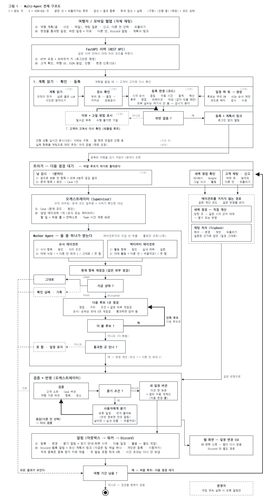
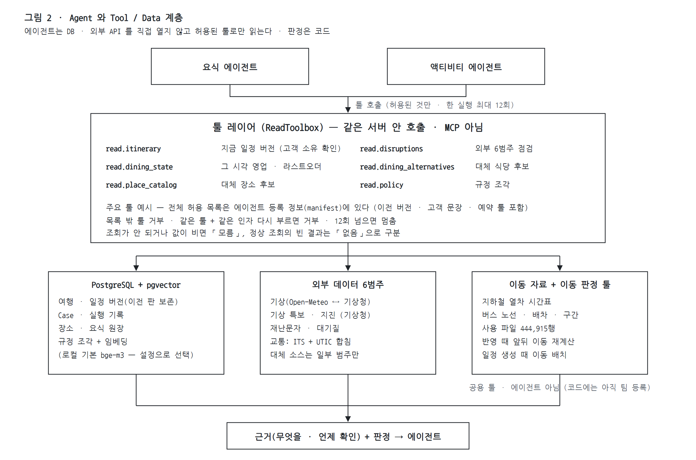

guguroute 의 **Multi-Agent 구조**는 다음처럼 정리할 수 있습니다. 핵심은 **낮 감시가 깨진 일정 항목을 Case 로 열면 오케스트레이터가 담당 에이전트 1개(요식 또는 액티비티)를 고르고, 에이전트는 허용된 툴로만 데이터를 읽어 대체 후보를 하나씩 다시 점검하며(안쪽 루프), 결과는 검증 · 묻기 · 반영 · 알림을 거쳐 여행 기간 동안 다음 점검을 기다리는(바깥 루프)** 구조입니다. 고객 채팅과 새벽 영업 확인은 에이전트를 거치지 않고 **같은 계산 코드와 같은 반영**을 씁니다. 이동은 에이전트가 아니라 **공용 판정 툴**입니다.

## Multi-Agent 전체 구조도

## Agent와 Tool / Data 계층 관계

특히 **에이전트가 DB · 외부 API 에 직접 접근하는 것이 아니라 툴 레이어(허용 목록)를 통해서만 조회**하도록 보는 것이 중요합니다. 판정은 코드가 하고, 조회가 안 되면 「없음」이 아니라 「모름」으로 돌려줍니다.

### Agent별 I/O 요약

| 구성 | 주요 Input | 주요 Output | 주요 역할 |
|---|---|---|---|
| **트리거 — 낮 감시** | 앞으로 90분 안 항목, 외부 6범주 | 문제 항목 + 원인 → Case 1건 | 1분마다 점검 — 깨진 것만 Case 로 |
| **트리거 — 새벽 영업 확인** | 그날 식사 · 활동, Google 영업 정보 | 닫힌 곳의 근처 대체 → 묻기 / 반영 | 03~08시 · 에이전트를 거치지 않는 직접 계산 |
| **채팅 처리 (TripDesk)** | 고객 문장(바꿔 줘 · 늦어요 · 다른 안 · 되돌리기 · 질문) | 변경 · 제안 · 답변 (질문은 일정 그대로) | 에이전트와 같은 계산 코드를 직접 부른다 |
| **오케스트레이터** | Case (문제 코드 · 원인) | 담당 에이전트 1개, 할 일 · 허용 툴 · 컨텍스트 | 규칙 라우팅 · Team 시간 제한 90초 |
| **요식 에이전트** | 식사 항목 · 원인 · 식이 조건 | 그대로 / 대체 식당 1 + 다른 안 최대 2 / 못 함 | 영업 · 브레이크 · 라스트오더 · 휴무 점검, 순위순 최대 3곳 재점검 |
| **액티비티 에이전트** | 활동 항목 · 원인 · 실내 여부 · 설문 | 그대로 / 대체 활동 + 다른 안 / 바꿀까요? / 못 함 | 운영 · 날씨 · 대기질 점검 → 후보 점검 후 순위 |
| **이동 판정 툴 (공용 · 에이전트 아님)** | 두 장소 · 목표 도착 시각 · 앞 일정 종료 시각 | 경로 · 소요 · 판정(성립 / 불가 / 모름) | 반영 때 앞뒤 이동 재계산 · 일정 생성 (후보 재점검 연결은 아직) |
| **검증 + 반영 (오케스트레이터)** | 변경 제안 | 새 일정 버전 / 사용자에게 묻기 / 거부 | 고객 소유 · Case 버전 · 여행 기준 버전 · 항목 · 장소 확인 |
| **알림 (아웃박스 워커)** | 등록 · 변경 · 묻기 알림, 정기 안내 | Discord 웹훅 알림 + 계획서 링크 | 중복 방지 키 · 첫 발송 포함 최대 3회 |
| **계획 읽기 · 일정 생성** | 계획 원문 / 「일정 짜 줘」 선호 | 일정 항목 + 근거 줄 / 판정을 통과한 초안 | 규칙 먼저 · AI 는 줄 위치 · 받아쓰기 · 순서 제안만 |

이 구조에서 에이전트 사이의 연결은 **오케스트레이터**(에이전트끼리 직접 부르지 않음), 에이전트와 데이터의 연결은 **툴 레이어**(허용 목록 · 12회 상한), 데이터는 **PostgreSQL + 외부 6범주 + 이동 자료**가 담당합니다. AI 모델은 계획서 줄 위치 찾기 · 사진 받아쓰기 · 문장 해석 · 일정 후보 순서 제안 · 영업시간 원문 정리 · 문장 작성에 쓰고, 일정 성립 · 영업 · 시간 판정과 반영 여부는 코드가 정합니다. 모델은 로컬 · API 비교 시험 중입니다.

시스템 구성도에서는 낮 감시의 대표 순환을 **`트리거 → Case → 오케스트레이터 → Worker Agent(후보 재점검 루프) → 검증 · 묻기 · 반영 → 알림 → 다음 점검 대기`**로 표현하면 guguroute 의 핵심 — 계획을 받아 여행이 끝날 때까지 지킨다 — 이 가장 명확하게 드러납니다. 고객 채팅 · 새벽 영업 확인 · 일정 생성 · 정기 안내는 별도 경로이며 같은 계산과 버전 저장을 공유합니다.

> 지금 상태: 일정 등록 거절 · 고객 채팅 · 다른 안 · 되돌리기 · 일정 생성 · 정기 안내 · 일정 변경 SSE 는 구현. 접수 · 생성 · 채팅 진행 SSE 는 서버 구현 · 웹 연결 진행 중. 실패 항목의 채팅 대안 추천 · 후보 재점검의 이동 판정 연결은 아직 없음. 알림은 팀 Discord 채널 하나(개인 Discord 는 등록 · 시험 발송까지). 로그인 · AWS 자동 배포는 팀 계획(코드 없음). 이동은 코드에 아직 팀으로 등록돼 있어 툴로 정리가 필요하다.
