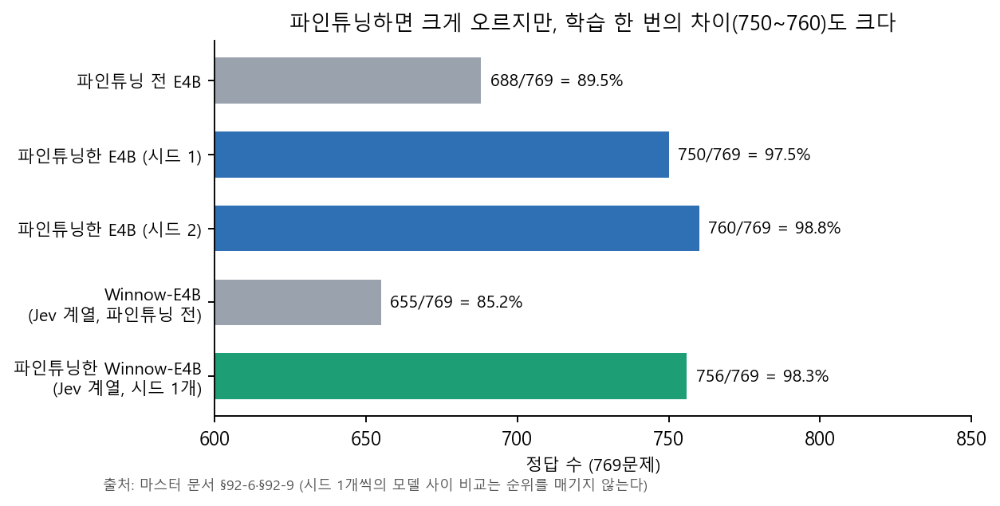
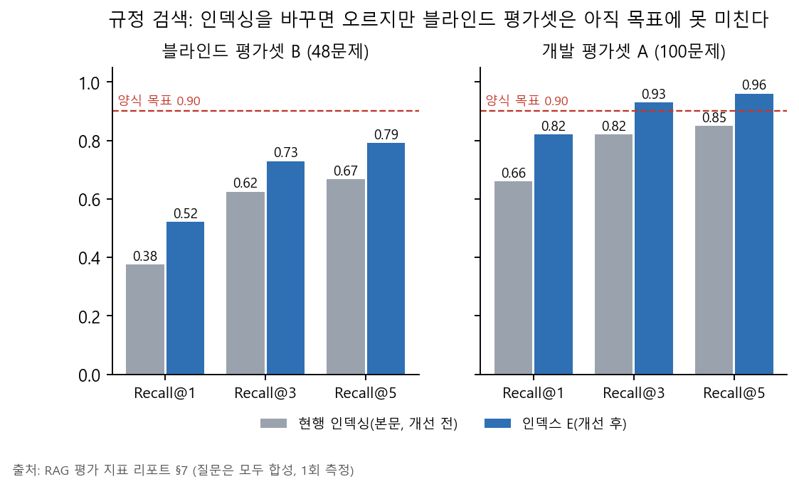
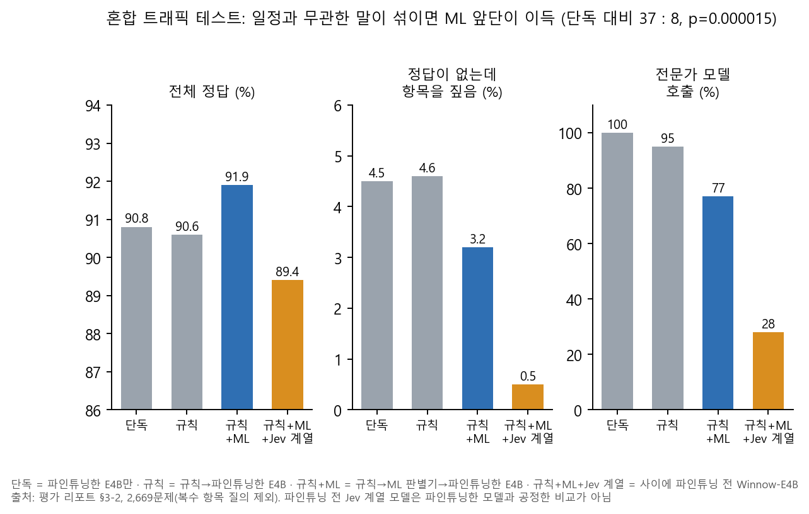
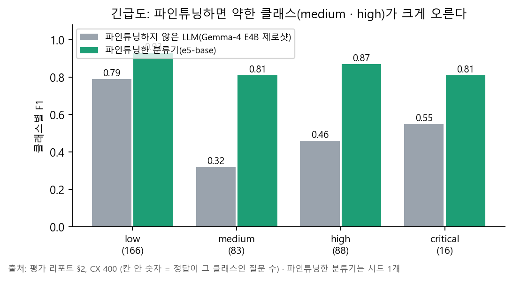

# [모델배포] 서비스 테스트 계획 및 결과 보고서 — 본문 초안 (6주차, 2026-10-06)

> 양식 `[모델배포] 서비스 테스트 계획 및 결과 보고서_양식.docx` 의 5개 절 순서대로 채운 **마크다운 초안**이다. docx 로 옮기는 것은 docs works 세션 몫이다.
> 수치의 출처·조건·한계는 [서비스 평가 베이스라인과 개선 전후](../../../../../final_project_cs/wiki/records/reports/2026-10-06_서비스_평가_베이스라인과_개선_전후.md)(이하 「평가 리포트」)와 [RAG 평가 지표 리포트](../../../../../final_project_cs/wiki/records/reports/2026-10-06_RAG_평가지표_리포트.md)에 있다. 이 초안은 그 표를 양식 칸에 맞춰 옮긴 것이다.
> ★양식에는 LangGraph · MCP · MySQL 같은 예시 용어가 있다. **우리 시스템에 없는 것은 있다고 쓰지 않았다**(예: LangGraph 는 코드에서 import 하지 않는다).
> ★**질문·시험 자료는 전부 모델이 쓴 합성이다. 이 표의 값은 「합성 시험 기준 점수」이지 실서비스 점수가 아니다.** 사람 평가는 한 사람 35행의 첫 결과뿐이다(§4.9).
> ★**숫자 읽는 법**: 비율은 `k/n = %`와 Wilson 95% 구간(괄호), 평균·F1은 부트스트랩 95% 구간, 두 방법의 차이는 같은 질문 짝지은 McNemar 정확검정으로 쟀다. 구간이 겹치면 「구분되지 않는다」고 쓴다. 어떤 지표를 왜 골랐는지는 §4.10.

## 1. 테스트 개요

### 1.1 테스트 목적

이 시험의 목적은 **고객 말을 여행 일정에 맞게 알아듣고(분류 · 항목 짚기) 규정을 근거와 함께 답하며(RAG) 일정 변경 알림을 고객 언어로 보내는** 서비스가 배포 전에 정확하고 안전한지 확인하는 것이다. 특히 ① 모델이 시각·금액·장소를 지어내지 않는지 ② 규정 답이 출처 문장 그대로인지 ③ 일정과 무관한 말에 일정이나 규정을 붙이지 않는지 ④ 응답이 SLA(15초) 안인지를 본다.

### 1.2 테스트 범위 및 대상 기능

| 분류 | 테스트 대상 기능 (Checklist) | 주요 검증 포인트 |
|---|---|---|
| 데이터 수집/저장 | 규정 조각 130개 벡터 적재(PostgreSQL + pgvector) · 장소 목록 8,370곳 | 벡터 칸 130/130 채움, 테넌트 격리 |
| 데이터 전처리 | 고객 말 분류 4종(의도 · 감정 · 긴급도 · 대상) — 학습한 e5-base 분류기 | 클래스별 정밀도·재현율·F1 |
| RAG/에이전트 | 일정 항목 짚기(규칙 → ML → 가르친 E4B) · 규정 검색 · 결정 단위 · 계획 읽기 | 정답 항목 번호, 「해당 없음」 판정, 근거 문장 인용 |
| 외부 연동 | 관광공사·카카오(계획 읽기) · 번역 모델 · MCP(여행 도구 — 읽기 5 · 쓰기 7, 쓰기는 기본 꺼짐) | 값 변조, 번역 숫자 보호 · MCP 호출 지연은 **이번에 못 잼** |
| 보안 및 UI | 개인정보 마스킹 · 테넌트·고객 격리 · 화면(별도 UI 세션) | 보안 시험 23/23 통과 · 화면 시험은 UI 세션 몫 |

## 2. 테스트 환경 및 도구

| 구분 | 상세 내용 | 버전 및 사양 |
|---|---|---|
| 인프라 | 개발 PC(Windows 11) · x600 서버(Windows + WSL2, Ollama) · GPU 서버(RunPod, 시험용) | 연결 시험 서버: RTX 4000 Ada 20GB / 학습 서버: RTX A4000 16GB |
| 데이터베이스 | PostgreSQL(pgvector) | PostgreSQL 16 · 규정 조각 130 · 임베딩 1,024차원 |
| 오케스트레이션 | 자체 Controller + Case 상태기계(12종) | **LangGraph 는 쓰지 않는다**(`requirements.txt` 에서도 뺐다) |
| 핵심 프로토콜 | MCP(`/mcp/`, 여행 도구) | 읽기 5 · 쓰기 7(`travel.mcp.write_enabled` 기본 꺼짐) |
| AI 모델 | 항목 짚기: 우리 데이터로 가르친 Gemma-4 E4B(Q8 GGUF, 유효 4B) · 규정 임베딩: bge-m3 · 분류: multilingual-e5-base(학습) · 번역·계획 읽기: gemma4:12b | 가르친 모델 재현 정보는 마스터 문서 §91 |
| 시험 도구 | pytest(4,257개) · 결정 단위 재생 · 계획 읽기 평가 · 연결 시험 스크립트 | 평가 리포트 §14 |

## 3. 테스트 상세 계획

### 3.1 핵심 시나리오 테스트

- **의도 파악·라우팅**: 고객 말 → 분류 4종 → 일정 항목 번호 또는 「없음」(규칙 → ML 판별기 → 가르친 E4B 순서, 앞 단계가 닫으면 뒤는 부르지 않는다).
- **일정 사실 답**: 모델은 번호만 고르고 시각·장소는 DB 값으로 문장을 만든다 — 지어낼 자리가 없다.
- **규정 답**: 규정 조각 top 3 중 점수 0.55 이상만, 고객용 문장 최대 2개를 출처와 함께 싣는다.
- **계획 읽기·알림**: 고객이 낸 일정(파일·사진·PDF)을 항목으로 뽑고, 알림은 고객 언어로 번역하되 숫자는 횟수까지 원문과 대조한다.

### 3.2 예외 상황 테스트 (Edge Cases & Failure Mode)

| ID | 테스트 항목 | 검증 및 기대 결과 |
|---|---|---|
| ERR-RAG-01 | 규정 검색 유사도 미달 | 점수 0.55 미만이면 규정 문장을 싣지 않고 답하지 않는다 — **새어 나감 3/110 = 2.7%**(목표 0, 미달) |
| ERR-LLM-01 | 모델이 빈 답 | 읽기 실패로 처리 — **85/2,735 = 3.1% 발생**, 결정적 재현. **원인은 호출의 생각 모드**(출력 한도 16토큰을 생각에 씀)였고 끄고 다시 돌리니 **0건**(요청 둘 제외 81/2,669 → 0). 제품 호출 반영 대기 |
| ERR-HALU-01 | 근거 없는 규정 문장 | 규정 문장은 저장된 고객용 문장만 싣는다 — **발송 0건**, 인용 정확도 334/334 |
| ERR-HALU-02 | 일정과 무관한 말에 일정 항목을 짚음 | 「없음」 판정 — **80/1,786 = 4.5%**(ML 앞단 3.2%)가 새어 나감 |
| ERR-TRN-01 | 번역에서 숫자 변조 | 숫자 대조로 번역을 버리고 한국어 원문 발송 — 시각·금액 변조 통과 **0/115**, 거름 5/120 = 4.2% |
| ERR-TRN-02 | 번역에서 금액 단위 변조 | **1건 통과**(일본어 원→엔, 미해결) — 단위 대조 제안 |
| ERR-ID-01 | 일정 짚기가 후보 목록 밖 번호를 냄 | 목록 밖이면 「없음」으로 버린다 — **0/835 · 0/2,735** |

### 3.3 통합 연동 및 보안 테스트

- **데이터 흐름 일관성**: 통합 시험 418개 · 종단 시험 800개 통과(3 오류는 환경 설정 문제 — 평가 리포트 §8).
- **개인정보**: 보안 시험 23/23 통과(전화번호 등 마스킹 · 테넌트·고객 격리 · 키 원문 비기록). 「필터링율 100%」 같은 비율은 **측정 방식이 시험 통과 여부라 비율로 쓰지 않는다.**

## 4. 테스트 결과 기록

### 4.1 상세 테스트 결과

| ID | 테스트 항목 | 측정 지표 | 예상 결과 | 실제 결과 | Pass/Fail |
|---|---|---|---|---|---|
| FUNC-RAG-01 | 규정 검색 | Recall@3(독립 B 48문제) | 0.92 이상 | **0.625**(30/48, 95% 구간 0.484~0.748) · 색인 개선 후 0.729(0.590~0.834) | **Fail** |
| FUNC-RAG-02 | 규정 검색 | Recall@3(A 100문제, 쉬운 세트) | 0.92 이상 | 0.820(82/100, 구간 0.733~0.883) · 개선 후 0.930(0.863~0.966) | Fail(개선 후 Pass) |
| FUNC-RAG-03 | 규정 검색 | **고객에게 보이는 앞 2줄 안에 정답**(Hit@2, 독립 B) | 목표 미정 | 24/48 = 50.0%(36.4~63.6) · 개선 후 34/48 = 70.8%(56.8~81.8) | — (기준 없음, 기록) |
| FUNC-RAG-04 | 규정 검색 — **재순위 개선안**(색인 E + 예상 질문 → 후보 20 → gemma4:12b 가 직접 답하는 줄 선택) | Recall@3(**사전 등록한 별도 평가셋 68문제, 1회**) | 0.92 이상(양식) · 0.90(팀 목표) | **63/68 = 92.6%**(83.9~96.8) · 운영 색인은 같은 평가셋 41/68 = 60.3%(23 : 1, p=3.0×10⁻⁶) · 개발 세트 B 45/48 | **Pass(0.90 기준, 구간 하한 0.84)** — 제품에는 미반영 |
| FUNC-CLS-01 | 의도 분류 | 정확도 | 목표 미정 | 97.5%(388/398, 구간 95.4~98.6) — CX 400 · **G96(독립 자료) 90.6%**(83.1~95.0) | — (기준 없음, 기록) |
| FUNC-CLS-02 | 긴급도 분류 | 정확도 | 목표 미정 | 88.4%(312/353, 구간 84.6~91.3) — CX 400, 작성자·교차 라벨러 일치 88.2%가 천장 · **G96 62.5%**(52.5~71.5) | — (기준 없음, 기록) |
| FUNC-CLS-03 | 분류 4종 동시 | 네 라벨이 모두 맞은 문장 | 목표 미정 | CX 400 219/284 = 77.1%(71.9~81.6) · **G96 42/96 = 43.8%**(34.3~53.7) | — (기준 없음, 기록) |
| FUNC-PTR-01 | 일정 항목 짚기 | 정확도(769문제 · 엄격) | 목표 미정 | 97.3%(748/769, 구간 95.9~98.2) | — (기준 없음, 기록) |
| FUNC-PTR-02 | 일정 항목 짚기 — 섞은 흐름 | 정확도(2,669문제) | 목표 미정 | 처음 측정(생각 모드 켜짐): 91.9%(구간 90.8~92.9, ML 앞단 포함) · 단독 90.8%(89.7~91.9). **생각 모드를 끈 재시험: 단독 93.6%**(2,498/2,669, 구간 92.6~94.5, 빈 답 0) | — (기준 없음, 기록) |
| FUNC-DU-01 | 결정 단위 재생 | 할 일+대상 동시 정답 | 95% 이상(계획서 합격선) | **3번 반복 평균 95.3%**(구간 92.6~97.7) · 마지막 1번만 보면 97.1%(167/172) | **경계** — 평균은 합격선 위지만 구간 하한이 아래 |
| FUNC-DU-03 | 결정 단위 재생 | 같은 사례를 3번 모두 맞힘(pass^3) | 목표 미정 | **91.3%**(86.6~95.3) · 3번 모두 틀린 사례 3 · 일부만 맞은 사례 12 | — (기준 없음, 기록) |
| FUNC-DU-02 | 결정 단위 재생 | 엉뚱한 대상 변경 | 0건(계획서 합격선) | **1건**(172문제) | **Fail** |
| FUNC-INT-01 | 계획 읽기 | 항목 재현율 | 목표 미정 | 97.0%(326/336) | — (기준 없음, 기록) |
| FUNC-INT-02 | 계획 읽기 | 값 변조 | 0건(팀 목표 — 환각 방지 「목표 0」) | **12/350 = 3.4%** | **Fail** |
| INTEG-MCP-01 | MCP 외부 연동 | 지연 | 5초 이내 | **측정하지 못함**(이번 측정 범위 밖) | — |
| SEC-PII-01 | 개인정보·격리 | 보안 시험 | 전부 통과 | 23/23 통과 | Pass |
| PERF-RESP-01 | 규정 답 응답 속도 | p50 / p95 | 평균 10초 이내 | 0.43초 / 0.60초 | Pass |
| PERF-RESP-02 | 일정 항목 짚기 응답 속도 | p50 / p95 | 평균 10초 이내 | 0.16초 / 0.21초(가르친 E4B Q8) | Pass |
| PERF-RESP-03 | 결정 단위 · 계획 읽기 | p95 | 15초 이내(SLA) · 결정 단위는 5초 이내(계획서) | 2.5~4.6초 · 11.7초 | Pass(결정 단위 5초도 충족) |
| REL-AUTO-01 | 자동 시험 | 통과율 | 100%(전부 통과) | 4,245/4,251 = 99.9% (실패 3 · 오류 3) | **Fail**(환경 설정 5건 + 시나리오 1건) |

※ 「예상 결과」는 **원래 있던 기준만** 적었다 — 양식에 있는 값(Recall 0.92 · 응답 10초 · SLA 15초), 계획서의 결정 단위 합격선(95% · 엉뚱한 변경 0 · p95 5초), 팀의 「환각 방지 목표 0」. **기준이 없던 항목은 시험 결과를 본 뒤 기준을 만들어 Pass/Fail 을 매기지 않고 「목표 미정 — 기록」으로 두었다.**

### 4.2 성능 벤치마킹 (Performance Metrics)

| 평가 지표 | 목표치 (Target) | 측정치 (Actual) | 비고 |
|---|---|---|---|
| Retriever Recall@3 | 0.90 이상 | **독립 B 0.625 · A 0.820**(개선 색인 B 0.729 · A 0.930) · **재순위 개선안: 사전 등록한 별도 평가셋 0.926(63/68), 개발 세트 B 0.938** | 운영 색인은 **미달**, 재순위 개선안은 **달성**(제품 미반영) — 질문은 합성, 임베딩 bge-m3 |
| Retriever MRR | — | B 0.509(0.393~0.626) · A 0.750(0.679~0.819) | 개선 후 B 0.654(0.544~0.763) · A 0.885(0.835~0.934), 괄호는 부트스트랩 95% 구간 |
| 문턱 0.55 판정 F1 | — | B 0.886 · A 0.964 | 문턱 곡선에서 0.55 는 크게 틀린 값 아님 |
| 답한 것 중 틀린 비율(선택적 위험, 문턱 0.55) | — | B 21/41 = 51.2%(36.5~65.7) · A 26/99 = 26.3%(18.6~35.7) | 개선 색인 B 12/43 = 27.9% · A 11/102 = 10.8%. 곡선 아래 면적(AURC, 작을수록 좋음) B 0.552 → 0.396 · A 0.294 → 0.137 |
| 답 없는 질문을 거절하는 비율(거절 재현율) / 답 있는데 거절(오거절률) | — | B 48/50 = 96.0%(86.5~98.9) / 9/48 = 18.8%(10.2~31.9) | 문턱을 올리면 거절 재현율은 오르고 오거절률도 오른다(0.60 에서 B 오거절률 50.0%) |
| Generator Faithfulness(답 문장이 출처 조각에서 나왔는가) | 0.85 이상 | **334/334 = 1.00** | 모델이 규정 문장을 쓰지 않는 구조라 나오는 값 |
| System Throughput(TPS) | — | **측정하지 못함** | 동시 사용자 부하 시험을 아직 안 돌렸다. 도구(닫힌 루프 동시 1~16 · 열린 루프 초당 1~8건, 워밍업 10초 + 45초)는 만들어 두었고 원격 임베딩 서버가 비는 때 돌린다. 지금의 지연(p50 431 · p95 596ms, n=360)은 동시 1~2 호출의 값이라 **부하 상태의 지연이 아니다** |
| 응답 시간 | 15초 이내 | 규정 답 p95 0.60초 · 결정 단위 p95 최대 4.6초 · 계획 읽기 p95 11.7초 | 시나리오 전체 end-to-end 시간은 안 쟀다 |

### 4.3 sLLM 파인튜닝 비교 평가

| 비교 항목 | Base Model(학습 없음) | Fine-tuned sLLM(우리 데이터로 가르침) | 개선 효과 |
|---|---|---|---|
| 일정 항목 짚기 정확도(769문제) — Gemma-4 E4B | 688 (89.5%) | **750 (97.5%)** · 시드만 바꿔 다시 가르치면 760 (98.8%) | **+8.1%p ~ +9.4%p**, 이쪽만 맞음 69 : 7, p=6.4×10⁻¹⁴ — 학습 한 번의 차이가 10문제(p=0.021) |
| 같은 방식 — Jev 계열 Winnow-E4B(시드 1개) | 655 (85.2%) | 756 (98.3%) | +13.1%p, 가르친 E4B(750·760)와는 구분 안 됨(p=0.18 · 0.39) |
| 긴급도 분류 정확도(CX 400 중 정답 칸이 있는 353문장) — 학습 없는 LLM vs 학습한 e5-base | 60.9% (215/353) | 88.4% (312/353) | +27.5%p(구간 +21.8~+33.1, 순증 97건 = McNemar 112 : 15, p<10⁻¹⁸) (매크로 F1 0.53 → 0.86) |
| 감정 분류 정확도(CX 400 중 355문장) | 83.9% (298/355) | 93.8% (333/355) | +9.9%p(구간 +6.2~+13.8, 순증 35건 = 44 : 9, p=1.2×10⁻⁶) |
| **같은 분류를 독립 자료 G96(96문장)에서 재면** | 의도 95.8 · 감정 84.4 · 긴급도 71.9 · 대상 83.3% | 90.6 · 82.3 · 62.5 · 83.3% | **네 라벨 모두 구분되지 않는다**(p 0.11~1, 점추정은 학습 쪽이 같거나 낮음) — CX 의 이득이 독립 자료로 확인되지 않았다 |
| 모델 크기·추론 비용 | 유효 4B | 유효 4B, Q8 GGUF 8GB, 호출 164ms(중앙) | 유료 API 호출 없음 — 유료 Jev API 는 시험에 쓰지 않았다 |
| 도메인 용어 정확도 | — | — | **측정하지 못함**(별도 지표 없음) |

학습 방식·재현 정보는 마스터 문서(program/research/여행일정_질문인식_모델비교_2026-09-29.md) §91·§92. 가르친 모델은 우리 합성 데이터로 학습했으므로 **평가 세트와 학습 세트가 같은 합성 분포에 가깝다** — 실서비스 분포에서는 낮아질 수 있다.

### 4.4 규정 검색 상세와 색인 개선 전후

질문은 모델(Codex)이 쓴 합성이다: A 180문제(고객용 문장을 보고 쓴 쉬운 세트, 답 있음 100), B 160문제(독립 세트, 답 있음 48). 임베딩 bge-m3, 규정 조각 130개, 문턱 0.55, 상위 3개. 1회 측정.

| 지표 | A (개선 전 → 후) | B (개선 전 → 후) |
|---|---|---|
| Recall@1 | 0.660 → 0.820 | 0.375(0.252~0.516) → 0.521(0.383~0.655) |
| **Hit@2 = 고객에게 보이는 줄 수** | 0.760 → 0.920 | 0.500(0.364~0.636) → 0.708(0.568~0.818) |
| Recall@3 | 0.820 → 0.930 | 0.625(0.484~0.748) → 0.729(0.590~0.834) |
| Recall@5 | 0.850 → 0.960 | 0.667 → 0.792 |
| Precision@3 / F1@3 | 0.273 / 0.410 → 0.310 / 0.465 | 0.208 / 0.312 → 0.243 / 0.365 |
| MRR / nDCG@10 | 0.750 / 0.788 → 0.885 / 0.910 | 0.509 / 0.554 → 0.654 / 0.701 |
| 문턱 0.55 판정 Precision / Recall / F1 | 0.979 / 0.950 / 0.964 → 0.970 / 0.980 / 0.975 | 0.975 / 0.812 / 0.886 → 1.000 / 0.896 / 0.945 |
| 정답 규정을 보인 비율 | 73/100 → 91/100 | 21/48 → 31/48 |
| 틀린 줄만 보인 비율 | 22/100 → 7/100 | 18/48 → 12/48 |
| 답 없는 질문에 규정을 보임(새어 나감) | 2/60 → 3/60 | 1/50 → 0/50 |

- **바꾼 것**: 규정 조각을 임베딩할 때 쓰는 글을 「직원용 본문」에서 「문서 제목 + 절 제목 + 고객용 문장」으로. 제품 코드·DB·문턱·질문은 그대로, 측정 스크립트가 같은 임베딩 함수로 색인을 메모리에 만들어 검색 자리만 바꿔 끼웠다.
- **독립 세트 B 가 판단 근거**다. 고객이 실제로 본 줄에 정답이 있었는지로 세면 개선 후에만 맞은 질문 10개 · 개선 전에만 맞은 질문 0개(McNemar 정확검정 p=0.002)다. 그러나 **검색 상위 3 안에 정답이 있는지(Recall@3)로 세면 5 : 0 이고 p=0.0625** — 질문 48개에서는 5건이 모두 한 방향이어도 정확검정이 0.05 를 넘는다(짝지은 부트스트랩 차이 +0.104, 구간 +0.021~+0.188). 같은 개선이 어느 지표로 보느냐에 따라 유의성이 갈리므로 **방향은 분명하나 「유의하다」고 단정하려면 더 큰 독립 세트가 필요하다.** A 는 개선판 색인과 같은 고객용 문장을 보고 쓴 질문이라 개선폭이 부풀려져 있다.
- **답할지 거절할지**: 운영 문턱 0.55 에서 답한 것 중 틀린 비율(선택적 위험)은 B 51.2% → 27.9%, 곡선 아래 면적(AURC)은 0.552 → 0.396 으로 줄었다. 그래도 **B 에서는 어느 문턱에서도 선택적 위험이 45% 아래로 내려가지 않는다**(문턱 0.60 에서 45.8%) — 문턱은 틀린 규정을 보이는 비용과 답을 안 하는 비용의 맞바꿈일 뿐 정확도를 만들지 못하고, 정확도는 검색을 고쳐야 오른다.
- **대가**: 규정이 아닌 여행 대화 발화(KLUE-WoS 300건, 라벨 없음)에 규정을 붙이는 비율 67/300 = 22.3% → 110/300 = 36.7%. 새로 붙은 표본 22개를 눈으로 보니 대부분 예약·검색 요청이었다. 제품에서는 의도 분류 뒤 이 경로로 들어오므로 실제 영향은 분류기에 달려 있고 이번 시험은 분류기를 거치지 않았다. 그래서 「분류기 뒤에서 다시 재 본 뒤 결정」이 제 의견이다.
- 문턱 곡선: F1 최고 문턱은 A 0.55(0.964), B 0.525(0.926)이고 B 에서 0.55 를 쓰면 0.886. 0.60 으로 올리면 B 재현율이 0.500 으로 떨어진다. 문턱을 바꾸려면 사람이 쓴 질문 세트가 먼저 필요하다.
- 다국어(B 를 영·일·중으로 옮긴 합성 번역, 상위 3 안에 정답): 한국어 30/48 · 영어 27/48 · 일본어 26/48 · 중국어 25/48 → 개선 후 35 · 31 · 33 · 33 /48. 영어는 「답할 질문을 답함」이 28/48 로 가장 낮다(한국어 39/48).
- 응답 시간(규정 답 전체, 360호출): p50 431ms · p95 596ms, 오류 0/680. 시간의 거의 전부가 질문 임베딩(원격 왕복 포함, p50 396ms)이다. 개선 색인의 응답 시간은 재지 않았다.

### 4.5 일정 항목 짚기 — 실전처럼 섞은 흐름 2,735문제

고객 말 하나를 일정 항목 번호 하나 또는 「없음」으로 바꾸는 과제를, 일정과 무관한 말을 섞어 서버에서 문제마다 실제 호출했다. 재료: 기존 합성 질문 835(요청 둘 66 포함) + 관광지 질문 틀 × 우리 장소 목록(일정 안 장소 300 · 일정 밖 장소 300) + AI Hub 일상 대화 1,000 + KoCulture 구어체 300을 일정 5개에 나눠 무작위로 섞음. 정답은 일정 항목 또는 「없음」. 변형당 1회, 엄격 계수(빈 답은 오답).

| 구조 | 요청 둘 제외 전체 정답(2,669) | 정답이 「없음」인데 항목을 짚음(1,786) | 정답 항목이 있는 질문 맞힘(883) | 전문가 모델 호출 | 지연 중앙 / p95 |
|---|---:|---:|---:|---:|---:|
| 가르친 E4B 단독 | 2,424 = 90.8% | 80 = 4.5% | 786 = 89.0% | 2,735 (100%) | 164 / 205ms |
| 규칙 → 가르친 E4B | 2,419 = 90.6% | 83 = 4.6% | 784 = 88.8% | 2,608 (95%) | 163 / 206ms |
| **규칙 → ML 판별기 → 가르친 E4B** | **2,453 = 91.9%** | **58 = 3.2%** | 784 = 88.8% | **2,117 (77%)** | 189 / 241ms |
| 규칙 → ML → 학습 없는 Winnow-E4B(Jev 계열 모델) → 가르친 E4B | 2,385 = 89.4% | 9 = 0.5% | 639 = 72.4% | 768 (28%) | 506 / 746ms |

- **ML 앞단**: 처음 측정(생각 모드 켜짐)에서는 단독 대비 이쪽만 맞음 37 : 단독만 맞음 8(p=1.5×10⁻⁵), 호출 23% 감소였다. **그러나 생각 모드를 끄고 사후 재계산하면 단독 2,498 = 93.6% 대 ML 앞단 2,506 = 93.9%, 16 : 8, p=0.15 로 정확도 이득은 구분되지 않는다.** 남는 이득은 **전문가 호출 23% 감소**(2,669 → 2,054)다. 일정 관련 질문만 있는 769문제에서는 오히려 −3 이었다. 앞단은 정확도가 아니라 호출 비용을 줄이는 장치로 설명한다.
- **하나의 정확도를 둘로 나눠 읽는다**(범위 밖 거절을 따로 재는 관행). 일정 항목이 있는 질문 883개의 정확도는 89.0%(Wilson 86.8~90.9)이고 **약한 쪽은 「다른 항목을 짚음」 8.7%**(77건, 대부분 같은 장소의 다른 일정 항목)이며 「없음」으로 닫는 미스는 0.8%다. 정답이 「없음」인 1,786개에서는 「없음」 재현율 91.7%(90.3~92.9) · **오지목 4.5%(3.6~5.5)** · 「없음」 정밀도 99.6%이고, ML 앞단은 재현율을 93.4%(92.2~94.5)로 올리고 오지목을 3.2%(2.5~4.2)로 줄이면서 항목이 있는 질문의 정확도는 88.8%로 거의 같다.
- **학습 없는 Jev 계열 모델(Winnow-E4B)을 보낼 곳 판정에 넣으면** 잡담 새어 나감이 0.5%로 가장 낮지만 일정 항목을 있는데 「없음」으로 닫아 전체가 단독보다 낮다(114 : 153, p=0.02). 학습 없는 모델이라 가르친 모델과 공정한 비교가 아니다. 가르친 Jev 계열 모델로는 아직 시험하지 않았다.
- **읽기 실패(빈 답) 85/2,735 = 3.1% — 원인을 찾아 고쳤다**: 빈 답이 난 문제를 다시 불러 보니 답 대신 「Thinking Process…」(생각)만 나오고 출력 한도 16토큰이 그 생각에 다 쓰여 있었다. 호출에서 생각 모드를 끄고 같은 2,735문제를 다시 돌리니 **빈 답 0건, 요청 둘 제외 전체 정답 2,424 → 2,498(90.8% → 93.6%, 새 쪽만 맞음 81 : 옛 쪽만 맞음 7, p=4.5×10⁻¹⁷)** 이다. 앞서 제안한 「빈 답 = 해당 없음」 처리(93.4%)는 필요 없어졌다. 한계: 시험 도구에서만 끄고 확인했고 제품 호출에 같은 설정을 넣는 일은 아직 안 했다.
- **일정 안 장소 300문제의 엄격 정답 71.3%는 라벨 모호성이 원인**이다: 틀린 66건 중 59건이 같은 장소의 다른 일정 항목을 고른 것(정답 장소가 일정에 두 번 이상 나오는 질문 132/300). 장소 일치로 보면 273/300 = 91.0%, 정답 장소가 한 번만 나오는 질문은 159/168 = 94.6%.
- 합성 관광지 질문 틀은 문장이 어색할 수 있고, 일정 밖 장소의 「정답 = 없음」은 이름이 일정과 겹치지 않는 것으로만 보장한 라벨이다.

### 4.6 환각 방지 · 근거 정확성 체크리스트

| 항목 | 목표 | 현재 값 | 비고 |
|---|---|---|---|
| 규정 문장 인용 정확도(출처 문장과 글자 그대로 일치) | 100% | 334/334 | 모델이 규정 문장을 쓰지 않는 구조라 나오는 값 |
| 근거 없는 규정 문장 발송 | 0 | 0건 | |
| 답 없는 질문에 규정을 보임(새어 나감) | 0 | 3/110 = 2.7% | 점수 0.55~0.60, 문턱 바로 위 |
| 알림 번역의 시각·금액 숫자 변조가 통과 | 0 | 0/115 | 실제 모델 gemma4:12b, 합성 알림 40개 × 영·일·중 = 120호출 1회, 거름 5/120 |
| 알림 번역의 금액 단위 변조가 통과 | 0 | 1건 | 일본어 「35,000원」→「35,000円」. 단위 대조를 더하면 이 1건이 걸리고 오탐 0(가상 적용) |
| 일정 짚기에서 후보 목록 밖 번호 | 0 | 0/835 · 섞은 흐름 0/2,735 | 형식 오류는 따로 85건 |
| 일정과 무관한 말에 항목을 짚음 | 0 | 80/1,786 = 4.5% (ML 앞단 3.2%) | §4.5 |
| 계획 읽기 — 원문에 없는 제목·예약번호를 뽑음 | 0 | 12/350 = 3.4% | |
| 계획 읽기 — 근거가 빈 값 | 0 | 0/1,828 | |
| 결정 단위 — 엉뚱한 대상을 바꿈 | 0 | 1/172 | |
| 보기 밖 값 반영(일정 변경 초안 체크리스트) | 0 | **측정하지 못함** | 초안을 만드는 모델 호출이 필요한 경로라 시나리오 러너 담당. 그쪽 참고값 30/30 · 위반 0 은 모델 흉내 값 |

### 4.7 에이전트 과제 평가

| 평가 | 값 | 조건 |
|---|---|---|
| 결정 단위 재생(채팅 한 마디 → 할 일 + 대상, 실제 모델) | **같은 172사례 3번 반복 평균 95.3%**(구간 92.6~97.7), pass^2 93.0% · **pass^3 91.3%**(86.6~95.3). 세 번의 값은 160 · 165 · 167/172(93.0 · 95.9 · 97.1%). 세트별 pass^3: 실제 대화 92.4% · 사실 질문 90.5% · 긴 대화 91.2% · 화면 조작 90.0%. 엉뚱한 대상 변경 1건, 지연 p95 2.5~4.6초 | 정답은 Claude 가 표기(사람 검수 아님), 2026-09-30 17:40~17:58 저장 결과. 회차가 갈수록 오른 것은 사이에 코드가 바뀐 흔적일 수 있어 마지막 값(97.1%)만 쓰면 과대평가한다. 모델명·코드 동일 여부는 보고서에 없음 |
| 계획 읽기(접수, gemma4:12b) | 항목 재현율 326/336 = 97.0% · 시각 정확도 321/321 · 장소 1위 325/326 = 99.7% · 값 변조 12/350 = 3.4% | 합성 60건 × 6형식, 2026-09-28. 60건 규모 이전 실행은 재현율 90.2%, 변조 2.8% — 재현율은 올랐고 변조는 조금 늘었다. 형식별 최저는 사진 52/57 = 91.2% |
| 여행 시나리오(감시 → 알림 → 승인, 30회) | 30/30 통과 · 위반 0 | 다른 세션(multi-agent flow) 측정, 모델 흉내 — 참고 |
| 분류 4종(CX 400 중 정답 칸이 있는 문장: 의도 398 · 감정 355 · 긴급도 353 · 대상 369, 학습한 e5-base) | 의도 97.5% · 감정 93.8% · 긴급도 88.4% · 대상 93.2% (매크로 F1 0.98 · 0.94 · 0.86 · 0.93) | 학습 없는 LLM 제로샷은 97.2% · 83.9% · 60.9% · 86.2%. 약한 클래스는 긴급도 medium(재현율 0.76)과 대상 flight(0.78). 확신도 보정(ECE)은 CX 에서 0.014~0.042 로 정확도와 잘 맞는다. **독립 자료 G96(96문장, Claude 초안 라벨)에서는 90.6 · 82.3 · 62.5 · 83.3% 로 내려가고 학습 없는 LLM(95.8 · 84.4 · 71.9 · 83.3%)과 구분되지 않으며, 확신하지만 틀리는 과신이 크다**(긴급도 ECE 0.254). 네 라벨 모두 맞은 문장은 CX 77.1% · G96 43.8% |

※ 그림 4 는 시험 세트 CX 400 의 값이다. 독립 자료 G96(96문장)의 긴급도 정확도는 학습한 분류기 62.5% · 학습 없는 LLM 71.9% 로 구분되지 않는다(위 표).

### 4.8 기능별 자동 시험

2026-10-06, `pytest tests`(실제 모델 호출 시험 238개 제외), 21분 39초. 측정용으로 이 실행 안에서만 설정 검사를 느슨하게 했다.

| 영역 | 통과 | 실패 | 오류 |
|---|---:|---:|---:|
| 여행 단위 시험 | 1,996 | 0 | 0 |
| 종단 시험 | 800 | 0 | 3 (건너뜀 6) |
| 통합 | 418 | 0 | 0 |
| 계약 | 265 | 1 | 0 |
| 코어 | 212 | 0 | 0 |
| 팀 | 195 | 0 | 0 |
| 구조 | 142 | 0 | 0 |
| 시나리오 | 102 | 1 | 0 |
| 보안 | 23 | 0 | 0 |
| 그 밖 | 92 | 1 | 0 |
| 합계 | 4,245 | 3 | 3 |

- 실패·오류 6건 중 5건은 같은 원인이다. 로컬 환경 파일에 다른 세션이 넣은 키 하나를 설정 클래스가 모르는 이름이라 설정 검사가 거부한다(시험이 스스로 「설정이 모르는 이름」이라고 적는다). 나머지 1건은 시나리오 시험(「다른」 종류 사건이 활성 팀 하나로 풀리지 않음)이고 원인은 조사하지 않았다.

### 4.9 사람 평가 — 첫 결과(한 사람 · 35행)

한 사람(평가자 A)이 35행을 평가했다. 화면에는 고객 입력 · 시스템 답 · 근거 자료와 **Claude 의견이 함께 보였고** 맞다 / 중간 / 틀리다 / 모름 중 하나를 골랐다. 표본은 틀리기 쉬운 쪽을 많이 뽑은 층 표본이라 전체 평균은 서비스 전체의 값이 아니다.

| 종류 | 행 | 맞다 | 중간 | 틀리다 | 모름 | 「맞다」 비율 (Wilson 95%) |
|---|---:|---:|---:|---:|---:|---|
| 규정 질문 답 | 24 | 10 | 4 | 10 | 0 | 10/24 = 41.7% (24.5~61.2) |
| 알림 번역 | 11 | 9 | 0 | 1 | 1 | 9/10 = 90.0% (59.6~98.2) |
| 전체 | 35 | 19 | 4 | 11 | 1 | 19/34 = 55.9% (39.5~71.1) |

- **층별 차이가 크다**: 정답 줄을 보인 규정 답 6행은 평균 0.83, 틀린 줄만 보인 6행은 0.08, 답 없는 질문에 답한(새어 나간) 3행은 0.00, 답 없는 질문을 거절한 4행은 1.00, 보호 장치를 통과한 번역 8행은 1.00 이다.
- **기계 검사기와 사람이 맞는가**: 규정 답에서 기계가 「정답 줄을 보임/거절」 대 「틀린 줄만/새어 나감」으로 가른 19행(모름 제외)에서 사람과 같은 쪽 **18/19 = 94.7%**(75.4~99.1, Cohen κ=0.90). 다른 1행은 기계는 맞다였지만 사람이 **답 앞뒤 문장이 서로 모순**(「실내 장소를 경로에 넣어 드려요」 / 「일정은 바꾸지 않았어요」)이라 틀리다고 본 것으로, 정답 줄 검사로는 못 잡는 문장 품질 결함이다(제품 쪽은 같은 날 사람 평가 메모를 반영해 답의 머리말·끝줄 모순 문구를 고쳤다).
- **한계**: 평가자가 1명이라 **평가자 사이 일치도를 못 낸다**. 사람이 Claude 의견을 보고 정했으므로 Claude 와의 일치 31/34 = 91.2% 는 독립 일치도가 아니다. 표본 35행 · 합성 질문. **사용자 결정(2026-10-07): 평가자 3명 · 60행의 v2 는 하지 않는다** — 사용자가 직접 내용을 정확히 보고 판정했고 기계 의견은 판단 보조로만 썼으므로 이 결과를 사람 평가로 그대로 둔다(한계는 위에 적은 대로 남는다). 모델이 매긴 점수는 「모델 평가」이고 사람 평가를 대신하지 않는다.

### 4.10 평가 방법과 근거 (어떤 지표를 왜 골랐나)

논문·표준·공식 문서 약 70건(본문까지 읽은 것 약 40건)을 조사해 우리 서비스에 맞는 지표와 규칙을 정했다. 전체 설계와 출처 목록은 [평가 설계서](../../../../../final_project_cs/wiki/records/reports/2026-10-06_평가_설계서_측정항목과_근거.md)에 있고, 여기에는 이 보고서가 쓴 것만 적는다.

| 무엇을 재나 | 쓴 지표 | 왜 이것인가 (근거) | 통계 처리 |
|---|---|---|---|
| 규정 검색 | Hit@1 · **Hit@2(고객에게 보이는 줄 수)** · Recall@3 · MRR · nDCG@10 | 제품이 상위 3 중 문턱 이상인 앞 2줄만 보인다 → 사용자가 보는 k 를 쓴다(IR 지표 정의 — BEIR · MTEB). 정답 줄이 질문마다 1개라 Recall@3 = Hit@3 | 비율 Wilson, 평균 부트스트랩, 개선 전후는 같은 질문 짝지은 McNemar + 짝지은 부트스트랩(Smucker 2007 · Urbano 2019) |
| 답할지 거절할지 | 거절 재현율 · 오거절률 · 선택적 위험 · 커버리지 · AURC | 정답이 없는 질문은 거절해야 정답이다(SQuAD 2.0). 문턱 하나의 점수보다 곡선이 맞바꿈을 보인다(Geifman·El-Yaniv) | 문턱은 개발 세트에서 고르고 보류 세트에 한 번(보류 세트는 사전 등록 후 마지막에) |
| 일정 항목 짚기 | 항목 있는 질문 정확도 · 「없음」 재현율 · 「없음」 정밀도 · 오지목 | 범위 밖을 안으로 오판하는 것이 가장 해롭다(CLINC150 — 범위 안 정확도와 범위 밖 재현율을 따로) | Wilson, 변형끼리는 McNemar |
| 에이전트 일관성 | pass^k | 같은 일을 k번 모두 맞히는 확률(τ-bench) — 평균은 높아도 매번 맞지는 않는 정도를 본다 | 사례 복원 추출 부트스트랩 |
| 분류 4종 | 정확도 · 매크로 F1 · MCC · ECE · Brier · 네 축 동시 정답률 | 클래스가 불균형이면 정확도가 다수 클래스에 끌려간다 → 매크로 F1·MCC. 확신도 문턱으로 되묻기를 정하려면 보정이 필요(Guo 2017) | Wilson · 부트스트랩, 모델 비교는 같은 문장 McNemar |
| 환각 방지 | 규정 문장 일치 회귀 시험(100%) · 번역 숫자·시각·금액 보존 대조 · 후보 밖 번호 | 규정 답을 모델이 쓰지 않는 구조라 Ragas faithfulness 류는 항상 1 이라 의미가 없다(추론). 번역은 BLEU·COMET 이 숫자 변조를 못 잡는다(Wang 2021) | 0건이어도 「0%」가 아니라 Wilson 상한을 같이(0/115 → 상한 3.2%) |
| 지연 · 처리량 · 오류 | p50 · p95 · p99 + 표본 수, 성공 TPS, 오류율(암묵 오류 포함) | 평균이 아니라 꼬리(Dean·Barroso 2013). 부하는 닫힌 루프만으로 하면 느려진 구간이 빠진다 → 열린 루프 병행(Tene · Schroeder 2006) | p95 는 59개, p99 는 299개 이상일 때만 상한을 보장 — **TPS 는 아직 못 쟀다** |
| 사람 평가 | (이상적 설계) 이진 체크리스트 · 평가자 3명 · 일치도 α · AC1 · 의견 숨김 | 기준을 이름·정의와 함께, 종합 점수 대신 기준별로(Howcroft 2020 · van der Lee 2019). 기계 의견을 먼저 보면 끌린다(앵커링) | **실제는 사용자 1명이 35행을 판정**(기계 의견은 판단 보조) — v2(3명)는 사용자 결정으로 하지 않아 일치도를 못 낸다 |

- **합성 질문의 한계**: 합성 질문 평가는 시스템 순위는 비슷하게 맞추지만 절대 점수는 높게 나온다(Rahmani 2024). 그래서 이 보고서의 절대값은 낙관으로 읽고, 개선 전후처럼 같은 질문에서 짝지은 비교를 더 믿는다.
- **조사에서 못 확인한 것**: 한국어 여행 도메인이나 130개 규모 코퍼스의 표본 크기 권장치를 직접 다룬 문헌, TPS 부하 시험의 공식 표준은 못 찾았다. 시드 5개 이상 · 워밍업 기준은 문헌이 아닌 우리의 제안이다.

## 5. 이슈 개선

### 5.1 결함 관리 대장

| 이슈 ID | 결함 내용 (Root Cause) | 심각도 | 조치 현황 | 개선 대책 |
|---|---|---|---|---|
| IS-001 | 일정 항목 짚기가 3.1%(85/2,735)에서 빈 답 — 원인은 호출의 생각 모드(출력 한도를 생각에 씀) | Mid | **원인 규명 · 재시험으로 해결 확인**(빈 답 0, 90.8% → 93.6%) | 제품의 모델 호출에 생각 모드 끄기 설정 반영(cs 프로젝트 개발 세션) |
| IS-002 | 알림 번역에서 금액 단위가 바뀐 번역이 숫자 보호 장치를 통과(일본어 원→엔) | High | 미조치 | 번역 보호 장치에 단위 대조 추가(가상 적용 시 1건 모두 걸림, 오탐 0) |
| IS-003 | 규정 검색이 독립 세트에서 정답을 맨 위에 올린 비율 37.5%, 틀린 줄만 보인 비율 37.5% | Mid | 개선 시험 완료 | 색인을 고객용 문장으로(정답을 보인 비율 43.8% → 64.6%) — 단 여행 대화에 규정이 붙는 비율 22.3% → 36.7% 로 늘어 분류기 뒤 재측정 후 결정 |
| IS-004 | 결정 단위에서 엉뚱한 대상을 바꾼 사례 1건(172문제) | High | 분석 중 | 긴 대화(`cases_long7`) 사례 확인 |
| IS-005 | 계획 읽기에서 원문에 없는 제목·예약번호 3.4% | Mid | 분석 중 | 원문 글자 일치 필터 강화 검토 |
| IS-006 | 여행 멱등 키가 대상 객체를 반영하지 않아 같은 사건의 둘째 제안이 사라질 수 있음(2026-09-10 발견) | High | **미해결**(수정 미적용) | 키에 서버가 확인한 대상 id 포함(v11 §4-E 결정) |
| IS-007 | 로컬 환경 파일의 설정이 모르는 키로 설정 검사 거부 → 시험 수집 78개 파일 막힘 | Mid | 다른 세션 변경 중 | 설정 클래스에 키 선언 추가 |
| IS-008 | 시나리오 시험 1건 실패(「다른」 종류 사건이 팀으로 안 풀림) | 미확인 | 원인 미조사 | 조사 필요 |

그 밖에 지금까지 쌓인 결함 보고서 37건(읽은 파일 37/37)의 분류는 다음과 같다.

| 원인 유형 | 건수 | 비율 |
|---|---:|---:|
| 논리·계산 오류 | 15/37 | 40.5% |
| 계약·인터페이스 어긋남 | 7/37 | 18.9% |
| 동시성·상태 전이 | 4/37 | 10.8% |
| 데이터 어긋남(DB와 코드 불일치) | 3/37 | 8.1% |
| 시험·검증 누락 | 3/37 | 8.1% |
| 기타 | 4/37 | 10.8% |
| 설정·환경 | 1/37 | 2.7% |

- 조치 상태: 해결 32/37 = 86.5% · 부분 1 · 미해결 4. 심각도: 높음 19 · 중간 11 · 낮음 7.
- 보고서 스스로 「시험이 못 잡았다」고 적은 건이 18/37 = 48.6%로 어느 단일 원인 유형보다 많다. 시기 경향: 8월 12~13일 결함 다수는 시험이 없거나 가짜 부품으로만 통과했고, 9월 17일~10월 5일 결함 7건은 모두 시험이 추가됐거나 시험 자료가 교정됐다.
- 아직 없는 방지 장치: 같은 패턴을 자동으로 찾는 장치, 평가자·검사기를 양방향으로 확인하는 장치, 「만들어 두고 연결하지 않은 기능」을 잡는 일반 점검.

### 5.2 SLA 준수 여부 및 보완 계획

- **응답 속도(15초 이내)**: 측정한 경로 모두 충족(최대 p95 계획 읽기 11.7초). 시나리오 end-to-end 시간은 측정하지 못했다.
- **정확도 지표**: 운영 색인의 **Retriever Recall@3 은 목표 0.90 미달**(독립 B 0.625 · 구간 0.484~0.748, 개선 색인 0.729)이지만, **재순위 개선안(색인 E + 예상 질문 + 후보 20 + 모델 재순위)은 사전 등록한 별도 평가셋에서 0.926(63/68)으로 목표를 달성**했다(개발 세트 B 0.938). 고객에게 보이는 앞 2줄 기준은 B 50.0%(색인 개선 후 70.8%)다. 보완 계획: 재순위 개선안을 운영에 넣는 일(재순위 호출 1회 추가 · 예상 질문 저장)은 아직 안 했고, 문턱 재조정에는 사람이 쓴 질문 세트가 먼저 필요하다. **분류기는 합성 시험(CX)에서만 학습 효과가 유의하고 독립 자료(G96)에서는 구분되지 않아**, 배포 전에 사람이 검수한 독립 분류 시험 세트가 필요하다.
- **할루시네이션**: 근거 없는 규정 문장 발송 0건이지만 **일정과 무관한 말에 항목을 짚는 비율 4.5% · 금액 단위 변조 1건**이 남아 있어 「목표 0」은 미달.
- **배포 판정에 대한 의견**: 양식 기준(「정확도 지표 미달 시 No-Go」)을 그대로 적용하면 위 미달 항목 때문에 **조건부**다. 합성 질문 기준 점수이고 사람 평가는 사용자 한 사람이 35행을 판정한 것뿐(규정 질문 답 「맞다」 41.7%)이고 평가자 3명의 v2 는 하지 않기로 했으므로, 배포 판정은 사람이 쓴 질문 시험 결과와 이 한계를 함께 보고 내려야 한다.
