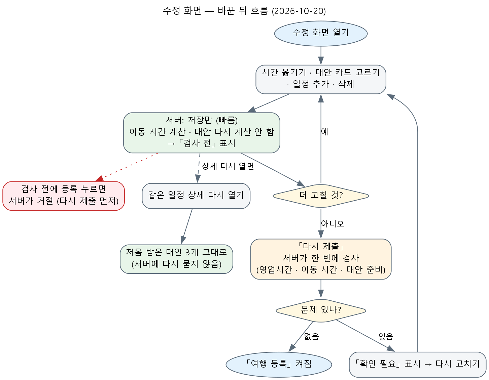

# 계획 확인 · 수정 화면 — 고칠 때는 저장만, 검사는 「다시 제출」 때 한 번

## 사용자 지시 (2026-10-20, 원문 요약)

- 수정 화면에서 시간을 바꾸면 앞뒤 여유 시간은 화면에서 바로 보이는데, 서버가 그때마다 따로 점검하느라 시간을 움직인 뒤 지연이 생긴다. 점검은 마지막에 「제출」을 누를 때 한 번에 하게 한다.
- 상세 수정에서 대안 카드를 골라 적용한 뒤 다시 들어오면, 바뀐 안의 대안을 새로 계산하지 말고 이전 대안 셋을 그대로 보인다. 「다시 제출」을 누를 때 한 번에 되는지 안 되는지 검사한다.

## 원인 (14:10 확인 — 원격 role-manager `09bf0dad` 코드 읽기)

- 시간을 바꾸면 화면이 `POST /v1/web/trip-intakes/{id}/edits` 를 한 번 보내고, 서버 `pipeline.edit` 가 같은 요청 안에서 새 판의 검사를 **강제로 다시 계산**했다(`_review_of(..., force=True)` → `review.build`). 이동 구간의 재사용 키에 시각이 들어 있어서 시간을 바꾼 일정의 앞뒤 구간은 늘 이동 계산기를 다시 불렀다(구간당 0.2~10.8초, 상한 25초 — `moves.py` 주석의 실측).
- 장소를 바꾸면 그 위에 앞뒤 시각 재배치(`direct_schedule.fit`, 이동 계산기 사용)가 더 붙었다.
- 고친 뒤에는 뒤에서 대안을 다시 준비(`_prepare_later`)했고, 화면은 대안 목록을 판 번호마다 따로 기억해서 판이 바뀌면 다시 받아 왔다(`use-server-review.ts` 의 `${revision}:${id}` 열쇠).
- 화면은 새 판마다 「전체 자동 추천」 미리 보기도 뒤에서 미리 받았다(`autofixIntake(dry_run)`).

## 바꾼 것 (로컬 격리 사본에서 구현 · 시험, 커밋 · 배포 전)

| 자리 | 바뀐 동작 |
|---|---|
| 서버 `POST …/edits` | 새 칸 `check`(기본 `true`). `false` 면 저장만 — 이동 계산기를 부르지 않는 미룬 검사(`review.ensure(quick=True)`: 바뀐 구간은 직선 어림, 안 바뀐 구간은 앞 판의 시간표 값), 장소를 바꿔도 재배치(`fit`) 없음, 대안 다시 준비 없음, 위험(날씨 · 재난)은 바깥 조회 없이 저장 값만(`cached` — 15:20 원격 `fb840cd1` 「바뀐 일정만 새로 점검」과 합치며 더함). 그 판의 검사는 `checked: false` · `ready: false`. 7일 넘김 검사는 그대로 |
| 서버 `POST …/revalidate` | 「다시 제출」 — 계산기로 한 번에 검사(어림 구간은 재사용되지 않아 다시 잰다). 끝나면 낡은 대안을 뒤에서 다시 준비 |
| 서버 `POST …/confirm` | `checked: false` 인 판은 409 `recheck_needed` — 검사 안 된 판은 등록하지 않는다 |
| 웹 고치기 | 시간 · 장소 · 대안 · 일정 추가 · 삭제 · 사진 읽기 고르기 · 되돌리기는 `check: false` 로 저장. 잠금 · 여행 이름은 예전대로(검사 포함) |
| 웹 대안 목록 | 일정마다 기억하고 「다시 제출」 · 「모두 되돌리기」 전까지 판이 바뀌어도 다시 받지 않는다 |
| 웹 버튼 | 저장만 한 판이면(새로 고침 뒤에도) 「여행 등록」 대신 「다시 제출」. 그 판에서는 「전체 자동 추천」 미리 받기도 하지 않는다 |
| 웹 알림 문구 | 장소를 바꾼 뒤 「앞뒤 이동은 「다시 제출」을 누르면 한 번에 확인해요」 |

계약 문서: [web-intakes.md](../../../final_project_cs/wiki/external/rest-endpoints/web-intakes.md) 「편집 칸 확장」의 `check: false` 줄 · 「재검증」 문단(구현 전에 고침).

## 달라지는 점 · 대가

- 장소를 대안으로 바꿨을 때 앞뒤 일정 시각을 자동으로 밀어 주던 재배치가 이제 일어나지 않는다. 대안 카드가 이미 그 시각에 맞는 곳(`fits`)과 제안 시각을 주므로 보통은 필요 없고, 안 맞으면 「다시 제출」의 검사가 「확인 필요」로 알린다.
- 「다시 제출」 전에는 바뀐 구간의 서버 판정이 직선 어림값이다. 목록의 여유 시간은 예전부터 화면이 직접 계산한 값이라 그대로다.
- 채팅 수정 · 자동 추천 적용 · 되돌리기(`restore`) · 이동 수단 고르기는 예전대로 그 자리에서 검사한다(이번 지시 범위 밖).

## 시험 (2026-10-20, 이 PC 격리 사본 — 원격 role-manager `09bf0dad` 위)

- 웹 vitest 115파일 940/940 = 100% 통과(새 시험 `use-server-review-deferred.test.ts` 3개 포함, 기존 시험 3개는 요청 모양이 바뀌어 기대값만 고침) · tsc 통과.
- 파이썬 새 시험 `tests/unit/intake/test_intake_deferred_check.py` 4/4 · ruff F·E9 통과.
- 파이썬 바뀐 코드에 닿는 단위 시험(접수 · 검사 · 고객 API · 택시 · 숙소 · 이동 줄 등 25파일) 828/828 = 100% 통과(43초).
- 파이썬 구조 · 계약 시험 480 통과 · 실패 31 · 오류 4 — 실패는 전부 이 격리 사본의 환경 탓으로 확인했다(DB 없음 → 프롬프트 · 멱등 계약 15건, git 저장소 아님 · `.env.apikeys` 검사, 모델 설정 없음 → 운영 앱 분리 15건, 꺼내지 않은 문서 폴더 · `acop_composer`). 이번에 바꾼 코드를 가리키는 실패는 없다.
- 빠른 묶음 전체(unit · architecture · contract · security)는 DB 연결 대기 때문에 40분 제한 안에 끝나지 않아 결과를 얻지 못했다(위 두 줄로 나눠 다시 돌림).
- 못 돌린 것: DB 종단(e2e) · 통합(로컬 개발 DB 데이터 폴더 없음), 웹 mock 서버 화면 시험, 실서버 확인(x600 배포 전).

## 실서버 확인 (2026-10-20 17:00~17:25, x600 서버 · 공개 주소 · 새 게스트)

반영: 커밋 `18698082`(팀 SKN · 개인 A-COP role-manager 같음, commit 세션 — 시험 DB 로 e2e · 통합 27파일 통과, 실패 2건은 바탕 판에서도 같은 기존 실패). x600 자동 배포 16:58 시작 → api · web 새 이미지로 정상(healthy).
시험 계획: 게스트 접수 `cc98be34`(2026-11-14 하루 · 경복궁 → 토속촌삼계탕 → 북촌한옥마을 → 인사동 쌈지길). 필수 약관 두 개만 동의(사용자 허락), 항로 지킴이 끔.

| 확인 | 반영 전(`fb840cd1`) | 반영 후(`18698082`) |
|---|---|---|
| 시간 5분 당기기(`edits`) | 0.71초 · 뒤이어 「전체 자동 추천」 미리 받기 1.8초 | 0.73초 · 미리 받기 없음 · 검사 `checked: false` · 「다시 제출」만 보임 |
| 대안으로 바꾸기(`edits`) | 2.0초(북촌한옥마을 → 백인제가옥) | 0.73초(백인제가옥 → 안녕인사동) |
| 바꾼 뒤 상세 다시 열기 | 대안이 새로 계산되어 다른 셋(유심사 터 · 안녕인사동 · 보성사터), 뒤에서 미리 받기 21.1초 | 같은 셋 그대로(유심사 터 · 안녕인사동 · 보성사터), 새 판(5)에 대안 요청 안 나감 |
| 검사 전 판 등록(`confirm` 직접 호출) | — | 409 `recheck_needed` |
| 「다시 제출」(`revalidate`) | — | 16.5초 한 번 → `checked: true`, 세 구간 모두 시간표로 다시 잼(11 · 10 · 3분) |

- 반영 후 저장만 한 판: 바뀐 두 구간은 직선 어림값, 안 바뀐 구간은 앞 판의 시간표 값 그대로, 위험은 `cached`.
- 시간 바꾸기 응답이 반영 전후 비슷한 것은 이 시험 일정의 구간이 걸어서 닿는 가까운 곳이라 계산기가 원래 빨랐기 때문이다(먼 구간 · 못 닿는 구간에서 차이가 커질 것으로 **예상** — 재지 않음). 모든 값은 **한 번씩 잰 것**(반복 · 편차 없음).
- 「여행 등록」이 다시 제출 뒤에도 꺼진 것은 읽기 단계에서 원래부터 있던 「인사동 쌈지길 — 인사동 구역으로 찾음, 맞는지 확인」 한 곳 때문이다(이번 변경과 무관).
- 시험 계획은 지우지 않았다. 등록한 여행이 아니라 보관함 표시(여행 단위) 대상이 아니고, 7일 뒤 게스트 정리 때 접수 백업(`intake_backups`)에 담긴다.
- 웹 mock 서버 화면 시험은 이 PC · commit 세션 모두 돌리지 않았다.

## 남은 일

- ~~commit 세션 반영 → x600 실서버 확인~~ — 위 절에서 했다.
- 웹 mock 서버 화면 시험(plan-check-screen · server-review) — 메모리 여유가 있는 곳에서.
- DB 종단 시험: `check: false` 로 고친 뒤 `confirm` 409 · `revalidate` 뒤 등록 성공을 e2e 로 추가(DB 가 되는 곳에서 — 실서버에서는 409 를 확인함).
