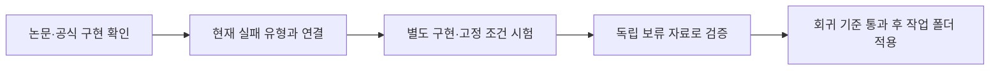

# RAG와 소형 모델 개선 연구

여행 자료 검색과 사용자 질의 인식을 별도로 개선한다. 논문 결과는 재현 후보를 고르는 근거이며 우리 프로젝트의 성능 향상을 증명하지 않는다.

## 읽는 순서와 정본

| 알고 싶은 것 | 정본 |
|---|---|
| 어떤 연구를 검토하고 무엇을 시험했나 | [날짜별 연구 기록](../../program/research/daily_rag_slm/index.md) |
| 원본 모델을 어떻게 비교하고 추가 학습할까 | [모델 평가 기준](../../final_project_cs/wiki/quality/slm-model-evaluation.md) |
| 승인된 GPU 일감을 어떻게 이어갈까 | [GPU 작업 운영법](../../final_project_cs/wiki/operations/gpu-work-queue.md) |
| 제품의 자료 검색 경로는 무엇인가 | [RAG 검색](../../final_project_cs/wiki/context/rag-retrieval.md) |

## 연구에서 적용까지

매일 마지막 확인 이후의 논문·모델 출시·가중치 수정판을 조사한다. 발표일과 확인일, 원문·공식 코드·버전을 기록한다. 후보별 적용 조건·비용·회귀 위험·개발 자료·보류 자료·사전 합격 기준을 정한다. 조사 완료, 검토 완료, 구현 완료, 실측 완료를 따로 관리한다.

검색 개선은 검색 적중과 근거 품질로, 질의 인식은 정상 요청 정답과 요청 없는 문장 오지목으로 평가한다. 한쪽 결과를 다른 쪽의 개선으로 쓰지 않는다. 사용자 자료 격리와 수치·고유명사·출처 보호를 유지하고 여행 자료만 사용한다.

## 확인된 범위와 남은 검증

`[실측 2026-10-09 작업 트리]` 학습률 조절의 첫 시드 비교와 검색 다양성·합산 후보를 완료했으나 정상 요청 회귀 또는 검색 기준 미달이 있어 제품에 승격하지 않았다. 새 원본 모델 시험·반복 시드·독립 보류 자료는 따로 이어간다. 상세 근거는 [일일 연구·실측 리포트](../../final_project_cs/wiki/records/reports/2026-10-09_1015_daily-research-and-serving.md)와 [현재 날짜 기록](../../program/research/daily_rag_slm/2026-10-09.json)에 있다.

연구 결과를 제품 반영으로 표시하려면 별도 보류 자료 검증·회귀 검사·실제 적용의 근거가 모두 필요하다. 모델 선별과 실서비스 배포는 별도 단계다.

문서 역할과 연결을 보완한 근거: [2026-10-08 문서 점검](../../final_project_cs/wiki/records/reports/2026-10-08_rag-wiki-document-audit.md).

`[검토 2026-10-09]` 최근 평가 연구를 선택·검색·답변 분리 계약과 가상 개발 예시에 연결했고 독립 검증·제품 적용은 대기입니다. Saluki 전담 학습 준비와 Jev 관련 모델 비교도 [새 리포트](../../final_project_cs/wiki/records/reports/2026-10-09_1150_selection-answer-plan-and-training-review.md)에서 확인합니다.

`[보완 2026-10-09]` 새 평가의 초기 예시 오류를 독립 검토로 수정했으며 고유 일정1개의 개발 자료로만 사용합니다. [수정된 계획·현재 판](../../final_project_cs/wiki/records/reports/2026-10-09_1158_pilot-independent-review-corrections.md).

`[실측·검토 2026-10-10]` 학습판 답을 원본 모델이 재검토하는 여행 적용판을 별도 시험했으나 D3에서 정상 요청 회복·오지목 기준을 통과하지 못했습니다. E도 완료했으며 같은 적용판은 기준 미달로 채택하지 않았습니다. 독립 검증은 대기입니다. [일일 연구·신모델·원본 근거](../../final_project_cs/wiki/records/reports/2026-10-10_1030_daily-context-research.md).

`[실측 2026-10-10 14시]` 재검토 전체 결과와 다음 진단을 분리했고 오늘 조사·학습을 중복하지 않았습니다. [후속 완료·회귀 근거](../../final_project_cs/wiki/records/reports/2026-10-10_1400_six-hour-gpu-arm-report.md).

`[연구·로컬 검증 2026-10-11]` 출력 문법·완성·내용 정답을 분리해 연결기 보호를 구현했으며 검색의 잘못된 대상 범위 축소는 검증 전 적용하지 않습니다. 독립 검증과 운영 반영은 대기입니다. [일일 조사·검증 근거](../../final_project_cs/wiki/records/reports/2026-10-11_1030_daily-response-completion-research.md).
